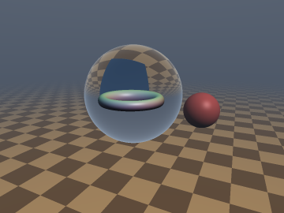
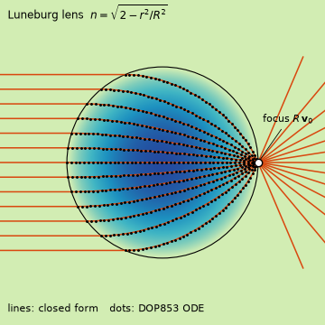
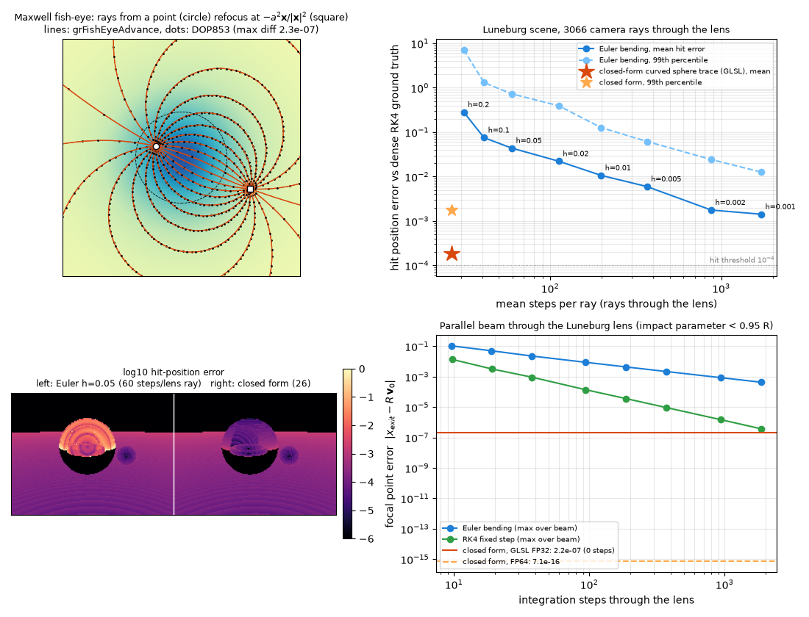

# `grFishEyeAdvance`, `grFishEyeMarch`, `grCircleSphere`, `grCirclePlane`, `grLuneburgAdvance`, `grLuneburgMarch` & helpers — Closed-Form Curved Rays in Gradient-Index Media, Sphere-Traced Without an ODE Solver

| 3D Preview (scene seen through a Luneburg ball) | 2D Ray Diagram |
| :---: | :---: |
|  |  |

The preview is marched by the literal `grLuneburgMarch` on the GPU (the index-matched lens is invisible, so a faint rim was added in
post). The ray diagram is drawn from the FP64 port of `grLuneburgAdvance` (lines) over a DOP853 solution of the ray ODE (dots).

| Property | Value |
| :--- | :--- |
| **Author** | **Claude Fable 5.2** (`sdf-gems`, 2026). The ray paths are classical (Maxwell 1854, Luneburg 1944). |
| **Category** | `grin` (experimental) |
| **GLSL File** | [`glsl/optics/grCurvedRays.glsl`](../../glsl/optics/grCurvedRays.glsl) |
| `grFishEyeCurvature`, `grFishEyeAdvance` | Exact closed form (verified against the ray ODE) |
| `grLuneburgAdvance`, `grLuneburgExitTau`, `grLuneburgOpticalPath`, `grLuneburgThrough` | Exact closed form (verified against the ray ODE); `ExitTau` is ill-conditioned in FP32 for grazing entry |
| `grCircleSphere`, `grCirclePlane` | Exact closed form (verified against ODE event detection) |
| `grFishEyeOpticalDist` | Exact optical length along the ray up to the antipode (verified by quadrature); minimality is the textbook 3-sphere argument, not tested |
| `grFishEyeChordStep` | Exact up to FP32 rounding (chord equals the clearance within a relative `2.8e-5`) |
| `grLuneburgTauStep` | Conservative bound (arc length at most the clearance; measured mean tightness `0.89`) |
| `grFishEyeMarch`, `grLuneburgMarch` | Sphere tracing; `0` oversteps measured on 20,000 rays each, given a 1-Lipschitz scene and a sufficient step budget |

---

## Idea



In a medium of refractive index $`n(\mathbf{x})`$ a light ray with unit tangent $`\mathbf{v} = d\mathbf{x}/ds`$ obeys

```math
\frac{d}{ds}\left(n \frac{d\mathbf{x}}{ds}\right) = \nabla n
\qquad\Longleftrightarrow\qquad
\frac{d\mathbf{v}}{ds} = \nabla_{\perp} \ln n = \nabla \ln n - (\mathbf{v}\cdot\nabla \ln n)\,\mathbf{v}.
```

Shaders normally integrate this with small Euler steps. For two classical profiles the solution is elementary, so the ray state
can be advanced by any amount in one evaluation, and that is enough to sphere-trace an ordinary SDF scene along the bent ray.

### 1. Maxwell fish-eye: every ray is a circle

```math
n(r) = \frac{n_0}{1 + r^2/a^2}, \qquad \boldsymbol{\kappa} = \nabla_{\perp}\ln n = \mathbf{g} - (\mathbf{g}\cdot\mathbf{v})\mathbf{v}, \quad \mathbf{g} = \frac{-2\,\mathbf{x}}{a^2 + r^2}.
```

$`|\boldsymbol{\kappa}| = k`$ is constant along the ray, which is therefore a circle of radius $`1/k`$. With $`t = ks`$:

```math
\mathbf{x}(s) = \mathbf{x}_0 + \mathbf{v}_0\, s\,\frac{\sin t}{t} + \boldsymbol{\kappa}\, s^2\, \frac{1-\cos t}{t^2},
\qquad
\mathbf{v}(s) = \mathbf{v}_0 \cos t + \boldsymbol{\kappa}\, s\, \frac{\sin t}{t}.
```

Both fractions are finite at $`t = 0`$, so the code degrades to $`\mathbf{x}_0 + s\mathbf{v}_0`$ as $`a \to \infty`$ with no branch on
the curvature. Every such circle through $`\mathbf{x}`$ also passes through the antipode $`-a^2\mathbf{x}/|\mathbf{x}|^2`$ (perfect imaging).

**Analytic hits.** A circle meets a sphere $`|\mathbf{y}-\mathbf{c}| = \rho`$ or a plane where
$`P + \alpha \frac{\sin ks}{k} + \beta \frac{1-\cos ks}{k^2} = 0`$, with $`\mathbf{e} = \mathbf{x}_0 - \mathbf{c}`$ and

```math
\text{sphere: } P = \tfrac12(|\mathbf{e}|^2 - \rho^2),\ \alpha = \mathbf{e}\cdot\mathbf{v}_0,\ \beta = 1 + \mathbf{e}\cdot\boldsymbol{\kappa};
\qquad
\text{plane: } P = \mathbf{n}\cdot\mathbf{x}_0 - h,\ \alpha = \mathbf{n}\cdot\mathbf{v}_0,\ \beta = \mathbf{n}\cdot\boldsymbol{\kappa}.
```

The half-angle substitution $`w = \tan(ks/2)/k`$ turns this into the quadratic $`(k^2 P + 2\beta)\,w^2 + 2\alpha\, w + P = 0`$,
which is the straight-ray equation at $`k = 0`$ (`grCircleRoot`).

**Optical distance.** The optical metric $`n^2\,|d\mathbf{x}|^2`$ is that of a round 3-sphere of radius $`n_0 a/2`$
(stereographic projection), so the eikonal distance between two points is

```math
T(\mathbf{x}, \mathbf{y}) = n_0\, a\, \arcsin \frac{a\,|\mathbf{x}-\mathbf{y}|}{\sqrt{(a^2+|\mathbf{x}|^2)(a^2+|\mathbf{y}|^2)}}.
```

### 2. Luneburg lens: rays are arcs of ellipses

For $`n(r) = \sqrt{2 - r^2/R^2}`$, $`r \le R`$, use the fictitious time $`d\tau = ds/n`$ and the optical momentum
$`\mathbf{p} = n\mathbf{v}`$. Then $`d\mathbf{x}/d\tau = \mathbf{p}`$ and $`d\mathbf{p}/d\tau = \tfrac12\nabla n^2 = -\mathbf{x}/R^2`$, a harmonic oscillator:

```math
\mathbf{x}(\tau) = \mathbf{x}_0 \cos\frac{\tau}{R} + R\,\mathbf{p}_0 \sin\frac{\tau}{R},
\qquad
|\mathbf{x}(\tau)|^2 = R^2 + (r_0^2 - R^2)\cos\frac{2\tau}{R} + R\,(\mathbf{x}_0\cdot\mathbf{p}_0)\sin\frac{2\tau}{R}.
```

The second identity gives the exit time in one `atan` (`grLuneburgExitTau`). A ray entering at $`|\mathbf{x}_0| = R`$ with direction
$`\mathbf{v}_0`$ leaves after a quarter period at $`R\mathbf{v}_0`$ with direction $`-\mathbf{x}_0/R`$ (`grLuneburgThrough`): a parallel beam
focuses on the far surface. The optical path $`\int n\,ds = \int n^2\,d\tau`$ is also elementary (`grLuneburgOpticalPath`).

### 3. Sphere tracing along the curve

If $`d = \mathrm{SDF}(\mathbf{x})`$, the ball of radius $`d`$ about $`\mathbf{x}`$ is empty. A path of arc length $`\le d`$ starting at
$`\mathbf{x}`$ stays in that ball because chord $`\le`$ arc, so stepping the closed-form state by arc length $`d`$ cannot cross a surface.

- **Fish-eye** (`grFishEyeChordStep`): the curvature is known, so step by the arc whose *chord* is $`d`$,
  $`s = \tfrac{2}{k}\arcsin\tfrac{kd}{2}`$. If $`kd \ge 2`$ the whole circular ray lies inside the empty ball and the march ends as a miss.
- **Luneburg** (`grLuneburgTauStep`): inside the ball $`n \le n_{\max} = n(\max(r-d,0))`$, so $`\tau = d/n_{\max}`$ travels an arc $`\le d`$.
  The step is clamped to the analytic exit time; outside the lens the ray is straight and is clamped to the analytic lens entry.

---

## GLSL Usage

```glsl
#define GR_SCENE myScene          // float myScene(vec3 p): any 1-Lipschitz SDF (default: built-in demo scene)
#define GR_MAX_STEPS 256
#include "glsl/optics/grCurvedRays.glsl"

// Scene inside / behind a Luneburg ball of radius R at the origin
vec3 x = ro, v = rd; int steps;
float opl = grLuneburgMarch(x, v, 1.0, 40.0, steps);   // optical path, or -1; x, v = hit point and ray tangent there

// Whole space filled with a Maxwell fish-eye of scale a
float s = grFishEyeMarch(x, v, 2.0, 25.0, steps);      // arc length, or -1

// No marching at all for spheres and planes in a fish-eye
float sHit = grCircleSphere(ro, rd, 2.0, centre, radius, 1e-4);
```

Shade with `-v` as the view vector. The lens centre is the origin; translate `x` for other placements.

---

## Verification

All numbers below were reproduced in this session from the literal GLSL on the GPU (FP32) and from an FP64 port, unless marked otherwise.
Ground truths are independent of the closed forms: DOP853 (`rtol 1e-12`) or dense fixed-step RK4 integration of the ray ODE.

| Check | N | FP64 port | Literal GLSL (FP32) |
| :--- | ---: | :--- | :--- |
| `grFishEyeAdvance` vs ODE, arc 0.2 to 6, max position / tangent error | 10,000 | `1.4e-9` / `1.2e-9` | `2.1e-6` / `1.3e-6`, 0 NaN |
| Fish-eye invariants: curvature drift along ODE ray; closure after $`2\pi/k`$; antipode reached | 10,000 | `3.7e-10`; `3.6e-14`; `1.2e-13` | not run on GPU |
| `grFishEyeOpticalDist` vs composite Gauss quadrature of $`n\,ds`$ (3 parameter sets, rays with $`ka > 0.3`$) | 21,000 | `2.5e-14` | `5.6e-6` |
| `grFishEyeChordStep`: chord after the step vs clearance | 50,000 | n/a | max abs `1.4e-6`, relative `-2.7e-5` to `+2.8e-5` |
| `grLuneburgAdvance` vs ODE, max position / tangent error | 10,000 | `4.5e-13` / `4.4e-13` | `2.9e-7` / `1.5e-7`, 0 NaN |
| `grLuneburgOpticalPath` vs ODE | 10,000 | `6.3e-13` | `4.1e-7` |
| `grLuneburgExitTau` vs ODE event | 10,000 | `1.6e-11` | `9.1e-7` |
| Luneburg focus $`\mathbf{x}_{exit} = R\mathbf{v}_0`$, full parallel beam | 2,000 | `2.5e-16` (ODE itself: `2.4e-8`) | `1.9e-4` via `ExitTau` + `Advance` |
| Luneburg focus, impact parameter below `0.95 R` | about 2,000 | `7.1e-16` | `2.2e-7` |
| Fermat: optical path plane to focus, spread over the beam (ODE); predicted $`L + \pi R/2`$ | 2,000 | spread `2.5e-8`, mean matches to `2.6e-11` | not run on GPU |
| `grCircleSphere` vs ODE event detection: hit/miss mismatches; max arc error | 4,000 (1,189 hits) | 0; `6.8e-10` | 0; `4.0e-5` (median `2.6e-7`) |
| `grCirclePlane` vs ODE event detection (arc lengths up to 119) | 4,000 (3,142 hits) | 0; `1.6e-10` | 0; `8.7e-5` (median `1.4e-7`) |
| Straight limit, $`a = 10^2 \dots 10^{15}`$: advance and both intersectors vs FP64 | 20,000 per $`a`$ | reference | 0 NaN, 0 hit/miss mismatches, arc error at most `4.4e-5` (sphere), relative `6.4e-5` (plane) |
| `grLuneburgTauStep`: arc length / clearance | 200,000 | max `0.999995`, mean `0.894`, min `0.709` | not run on GPU |
| `grFishEyeMarch` ($`a = 2`$) vs dense RK4, 2000-step budget: missed / stopped past the surface | 20,000 (13,122 hits) | 0 / 0 | 0 / 0 |
| `grFishEyeMarch`, default 256-step budget | 20,000 | n/a | 2 missed (9 rays ran out of steps), 0 past the surface |
| `grLuneburgMarch` ($`R = 1`$) vs dense RK4, 2000-step budget | 20,000 (12,552 hits) | 0 / 0 | 0 / 0 |
| `grLuneburgMarch`, default 256-step budget | 20,000 | n/a | 14 missed (15 rays ran out of steps), 0 past the surface |
| Single-translation-unit compile (forward, reverse, new-first) | 296 files | n/a | OK |

The dense-RK4 reference ($`h = 4\times 10^{-3}`$) agrees with its own half-step run to `1.7e-11` (fish-eye) and `4.6e-9` (Luneburg) with no
hit/miss flips on a 2,000-ray subset.

**Step counts (FP64 port, same demo scene, hit threshold `1e-4`).** Fish-eye: mean 18.6 steps per ray, against 15.5 for straight
rays in the same scene. Luneburg: 21.1, against 20.7 with no lens. Camera view of the preview (3,066 rays through the lens, literal GLSL):
26.5 steps per ray, hit-position error mean `1.9e-4`, 99th percentile `1.8e-3`, max `3.2e-3`, no hit/miss mismatches.

**Against small-step bending.** A plain Euler bender (step $`\min(d, h)`$ in the lens, written for this experiment) on the same camera rays:

| Method | Steps per lens ray | Mean hit error | 99th percentile | Hit/miss mismatches |
| :--- | ---: | ---: | ---: | ---: |
| Closed form (`grLuneburgMarch`) | 26.5 | `1.9e-4` | `1.8e-3` | 0 |
| Euler, $`h = 0.05`$ | 59.6 | `4.4e-2` | `7.3e-1` | 0.23% |
| Euler, $`h = 0.01`$ | 198 | `1.1e-2` | `1.3e-1` | 0.03% |
| Euler, $`h = 0.001`$ | 1,714 | `1.4e-3` | `1.3e-2` | 0 |

Focal error of a parallel beam after 187 fixed steps through the lens: Euler `4.4e-3`, RK4 `3.6e-5`; closed form `2.2e-7` in FP32.
Euler is the weakest reasonable baseline. A fixed-step RK4 needs about 1,900 steps to reach the closed form's FP32 focal error, but a
scene march with RK4 or a symplectic integrator was not measured, so the table overstates the gap to a well-built integrator.

---

## Findings

**Held**

- Fish-eye rays are circles and the closed-form advance matches the ODE (`1.4e-9` FP64, `2.1e-6` FP32). Closure and the antipodal
  focus hold to `1e-13`.
- Luneburg rays are harmonic in fictitious time; position, tangent, exit time and optical path match the ODE to `1e-11` or better in
  FP64 and `1e-6` or better in FP32. The focus on the far surface and the equal optical path (Fermat) hold.
- Circle-sphere and circle-plane hits reduce to one quadratic: 0 hit/miss mismatches against ODE event detection, and the same code
  handles straight rays up to $`a = 10^{15}`$ with no NaN.
- Curved sphere tracing is conservative: 0 missed surfaces and 0 stops beyond a surface on 20,000 rays per medium, FP64 and FP32,
  when the step budget is sufficient.
- It costs about the same number of steps as straight sphere tracing (18.6 vs 15.5 and 21.1 vs 20.7).

**Failed or weaker than hoped**

- The default 256-step budget is not enough for a few grazing rays: 2 of 13,122 (fish-eye) and 14 of 12,552 (Luneburg) true hits are
  returned as misses. This is budget exhaustion, not overstepping; all disappear at 2,000 steps.
- The chord-length step buys almost nothing: 18.6 mean steps against 18.7 for the plain arc $`= d`$ step. Its useful part is the
  $`kd \ge 2`$ early exit, taken by 6,875 of 20,000 rays.
- The local index bound in `grLuneburgTauStep` is only about 2% better than the global $`d/\sqrt{2}`$ (21.1 vs 21.5 steps).
- `grLuneburgExitTau` followed by `grLuneburgAdvance` loses accuracy in FP32 over the full beam: focal error `1.9e-4`, against `2.2e-7`
  when the impact parameter stays below `0.95 R`. This is consistent with ill-conditioning at grazing entry, but the worst rays were
  not isolated. `grLuneburgThrough` is algebraic and avoids it for an empty lens.
- `grFishEyeChordStep` lands on the unbounding sphere only to FP32 rounding; the chord exceeded $`d`$ by up to `2.8e-5` relative, so
  the step is not strictly conservative at rounding level. The hit threshold absorbs this in the tests.
- The marchers stop at the first point with clearance below `GR_HIT_EPS`. On 2 to 3 rays of 20,000 this happens at a grazing pass
  well before the true crossing (up to 2.4 length units earlier on one Luneburg ray). The reference did not register an
  $`\varepsilon`$-crossing for some of these, which is probably its own sampling resolution; that was not confirmed.

**Open questions**

- Whether the step-budget failures are best fixed by a larger budget or by over-relaxation near grazing incidence.
- A conditioning-safe FP32 form of the exit time for grazing entry.
- Exact hits of the Luneburg ellipse arc with a plane look like a one-`atan` problem (the path is a sinusoid in $`\tau`$); not derived here.
- Other solvable profiles (Eaton, parabolic or sech fibre) and non-index-matched lens surfaces.

---

## Novelty & Prior Art

One web search was run for this page; it returned no specific shader or paper combining these pieces. The rest of this section is
**from memory, not checked**.

- Circular rays and perfect imaging in the fish-eye: Maxwell (1854); see Born & Wolf, *Principles of Optics*. The stereographic
  3-sphere picture of the fish-eye metric is textbook material (Luneburg; Leonhardt & Philbin, *Geometry and Light*).
- Luneburg lens and its elliptical rays via the harmonic-oscillator form: Luneburg (1944) and standard Hamiltonian optics.
- Curved-ray rendering by numerical integration is common (GRIN and mirage renderers, black-hole shaders), usually with Euler or RK4 steps.
- Sphere tracing along non-straight paths with a chord $`\le`$ arc safety argument is used in non-Euclidean ray marching.

What is believed to be new here is the packaging, not the physics: branch-free FP32 state updates that are stable in the straight
limit, the half-angle quadratic for circle-sphere and circle-plane hits, the chord and local-index step rules with the trapped-circle
exit, and the measured overstep and step-count numbers. No claim of priority is made.

---

## Not done

- No GPU runs of the fish-eye invariants, the Fermat check or the $`\tau`$-step tightness (FP64 only).
- The 3D preview and ray diagram were not produced with `render_3d_sdf` / `render_slice_3d`, which cannot bend rays; the preview uses
  the literal `grLuneburgMarch` with custom shading, and the ray diagram uses the FP64 port.
- No refraction or reflection at the lens surface, no dispersion, no shadows or secondary rays along curved paths.
- No timing on a GPU; cost is reported in steps only.
- Lens centre fixed at the origin; no moving scenes; non-exact (non-1-Lipschitz) scene SDFs were not tested.
