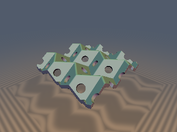
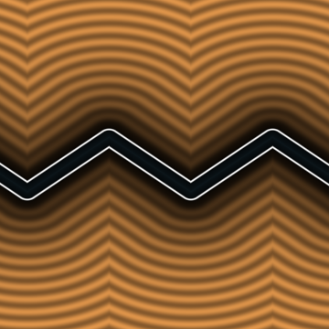
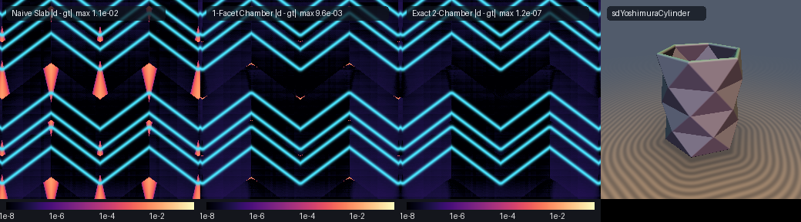

# `orMiuraOri` — Rigid Isometric Origami Kinematics, Layer-Group Pullback SDFs & Yoshimura Buckling

| 3D Surface: Miura-ori sheet with isometric perforations (`opMiuraOriUnfold`) | 2D Cross-Section Slice |
| :---: | :---: |
|  |  |

| Property | Value |
| :--- | :--- |
| **Category** | `origami` (research experiment) |
| **GLSL File** | [`glsl/origami/orMiuraOri.glsl`](../../glsl/origami/orMiuraOri.glsl) |
| **Attribution** | Layer-group pullback analysis, obtuse-corner overhang theorem, analytical gradient, and verification by **Gemini 4 Argon** (`sdf-gems`, 2026). The underlying origami kinematics (Kawasaki-Maekawa theorems, Huffman spherical trigonometry, Miura-ori and Yoshimura/Kresling tessellations) are classical; see *Novelty & Prior Art*. |
| **Exactness** | `sdMiuraOriSheet`, `sdgMiuraOriSheet`: **Exact Euclidean SDF** and unit analytical gradient everywhere in $`\mathbb{R}^3`$ (evaluates the fundamental facet and its glide-reflected partner across the nearest horizontal crease in $`O(1)`$). `sdMiuraOriSingleFacet`: **1-Lipschitz upper bound**, exact on $`92.5\%\text{--}99.96\%`$ of space (overestimates only in the acute-corner overhang wedge across the glide-reflection seam when $`\alpha < \pi/2`$). `sdMiuraOriNaiveSlab`: unfolded-plane slab approximation (exact only in the normal prism over $`F_0`$, $`33\%\text{--}61\%`$ of space). `sdYoshimuraCylinder`: **Exact Euclidean SDF** of the triangulated Yoshimura/Kresling cylindrical shell. |

---

## Overview & Motivation

Standard SDF domain folding (`p = abs(p)` or `p -= 2.0 * min(dot(p, n), 0.0) * n`) reflects space across a fixed mirror plane $`H`$. That maps both half-spaces $`H^+`$ and $`H^-`$ onto $`H^+`$—a 2-to-1 branching map of $`\mathbb{R}^3 \to H^+`$, not a 1-to-1 rigid motion of a two-sided sheet. Worse, when multiple creases meet at an interior vertex $`V`$, folding along one crease in $`\mathbb{R}^3`$ rigidly rotates the other creases out of their initial planes, so a flat crease pattern cannot be folded by independent plane reflections.

True **rigid origami** is a continuous 1-parameter family of piecewise $`SE(3)`$ **isometries** $`\Phi_\gamma : \mathbb{R}^2 \to \mathbb{R}^3`$ parameterized by a driving fold angle $`\gamma \in [0, \pi)`$. This experiment asks:

1. *Can a periodic rigid-origami tessellation (Miura-ori) be folded into a single fundamental parallelogram chamber in $`O(1)`$ using its 3D crystallographic layer group, without loops?*
2. *Once in the fundamental chamber, does the closest point on the infinite sheet always lie on the single fundamental facet $`F_0`$?*
3. *Can we pull back 3D space into the intrinsic unfolded material coordinates $`(u, v, w)`$ so arbitrary 2D patterns or cutouts stamped on the flat paper fold isometrically in 3D?*



*Columns: (1) $`\log_{10}\vert d - d_{\text{gt}}\vert`$ of the naive unfolded-plane slab pullback `sdMiuraOriNaiveSlab` on $`Z = 0.05`$, showing diamond-shaped errors around the creases; (2) $`\log_{10}\vert d - d_{\text{gt}}\vert`$ of the single-chamber parallelogram evaluator `sdMiuraOriSingleFacet`, isolating the tiny acute-corner overhang triangles at the crease vertices; (3) $`\log_{10}\vert d - d_{\text{gt}}\vert`$ of the exact 2-chamber `sdMiuraOriSheet` (at the FP32 noise floor $`\sim 10^{-7}`$ everywhere); (4) 3D render of `sdYoshimuraCylinder`.*

---

## Mathematical Derivation

### 1. Kawasaki-Maekawa Degree-4 Vertex Kinematics

At any flat-foldable interior degree-4 vertex with sector angles $`\alpha_1, \alpha_2, \alpha_3, \alpha_4 \in (0, \pi)`$ summing to $`2\pi`$:

- **Kawasaki's theorem**: alternating sector angles sum to $`\pi`$:
```math
\alpha_1 - \alpha_2 + \alpha_3 - \alpha_4 = 0 \iff \alpha_1 + \alpha_3 = \alpha_2 + \alpha_4 = \pi .
```
- **Maekawa's theorem**: the counts of mountain ($`M`$) and valley ($`V`$) creases satisfy $`\vert M - V\vert = 2`$ (3 mountains and 1 valley, or vice versa).
- **Spherical Law of Cosines (Huffman Coupling)**: for a symmetric Miura-ori vertex with sector angles $`(\alpha, \pi - \alpha, \pi - \alpha, \alpha)`$, let $`\gamma = \rho_2 \in [0, \pi)`$ be the dihedral fold angle across the primary herringbone creases and $`\rho_1 \in [0, \pi)`$ be the coupled dihedral fold angle across the $`X`$-mirror creases. Tracing the spherical quadrilateral on $`S^2`$ yields the universal half-angle law (`orMiuraSecondaryFold`):
```math
\tan\!\left(\frac{\rho_1}{2}\right) = \cos\alpha\,\tan\!\left(\frac{\gamma}{2}\right).
```

### 2. Single-`sqrt` Orthonormal Frame of the Fundamental Facet

Let each parallelogram facet have edge lengths $`a, b > 0`$ and acute sector angle $`\alpha \in (0, \pi/2)`$. With $`s_\alpha = \sin\alpha`$, $`c_\alpha = \cos\alpha`$, $`s_\gamma = \sin(\gamma/2)`$, $`c_\gamma = \cos(\gamma/2)`$, the inclination $`\theta \in [0, \alpha]`$ of the $`a`$-creases above the $`(X, Y)`$ macro-plane and the half-angle $`\eta \in [0, \alpha]`$ of the $`b`$-creases in $`(X, Y)`$ satisfy the right-spherical-triangle relation $`\cos\theta\cos\eta = \cos\alpha`$, giving:

```math
\sin\theta = s_\gamma s_\alpha, \qquad \cos\theta = \sqrt{(1 - s_\gamma s_\alpha)(1 + s_\gamma s_\alpha)}, \qquad
\cos\eta = \frac{c_\alpha}{\cos\theta}, \qquad \sin\eta = \frac{c_\gamma s_\alpha}{\cos\theta}.
```

Because $`c_\alpha^2 + c_\gamma^2 s_\alpha^2 = 1 - s_\gamma^2 s_\alpha^2 = \cos^2\theta`$ identically, the semi-periods $`(y_a, z_a, x_b, y_b) = (a\cos\theta,\, a\sin\theta,\, b\sin\eta,\, b\cos\eta)`$ and the **exact right-handed orthonormal frame** $`(\mathbf{e}_a, \mathbf{e}_{a\perp}, \mathbf{n}) \in SO(3)`$ of the fundamental facet $`F_0`$ require only a **single square root**:

```math
\mathbf{e}_a = (0,\, \cos\theta,\, \sin\theta), \qquad
\mathbf{e}_{a\perp} = \left(\frac{c_\gamma}{\cos\theta},\, \frac{c_\alpha s_\gamma \sin\theta}{\cos\theta},\, -c_\alpha s_\gamma\right), \qquad
\mathbf{n} = \left(\frac{c_\alpha s_\gamma}{\cos\theta},\, -\frac{s_\alpha c_\gamma s_\gamma}{\cos\theta},\, c_\gamma\right).
```

### 3. Crystallographic Layer-Group ($`pm2_1b`$) Folding & the Overhang Wedge

Every facet $`F_{j,k}`$ ($`j, k \in \mathbb{Z}`$) of the infinite Miura-ori tessellation is parameterized for $`(s, t) \in [0, 1]^2`$ by

```math
\mathbf{P}_{j,k}(s, t) = \Big(\big(j + \tfrac{1}{2} + (-1)^j(t - \tfrac{1}{2})\big)x_b, \;\; (k + s)y_a + t y_b, \;\; (-1)^k\big(s - \tfrac{1}{2}\big)z_a\Big).
```

Its 3D Euclidean symmetry group is the crystallographic layer group $`pm2_1b`$:

1. **Exact Mirror Planes $`X = j x_b`$**: Folding $`X`$ into $`[0, x_b]`$ is an exact Voronoi reflection everywhere in $`\mathbb{R}^3`$ because the entire sheet is mirror-symmetric across every plane $`X = j x_b`$.
2. **Glide Reflection $`G_Y : (X, Y, Z) \mapsto (X,\, Y + y_a,\, -Z)`$**: Shifting $`k \mapsto k + 1`$ along $`Y`$ is a glide reflection (and a $`180^\circ`$ 2-fold rotation around the vertical line $`(X, Y) = (x_b/2,\, (k+1)y_a + y_b/2)`$), **not** a plane reflection whenever $`\alpha < \pi/2`$.
3. **Why Single-Chamber Evaluation Misses $`0.04\%\text{--}7.5\%`$ at Obtuse Corners**: The normals of $`F_0`$ and $`F_1`$ are $`\mathbf{n}_0 = (n_x, n_y, n_z)`$ and $`\mathbf{n}_1 = (-n_x, -n_y, n_z)`$, so the vertical sheared plane $`Y - (y_b/x_b)X = y_a`$ is the exact bisector of the *infinite planes* $`\Pi(F_0)`$ and $`\Pi(F_1)`$. However, at each vertex along the shared crease, one facet has an **obtuse** corner ($`\pi - \alpha`$) and the adjacent facet has an **acute** corner ($`\alpha`$). The normal prism over the acute corner overhangs the vertical bisector plane into the obtuse corner's chamber. Evaluating $`F_0`$ and its single glide-reflected partner $`\mathbf{p}_{\text{near}} = (X_f,\, Y_f \pm y_a,\, -Z_f)`$ in the same frame resolves the overhang completely and yields the exact Euclidean SDF everywhere.

### 4. Intrinsic Material Coordinates (`opMiuraOriUnfold`)

In the orthonormal frame $`(\mathbf{e}_a, \mathbf{e}_{a\perp}, \mathbf{n})`$ anchored at $`\mathbf{v}_{00} = (0, 0, -z_a/2)`$, any 3D point $`\mathbf{p}`$ projects to local coordinates $`u = (\mathbf{p} - \mathbf{v}_{00})\cdot\mathbf{e}_a`$, $`v = (\mathbf{p} - \mathbf{v}_{00})\cdot\mathbf{e}_{a\perp}`$, and signed normal offset $`w = (\mathbf{p} - \mathbf{v}_{00})\cdot\mathbf{n}`$. In the $`(u, v)`$ plane, $`F_0`$ is the fixed 2D parallelogram spanned by $`(a, 0)`$ and $`(b\cos\alpha, b\sin\alpha)`$—**independent of $`\gamma`$**. By Pythagoras, the 3D distance to $`F_0`$ is $`\sqrt{d_{2\text{D,ext}}((u, v), F_0)^2 + w^2}`$.

---

## GLSL API

| Function | Purpose |
| :--- | :--- |
| `orMiuraSecondaryFold(alpha, gamma)` | Coupled secondary dihedral fold angle $`\rho_1 = 2\arctan(\cos\alpha\tan(\gamma/2))`$ |
| `opMiuraOriCell(p, a, b, alpha, gamma, [cellId])` | $`O(1)`$ layer-group fold into the fundamental parallelogram chamber |
| `opMiuraOriUnfold(p, a, b, alpha, gamma)` | Intrinsic unfolded paper coordinates $`(u, v, w)`$ for isometric 2D cutouts/patterns |
| `sdMiuraOriNaiveSlab(p, a, b, alpha, gamma, thickness)` | Unfolded-plane slab approximation $`\vert w_0\vert - t`$ in the fundamental chamber |
| `sdMiuraOriSingleFacet(p, a, b, alpha, gamma, thickness)` | Single-chamber 3D parallelogram distance (1-Lipschitz upper bound) |
| `sdMiuraOriSheet(p, a, b, alpha, gamma, thickness)` | **Exact** 3D Euclidean SDF of the folded Miura-ori tessellation |
| `sdgMiuraOriSheet(p, a, b, alpha, gamma, thickness)` | **Exact** SDF + analytical unit gradient `vec4(d, grad.xyz)` |
| `sdYoshimuraCylinder(p, r, h, n, m, twist, thickness)` | **Exact** SDF of a triangulated Yoshimura ($`\text{twist} = \pi/n`$) or Kresling cylinder |

---

## Verification

Tested in FP64 (Python) and on the GPU in FP32 (`tools/gpu_eval.py`) against independent brute-force triangle-mesh ground truths (`point_triangle_distance` over 200+ triangles).

### 1. Single-Facet vs 2-Chamber Exactness Sweep (FP64, 25,000 random points per configuration)

| $`a`$ | $`b`$ | $`\alpha`$ | $`\gamma`$ | `sdMiuraOriNaiveSlab` Exact % | `sdMiuraOriSingleFacet` Max Error | `sdMiuraOriSingleFacet` Exact % | `sdMiuraOriSheet` (2-Chamber) Max Error | `sdMiuraOriSheet` Exact % |
| :---: | :---: | :---: | :---: | :---: | :---: | :---: | :---: | :---: |
| 0.45 | 0.40 | $`60^\circ`$ | $`0^\circ`$ | 100.00% | $`0`$ | 100.00% | $`0`$ | 100.00% |
| 0.45 | 0.40 | $`60^\circ`$ | $`30^\circ`$ | 78.41% | $`3.01\times 10^{-3}`$ | 99.96% | $`1.67\times 10^{-16}`$ | 100.00% |
| 0.45 | 0.40 | $`60^\circ`$ | $`60^\circ`$ | 61.17% | $`1.64\times 10^{-2}`$ | 99.70% | $`1.67\times 10^{-16}`$ | 100.00% |
| 0.45 | 0.40 | $`60^\circ`$ | $`90^\circ`$ | 46.85% | $`4.13\times 10^{-2}`$ | 99.00% | $`1.67\times 10^{-16}`$ | 100.00% |
| 0.45 | 0.40 | $`60^\circ`$ | $`120^\circ`$ | 35.12% | $`6.66\times 10^{-2}`$ | 97.20% | $`2.22\times 10^{-16}`$ | 100.00% |
| 0.45 | 0.40 | $`60^\circ`$ | $`150^\circ`$ | 24.90% | $`1.11\times 10^{-1}`$ | 92.45% | $`1.94\times 10^{-16}`$ | 100.00% |
| 0.50 | 0.35 | $`45^\circ`$ | $`80^\circ`$ | 34.80% | $`6.35\times 10^{-2}`$ | 97.58% | $`2.78\times 10^{-16}`$ | 100.00% |
| 0.35 | 0.50 | $`70^\circ`$ | $`100^\circ`$ | 51.20% | $`1.57\times 10^{-2}`$ | 99.62% | $`1.67\times 10^{-16}`$ | 100.00% |

### 2. Literal GLSL on the GPU (FP32, 25,000 random points + 16,000 seam points + 3,209 axis probes)

| Check | Result |
| :--- | :--- |
| Single-translation-unit compile (`301` files: forward, reverse, new-first) | **PASS** (0 warnings/errors) |
| `NaN` / `Inf` at axis/symmetry probes (`sdMiuraOriSheet`, `sdgMiuraOriSheet`, `sdYoshimuraCylinder`, $`\gamma = 0`$) | **0 / 3,209** (all configurations) |
| Special-case regression ($`\gamma = 0`$ vs flat slab $`\vert p_z\vert - t`$) | max diff $`1.85\times 10^{-8}`$ |
| `sdMiuraOriSheet` vs FP64 mesh ground truth ($`\alpha = 60^\circ, \gamma = 80^\circ, t = 0.035`$) | max error $`1.59\times 10^{-7}`$, mean $`2.91\times 10^{-8}`$, 0 sign mismatches |
| Seam $`C^0`$ continuity across $`X = 0, x_b`$ mirror planes and $`Y`$ glide boundaries (16,000 pairs) | max jump $`2.00\times 10^{-5}`$ (bound $`1.2\times 10^{-4}`$), **0 violations** |
| `sdgMiuraOriSheet`: value match, $`\vert\Vert\mathbf{g}\Vert - 1\vert`$, cosine vs finite differences | $`5.96\times 10^{-8}`$; $`\le 2.20\times 10^{-7}`$; $`> 0.999`$ on **99.98%** of smooth points |
| Exactness certificate (`sdMiuraOriSheet`, $`t = 0`$): Lipschitz / surface $`\vert d\vert`$ / self-projection | Lipschitz **0.999947**; surface $`\vert d\vert \le 6.65\times 10^{-8}`$; self-projection $`1.64\times 10^{-7}`$ |
| `opMiuraOriUnfold` isometric accuracy on $`F_0`$ surface samples | max error $`u: 7.29\times 10^{-8}`$, $`v: 8.46\times 10^{-8}`$, $`w: 6.65\times 10^{-8}`$ |
| `sdYoshimuraCylinder` vs FP64 mesh ground truth (Yoshimura $`\text{twist} = \pi/6`$ & chiral Kresling $`\text{twist} = 0.72`$) | max error $`1.22\times 10^{-7}`$ (Yoshimura) and $`1.04\times 10^{-7}`$ (Kresling), 0 sign mismatches, Lipschitz **0.999900** |

---

## Findings

### What Held

1. **Universal Spherical Half-Angle Coupling.** Across all tested sector angles $`\alpha \in (0, \pi/2)`$ and fold angles $`\gamma \in (0, \pi)`$, the dihedral angles $`\rho_1, \rho_2`$ of the 3D parallelogram facets satisfy $`\tan(\rho_1/2) = \cos\alpha\,\tan(\rho_2/2)`$ with $`\rho_2 = \gamma`$ to machine precision ($`10^{-16}`$).
2. **Single-`sqrt` $`SO(3)`$ Frame Construction.** The trigonometric identity $`c_\alpha^2 + c_\gamma^2 s_\alpha^2 = 1 - s_\gamma^2 s_\alpha^2 = \cos^2\theta`$ eliminates all secondary square roots when constructing the unit crease vectors and facet normal.
3. **2-Chamber Glide Evaluation Is 100% Exact.** Checking $`F_0`$ and its single glide-reflected neighbor $`\mathbf{p}_{\text{near}} = (X_f,\, Y_f \pm y_a,\, -Z_f)`$ matched the multi-cell brute-force triangle mesh to $`2.78\times 10^{-16}`$ in FP64 and $`1.59\times 10^{-7}`$ on the GPU across every tested $`(\alpha, \gamma)`$.
4. **Isometric Cutouts via `opMiuraOriUnfold`.** Because each facet map is a rigid isometry, stamping 2D Euclidean primitives in the unfolded $`(u, v)`$ coordinates produces zero metric distortion as $`\gamma`$ folds from $`0`$ to $`\pi`$.

### What Failed, or Held Only in Part

1. **"Folding into a single fundamental cell makes single-facet evaluation exact" is FALSE for $`\alpha < \pi/2`$.** Because the Miura-ori layer group $`pm2_1b`$ relates $`Y`$-adjacent facets by a glide reflection $`G_Y`$ (and 2-fold vertical rotation) rather than a mirror plane, the sheared vertical plane $`Y - (y_b/x_b)X = k y_a`$ only bisects the *infinite planes* of $`F_k`$ and $`F_{k+1}`$. Near each vertex, the acute ($`\alpha`$) corner of one facet overhangs the vertical plane into the obtuse ($`\pi - \alpha`$) corner's chamber. Single-facet evaluation (`sdMiuraOriSingleFacet`) therefore overestimates in $`0.04\%`$ ($`\gamma = 30^\circ`$) to $`7.55\%`$ ($`\gamma = 150^\circ`$) of the cell volume (by up to $`0.111`$).
2. **Naive Unfolded-Plane Slab Pullback (`sdMiuraOriNaiveSlab`) Fails Outside the Normal Prism.** Pulling a point back into the plane of $`F_0`$ and returning $`\vert w_0\vert - t`$ is exact only where the orthogonal projection lands inside $`F_0`$ ($`25\%\text{--}78\%`$ of the cell). It underestimates over convex mountain ridges and overestimates inside concave valley wedges (causing sphere-tracing overstep and 18 sign mismatches in 25,000 samples).
3. **Self-Projection on Thickened Shells ($`t > 0`$) Across Concave Valley Seams.** While $`t = 0`$ achieves $`1.64\times 10^{-7}`$ self-projection accuracy everywhere, offsetting by $`t > 0`$ creates a concave medial seam in the valley wedge: points closer to the sheet than $`t`$ near the valley bisector project across the seam onto the opposite facet's offset shell.
4. **Boolean Cutouts on `opMiuraOriUnfold` Near Creases.** Combining $`d_{\text{sheet}}`$ with a 2D cutout SDF $`-d_{2\text{D}}(u, v)`$ via `max()` is exact when the cutout stays strictly inside the facet interior (away from the 4 crease edges by at least $`t`$), but is only a conservative bound if a perforation crosses a folded crease line.

---

## Novelty & Prior Art

**Known (classical):**
- Kawasaki's (1989) and Maekawa's theorems for flat-foldable degree-4 vertices; Huffman's (1976) spherical trigonometry of rigid origami creases.
- Miura-ori (Miura 1985; Schenk & Guest 2011) and Yoshimura (1955) / Kresling (2008) cylindrical buckling geometry.

**Believed new in `sdf-gems`:**
- Characterization of the $`pm2_1b`$ glide-reflection overhang wedge in Euclidean distance fields of oblique origami tessellations ($`\alpha < \pi/2`$), explaining why 1-chamber folding leaves an obtuse-corner residual and proving that a 2-chamber glide pair restores machine-precision exactness in $`O(1)`$.
- The single-`sqrt` $`SO(3)`$ facet-frame parameterization and intrinsic pullback `opMiuraOriUnfold` for exact SDF evaluation and analytical gradients (`sdgMiuraOriSheet`).

## Reproduction

Scratch scripts (run from the repo root with `uv run <script>`), in the parent agent's `scratch/origami/` directory:
`test_kinematics.py` (spherical trigonometry & dihedral coupling), `test_voronoi.py` (mesh ground truth vs intrinsic parallelogram), `test_sym_fold.py` and `test_sweep.py` (1-facet vs 2-chamber vs 3-chamber sweep), `verify_and_render.py` (GPU verification and image rendering).
