# 2. Exact Polyhedra & 4D Polytopes

[**← Back to Main `sdf-gems` README**](../../README.md) · **GLSL Headers**: [`glsl/polyhedra/`](../../glsl/polyhedra/) (47 headers)

Exact Euclidean polyhedral SDFs folded into fundamental Weyl chambers ($`O_h`$, $`T_d`$, $`D_{nd}`$, $`I_h`$, and $`H_4`$), valid for outer rounding (`sdPoly(p) - r`) and concentric shelling without corner distortion.

## Contents

- **Platonic, Archimedean & Catalan Solids** (29)
- **Star Polyhedra, Compounds, Antiprisms & Crystal Habits** (14)
- **Universal Wythoffian Projectors, Permutohedra, 4D Polytopes & Projective Balls** (4)

## Platonic, Archimedean & Catalan Solids

| Preview | Function | Summary |
| :---: | :--- | :--- |
| 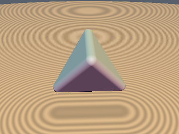&nbsp;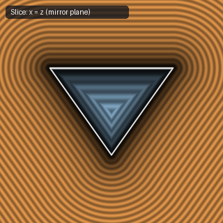 | [**`sdTetrahedron`**](sdTetrahedron.md) [`glsl`](../../glsl/polyhedra/sdTetrahedron.glsl) · **Exact** | $`T_d`$ chamber fold ($`p_x \ge p_y \ge p_z`$, conditional sign flip of $`p_y + p_z`$) + 1-face/2-edge projection |
| 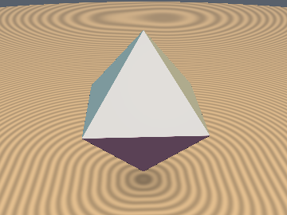&nbsp;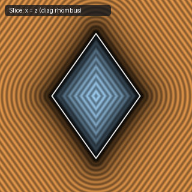 | [**`sdOctahedron`**](sdOctahedron.md) [`glsl`](../../glsl/polyhedra/sdOctahedron.glsl) · **Exact** | 4-line branchless sorted Weyl-chamber projection with weights $`(2, 1, 3)`$ |
| 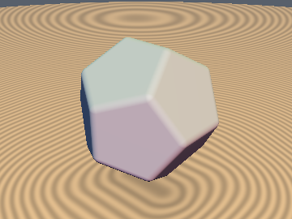&nbsp;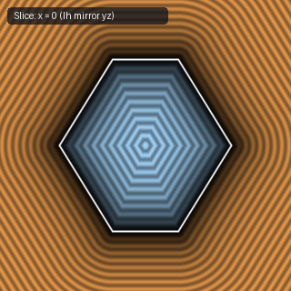 | [**`sdDodecahedron`**](sdDodecahedron.md) [`glsl`](../../glsl/polyhedra/sdDodecahedron.glsl) · **Exact** | 5-step $`I_h`$ reflection fold into the fundamental chamber + 1-face/1-edge projection |
| 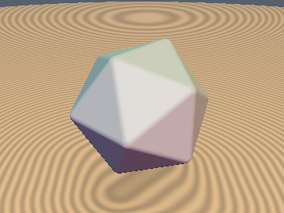&nbsp;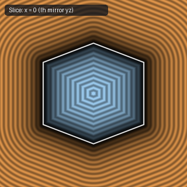 | [**`sdIcosahedron`**](sdIcosahedron.md) [`glsl`](../../glsl/polyhedra/sdIcosahedron.glsl) · **Exact** | 5-step $`I_h`$ reflection fold into the fundamental chamber + 1-face/1-edge projection |
| 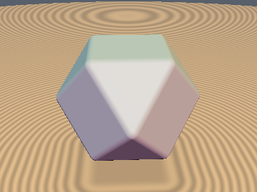&nbsp;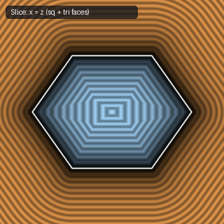 | [**`sdCuboctahedron`**](sdCuboctahedron.md) [`glsl`](../../glsl/polyhedra/sdCuboctahedron.glsl) · **Exact** | $`O_h`$ Weyl-chamber projection onto 1 square face, 1 triangle face, and 1 shared edge |
| 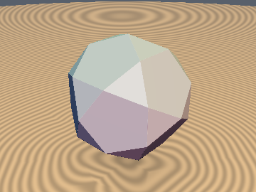&nbsp;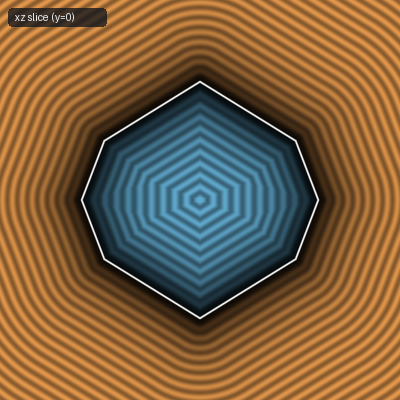 | [**`sdIcosidodecahedron`**](sdIcosidodecahedron.md) [`glsl`](../../glsl/polyhedra/sdIcosidodecahedron.glsl) · **Exact** | 32-face Archimedean solid via $`I_h`$ chamber fold + pentagon/triangle face separator |
| 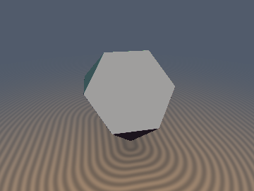 | [**`sdTruncatedTetrahedron`**](sdTruncatedTetrahedron.md) [`glsl`](../../glsl/polyhedra/sdTruncatedTetrahedron.glsl) · **Exact** | **Also**: `sdgTruncatedTetrahedron`. 0/1-`sqrt` 8-face Archimedean solid (4 hexagons + 4 triangles $`\to`$ 1 vertex & 2 edges in 24-fold $`T_d`$ chamber) |
| 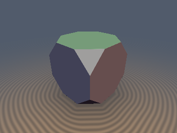&nbsp;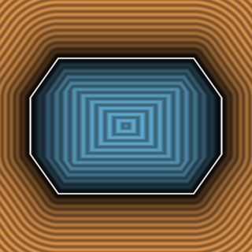 | [**`sdTruncatedCube`**](sdTruncatedCube.md) [`glsl`](../../glsl/polyhedra/sdTruncatedCube.glsl) · **Exact** | **Also**: `sdgTruncatedCube`. 0/1-`sqrt` 14-face Archimedean solid (`0` `sqrt`s in interior & triangle prisms, `1` `sqrt` in 2D octagon chain) + analytical gradient |
| 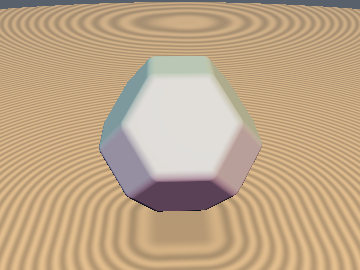&nbsp;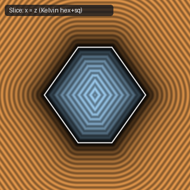 | [**`sdTruncatedOctahedron`**](sdTruncatedOctahedron.md) [`glsl`](../../glsl/polyhedra/sdTruncatedOctahedron.glsl) · **Exact** | Exact Kelvin cell (BCC Voronoi cell) via $`O_h`$ Weyl-chamber projection |
| 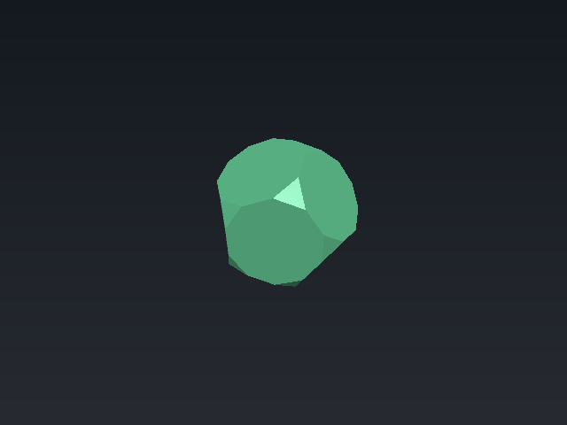 | [**`sdTruncatedDodecahedron`**](sdTruncatedDodecahedron.md) [`glsl`](../../glsl/polyhedra/sdTruncatedDodecahedron.glsl) · **Exact** | **Also**: `sdgTruncatedDodecahedron`. 0/1-`sqrt` 32-face Archimedean solid (12 decagons + 20 triangles) via 120-fold $`I_h`$ Weyl-chamber projection |
| 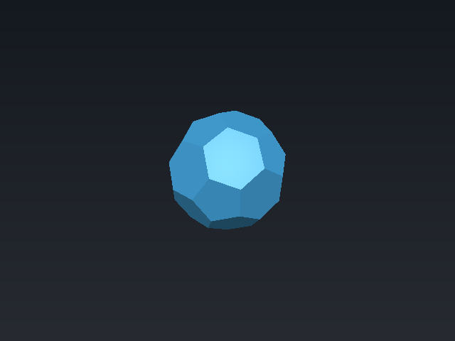 | [**`sdTruncatedIcosahedron`**](sdTruncatedIcosahedron.md) [`glsl`](../../glsl/polyhedra/sdTruncatedIcosahedron.glsl) · **Exact** | **Also**: `sdgTruncatedIcosahedron`. 0/1-`sqrt` 32-face soccer ball / $`C_{60}`$ buckyball (12 pentagons + 20 hexagons $`\to`$ 2 planes & 2 edges in $`I_h`$ chamber) |
| 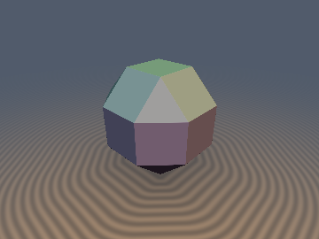&nbsp;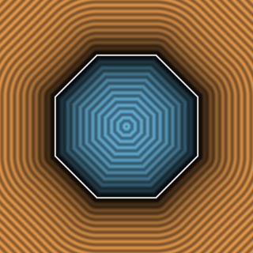 | [**`sdRhombicuboctahedron`**](sdRhombicuboctahedron.md) [`glsl`](../../glsl/polyhedra/sdRhombicuboctahedron.glsl) · **Exact** | **Also**: `sdgRhombicuboctahedron`. 0/1-`sqrt` 26-face Archimedean solid (`0` `sqrt`s in interior & triangle prisms, `1` `sqrt` in 2D octagon chain) + analytical gradient |
| 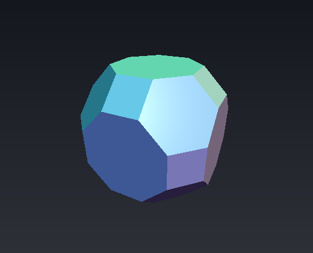 | [**`sdTruncatedCuboctahedron`**](sdTruncatedCuboctahedron.md) [`glsl`](../../glsl/polyhedra/sdTruncatedCuboctahedron.glsl) · **Exact** | **Also**: `sdgTruncatedCuboctahedron`. 0/1-`sqrt` 26-face great rhombicuboctahedron (48 vertices $`\to`$ 1 vertex & 3 mirror-normal edges in $`O_h`$ chamber) |
| 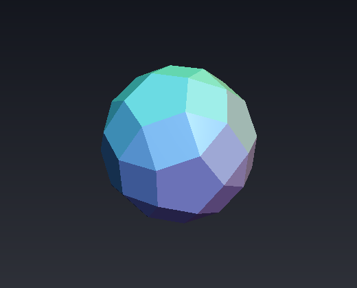 | [**`sdRhombicosidodecahedron`**](sdRhombicosidodecahedron.md) [`glsl`](../../glsl/polyhedra/sdRhombicosidodecahedron.glsl) · **Exact** | **Also**: `sdgRhombicosidodecahedron`. 0/1-`sqrt` 62-face Archimedean solid (120 edges collapse to 2 axis-aligned edges along $`x`$ and $`y`$ in $`I_h`$ chamber) |
| 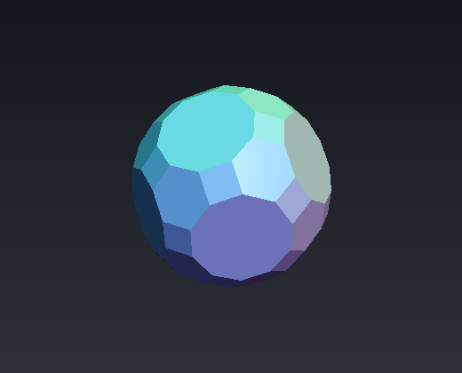 | [**`sdTruncatedIcosidodecahedron`**](sdTruncatedIcosidodecahedron.md) [`glsl`](../../glsl/polyhedra/sdTruncatedIcosidodecahedron.glsl) · **Exact** | **Also**: `sdgTruncatedIcosidodecahedron`. 0/1-`sqrt` 62-face great rhombicosidodecahedron (120 vertices $`\to`$ 1 vertex & 3 mirror-normal edges in $`I_h`$ chamber) |
| 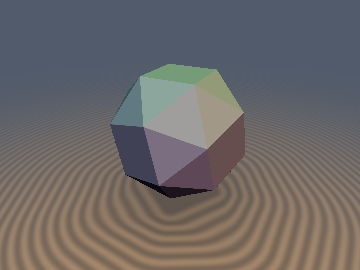&nbsp;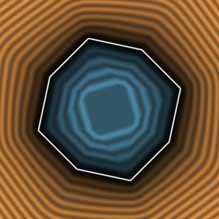 | [**`sdSnubCube`**](sdSnubCube.md) [`glsl`](../../glsl/polyhedra/sdSnubCube.glsl) · **Exact** | **Also**: `sdgSnubCube`. 0/1-`sqrt` chiral Archimedean snub cube via the Chiral Parity Fold (parity-tracked $`O_h`$ fold + 1 wall swizzle → rotation-group domain) & Nearest-Vertex Tangent-Cone Lemma (fixes $`9.6\%`$ plane-max underestimation) |
| 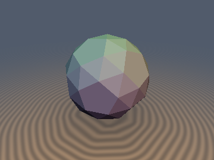 | [**`sdSnubDodecahedron`**](sdSnubDodecahedron.md) [`glsl`](../../glsl/polyhedra/sdSnubDodecahedron.glsl) · **Exact** | **Also**: `sdgSnubDodecahedron`, `sdPentagonalHexecontahedron`, `sdgPentagonalHexecontahedron`. 0-trig, 0/1-`sqrt` chiral Archimedean snub dodecahedron (92 faces, 60 vertices) & Catalan dual pentagonal hexecontahedron (60 pentagons, 92 vertices) via the Icosahedral Chiral Parity Fold & Intrinsic Bilateral Frame (completes all 13 Archimedean & 13 Catalan solids) |
| 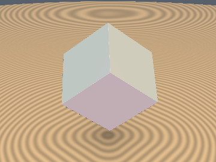&nbsp;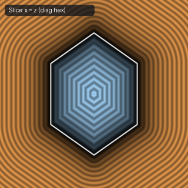 | [**`sdRhombicDodecahedron`**](sdRhombicDodecahedron.md) [`glsl`](../../glsl/polyhedra/sdRhombicDodecahedron.glsl) · **Exact** | 4-line branchless sorted Weyl-chamber projection with weights $`(3, 1, 2)`$; FCC Voronoi cell |
| 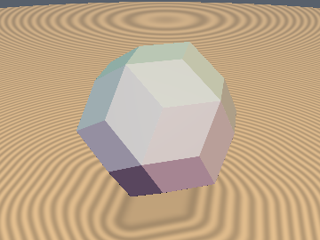&nbsp;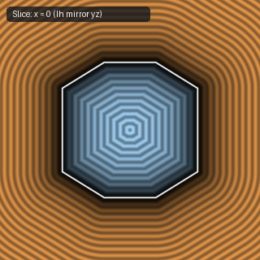 | [**`sdRhombicTriacontahedron`**](sdRhombicTriacontahedron.md) [`glsl`](../../glsl/polyhedra/sdRhombicTriacontahedron.glsl) · **Exact** | 30-face Catalan solid via $`I_h`$ chamber fold + golden-rhombus face/edge projection |
| 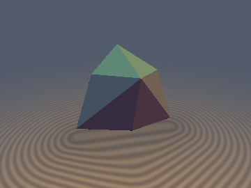 | [**`sdTriakisTetrahedron`**](sdTriakisTetrahedron.md) [`glsl`](../../glsl/polyhedra/sdTriakisTetrahedron.glsl) · **Exact** | **Also**: `sdgTriakisTetrahedron`. 0/1-`sqrt` 12-triangle Catalan solid (dual of truncated tetrahedron) via 24-fold $`T_d`$ parity-sorted Weyl chamber |
| 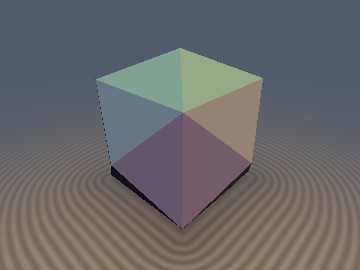&nbsp;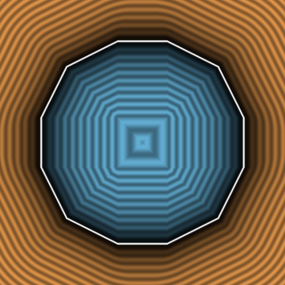 | [**`sdTetrakisHexahedron`**](sdTetrakisHexahedron.md) [`glsl`](../../glsl/polyhedra/sdTetrakisHexahedron.glsl) · **Exact** | **Also**: `sdgTetrakisHexahedron`. 0/1-`sqrt` 24-face Catalan solid (`0` `sqrt`s in interior & 24 face strips, `1` `sqrt` at edges) via $`O_h`$ Weyl-chamber projection |
| 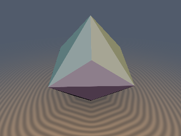&nbsp; | [**`sdTriakisOctahedron`**](sdTriakisOctahedron.md) [`glsl`](../../glsl/polyhedra/sdTriakisOctahedron.glsl) · **Exact** | **Also**: `sdgTriakisOctahedron`. 0/1-`sqrt` 24-face Catalan solid (dual of truncated cube, `0` `sqrt`s in interior & face strips, `1` `sqrt` at edges) via $`O_h`$ Weyl-chamber projection |
| 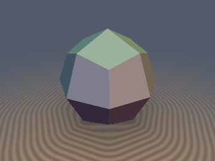&nbsp;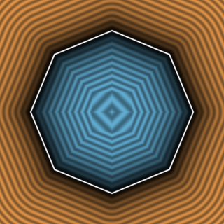 | [**`sdDeltoidalIcositetrahedron`**](sdDeltoidalIcositetrahedron.md) [`glsl`](../../glsl/polyhedra/sdDeltoidalIcositetrahedron.glsl) · **Exact** | **Also**: `sdgDeltoidalIcositetrahedron`. 0/1-`sqrt` 24-face Catalan kite solid (dual of rhombicuboctahedron, `0` `sqrt`s in interior & face strips) via $`O_h`$ Weyl-chamber projection |
| 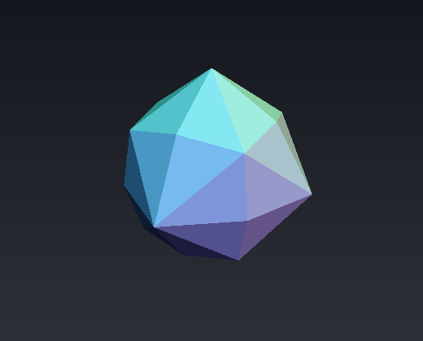 | [**`sdDisdyakisDodecahedron`**](sdDisdyakisDodecahedron.md) [`glsl`](../../glsl/polyhedra/sdDisdyakisDodecahedron.glsl) · **Exact** | **Also**: `sdgDisdyakisDodecahedron`. 0/1-`sqrt` 48-triangle Catalan solid (dual of truncated cuboctahedron; 48 faces $`\to`$ 1 plane in $`O_h`$ Weyl chamber) |
| 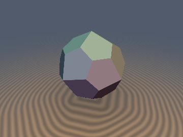&nbsp;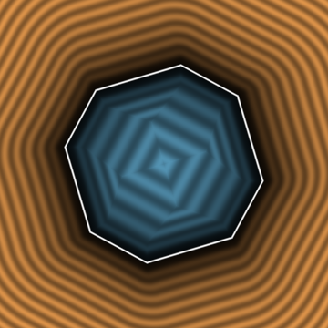 | [**`sdPentagonalIcositetrahedron`**](sdPentagonalIcositetrahedron.md) [`glsl`](../../glsl/polyhedra/sdPentagonalIcositetrahedron.glsl) · **Exact** | **Also**: `sdgPentagonalIcositetrahedron`. 0/1-`sqrt` chiral Catalan dual of the snub cube via Chiral Parity Fold + Argmax-Face Lemma (one fixed pentagon, 3 edges; fixes $`13.3\%`$ plane-max underestimation) |
| 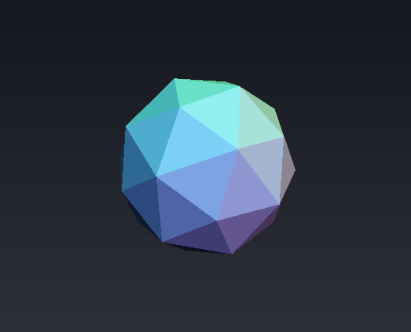 | [**`sdPentakisDodecahedron`**](sdPentakisDodecahedron.md) [`glsl`](../../glsl/polyhedra/sdPentakisDodecahedron.glsl) · **Exact** | **Also**: `sdgPentakisDodecahedron`. 0/1-`sqrt` 60-triangle Catalan geodesic dome (dual of $`C_{60}`$ buckyball; 60 faces $`\to`$ 1 plane in $`I_h`$ chamber) |
| 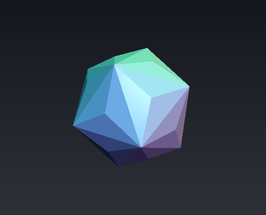 | [**`sdTriakisIcosahedron`**](sdTriakisIcosahedron.md) [`glsl`](../../glsl/polyhedra/sdTriakisIcosahedron.glsl) · **Exact** | **Also**: `sdgTriakisIcosahedron`. 0/1-`sqrt` 60-triangle Catalan solid (dual of truncated dodecahedron; 60 faces $`\to`$ 1 plane in $`I_h`$ chamber) |
| 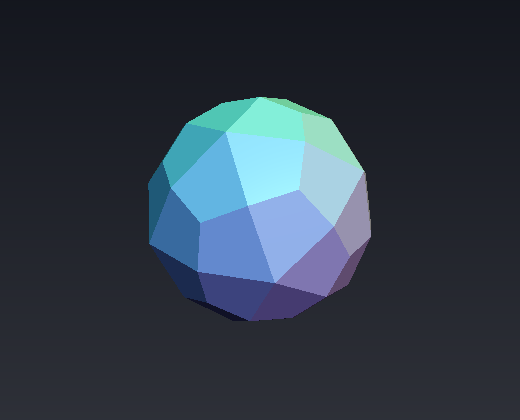 | [**`sdDeltoidalHexecontahedron`**](sdDeltoidalHexecontahedron.md) [`glsl`](../../glsl/polyhedra/sdDeltoidalHexecontahedron.glsl) · **Exact** | **Also**: `sdgDeltoidalHexecontahedron`. 0/1-`sqrt` 60-kite Catalan solid (dual of rhombicosidodecahedron; all 60 kites collapse to 1 plane on the $`I_h`$ mirror wall) |
| 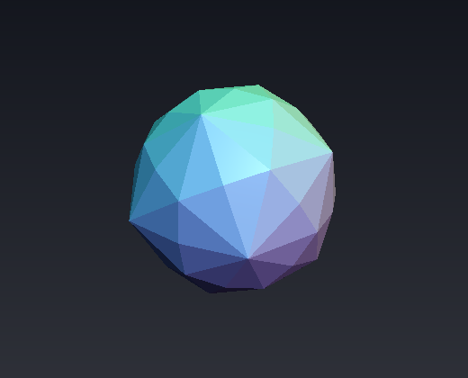 | [**`sdDisdyakisTriacontahedron`**](sdDisdyakisTriacontahedron.md) [`glsl`](../../glsl/polyhedra/sdDisdyakisTriacontahedron.glsl) · **Exact** | **Also**: `sdgDisdyakisTriacontahedron`. 0/1-`sqrt` 120-triangle Catalan solid (largest Archimedean/Catalan solid; all 120 faces collapse to 1 triangle in $`I_h`$ chamber) |

## Star Polyhedra, Compounds, Antiprisms & Crystal Habits

| Preview | Function | Summary |
| :---: | :--- | :--- |
| 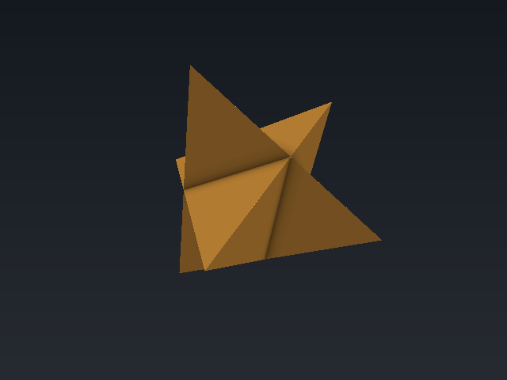 | [**`sdStellaOctangula`**](sdStellaOctangula.md) [`glsl`](../../glsl/polyhedra/sdStellaOctangula.glsl) · **Exact** | **Also**: `sdgStellaOctangula`. 0/1-`sqrt` Kepler's Stella Octangula (compound of two dual tetrahedra; 24 triangles $`\to`$ 1 face, 1 ridge, & 1 valley seam in $`O_h`$) |
| 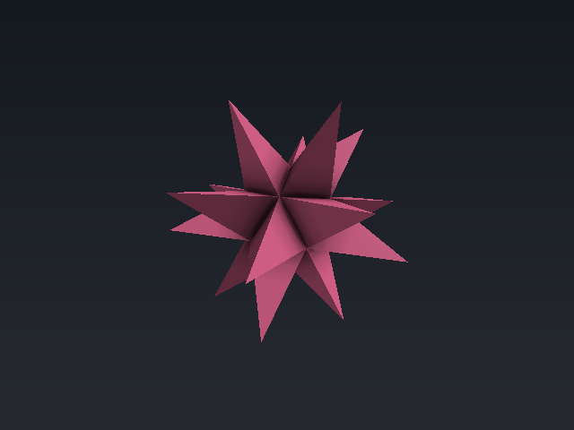 | [**`sdKeplerPoinsot`**](sdKeplerPoinsot.md) [`glsl`](../../glsl/polyhedra/sdKeplerPoinsot.glsl) · **Exact** | **Also**: `sdSmallStellatedDodecahedron`, `sdGreatDodecahedron`, `sdGreatStellatedDodecahedron`, `sdg*`. 0/1-`sqrt` Kepler-Poinsot regular star polyhedra (60 outer facets $`\to`$ 1 triangle, 1 ridge, & 1 valley seam in $`I_h`$ chamber) |
| 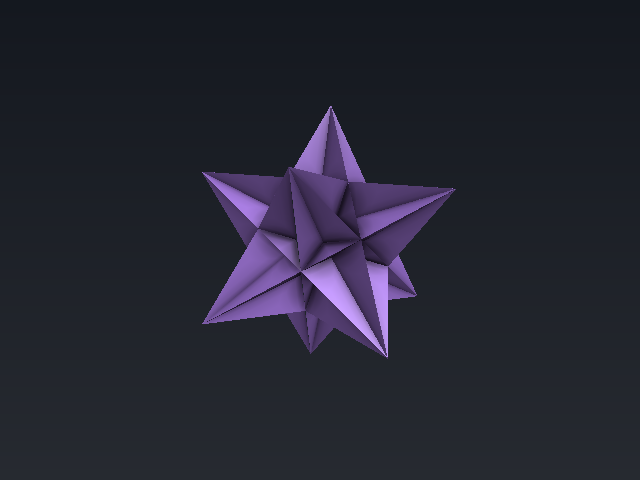 | [**`sdGreatIcosahedron`**](sdGreatIcosahedron.md) [`glsl`](../../glsl/polyhedra/sdGreatIcosahedron.glsl) · **Exact** | **Also**: `sdgGreatIcosahedron`. 0/1-`sqrt` Kepler-Poinsot regular star polyhedron (180 visible outer triangles $`\to`$ 1 chamber facet + 2 interior valley seams) |
| 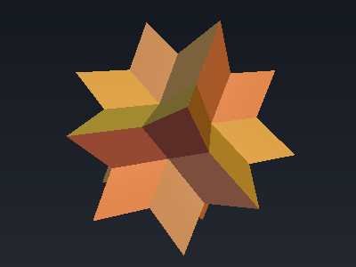 | [**`sdRhombicHexecontahedron`**](sdRhombicHexecontahedron.md) [`glsl`](../../glsl/polyhedra/sdRhombicHexecontahedron.glsl) · **Exact** | **Also**: `sdgRhombicHexecontahedron`. 0/1-`sqrt` Unkelbach 60-golden-rhombus stellation via Face-Normal Swizzle Identity $`\mathbf{n} \equiv -\mathbf{n}_3.\text{yzx}`$ & wall-aligned edges |
| 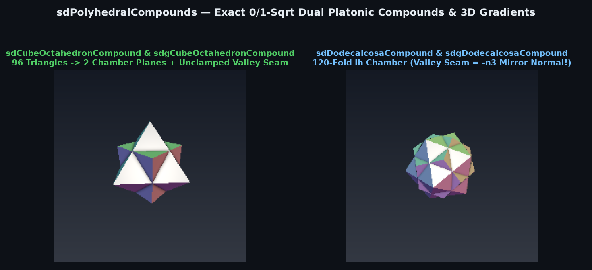 | [**`sdPolyhedralCompounds`**](sdPolyhedralCompounds.md) [`glsl`](../../glsl/polyhedra/sdPolyhedralCompounds.glsl) · **Exact** | **Also**: `sdCubeOctahedronCompound`, `sdDodecaIcosaCompound`, `sdg*`. 0/1-`sqrt` dual Platonic compounds via the Unclamped Interior Valley-Seam Theorem (eliminates $`5.3\%\text{--}11.2\%`$ CSG valley error) |
| 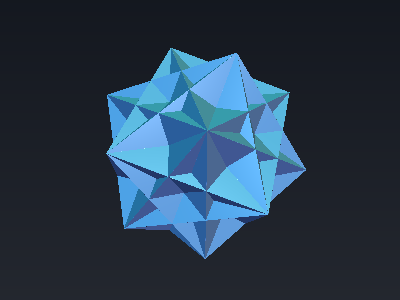 | [**`sdFiveCubesCompound`**](sdFiveCubesCompound.md) [`glsl`](../../glsl/polyhedra/sdFiveCubesCompound.glsl) · **Exact** | **Also**: `sdFiveOctahedraCompound`, `sdgFiveOctahedraCompound`. 0/1-`sqrt` regular icosahedral compounds of 5 cubes (Swizzle-Frame) & 5 octahedra (Single-Octahedron Collapse) |
|  | [**`sdHexFrustum`**](sdHexFrustum.md) [`glsl`](../../glsl/polyhedra/sdHexFrustum.glsl) · **Exact** | **Also**: `sdgHexFrustum`, `sdRegularFrustum`. 0-trig, 0/1-`sqrt` hexagonal frustum/pyramid ($`D_6`$ fold) and general $`N`$-gonal frustum |
|  | [**`sdSquareAntiprism`**](sdSquareAntiprism.md) [`glsl`](../../glsl/polyhedra/sdSquareAntiprism.glsl) · **Exact** | **Also**: `sdPentAntiprism`, `sdHexAntiprism`, `sdAntiprism`, `sdg*`. 0-trig, 0/1-`sqrt` square, pentagonal (icosahedral core), and hexagonal antiprisms via $`D_{nd}`$ involutory bisector folding |
|  | [**`sdTrapezohedron`**](sdTrapezohedron.md) [`glsl`](../../glsl/polyhedra/sdTrapezohedron.glsl) · **Exact** | **Also**: `sdPentTrapezohedron`, `sdSquareTrapezohedron`, `sdgPentTrapezohedron`. 0-trig, 0/1-`sqrt` $`2n`$-kite trapezohedra including the 10-sided $`D_{10}`$ die (`sdPentTrapezohedron`) |
|  | [**`sdTetragonalTrapezohedron`**](sdTetragonalTrapezohedron.md) [`glsl`](../../glsl/polyhedra/sdTetragonalTrapezohedron.glsl) · **Exact** | **Also**: `sdGyroelongatedSquareBipyramid`. Exact 0-loop, 0-trig, 1-`sqrt` 3D Euclidean leucite/analcime tetragonal trapezohedron (8 kites) and Norman Johnson's (1966) solid $`J_{17}`$ gyroelongated square bipyramid (16 equilateral triangles) via the $`D_{4d}`$ commutation theorem |
|  | [**`sdGyrobifastigium`**](sdGyrobifastigium.md) [`glsl`](../../glsl/polyhedra/sdGyrobifastigium.glsl) · **Exact** | **Also**: `sdgGyrobifastigium`. 0/1-`sqrt` space-filling Johnson solid $`J_{26}`$ (`0` `sqrt`s in interior, `1` in exterior via 2-line $`D_{2d}`$ fold & 4-Square Edge-Cover Theorem) |
|  | [**`sdElongatedDodecahedron`**](sdElongatedDodecahedron.md) [`glsl`](../../glsl/polyhedra/sdElongatedDodecahedron.glsl) · **Exact** | **Also**: `sdgElongatedDodecahedron`. Exact 0-loop, 0-trig, 1-`sqrt` 3D Euclidean Fedorov's (1885) space-filling elongated dodecahedron (12 faces) and Bilinski's (1960) golden rhombic icosahedron (20 faces) with analytical unit gradients via octant-folded Voronoi feature pruning |
|  | [**`sdPyritohedron`**](sdPyritohedron.md) [`glsl`](../../glsl/polyhedra/sdPyritohedron.glsl) · **Exact** | **Also**: `sdgPyritohedron`, `sdBilinskiDodecahedron`, `sdgBilinskiDodecahedron`. Exact 0-loop, 0-trig, 1-`sqrt` 3D Euclidean crystallographic $`T_h`$ pyritohedron family (iron pyrite $`\{210\}`$ habit) and Stanko Bilinski's (1960) golden rhombic dodecahedron with analytical unit gradients |
|  | [**`sdDurerSolid`**](sdDurerSolid.md) [`glsl`](../../glsl/polyhedra/sdDurerSolid.glsl) · **Exact** | **Also**: `sdgDurerSolid`, `sdRhombohedron`, `sdgRhombohedron`. Exact 0-loop, 0-trig, 1-`sqrt` 3D Euclidean Albrecht Dürer's (1514) *Melencolia I* solid (6 pentagons + 2 triangles) and calcite trigonal rhombohedron via the $`D_{3d}`$ truncation commutation theorem |

## Universal Wythoffian Projectors, Permutohedra, 4D Polytopes & Projective Balls

| Preview | Function | Summary |
| :---: | :--- | :--- |
|  | [**`cxWythoffUniversal`**](cxWythoffUniversal.md) [`glsl`](../../glsl/polyhedra/cxWythoffUniversal.glsl) · **Exact** | **Also**: `cxProjectRootWeightCone`, `sdWythoffIcosahedral`, `sdgWythoffIcosahedral`, `sdBuckyballC60`, `sdgBuckyballC60`, `sdWythoffOctahedral`, `sdWythoffTetrahedral`. Universal 0/1-`sqrt` root-weight simplicial cone projector unifying all uniform and continuous Wythoffian polyhedra across $`H_3`$ ($`I_h`$, including the 60-vertex buckyball and 120-vertex great rhombicosidodecahedron), $`B_3`$ ($`O_h`$), and $`A_3`$ ($`T_d`$) |
|  | [**`isPermutohedronPAVA`**](isPermutohedronPAVA.md) [`glsl`](../../glsl/polyhedra/isPermutohedronPAVA.glsl) · **Exact** | **Also**: `isPavaWeyl3D`, `sdPermutohedron`, `sdgPermutohedron`, `sdBrunnMinkowskiGeodesic`, `sdgBrunnMinkowskiGeodesic`. Branchless 3-element Pool-Adjacent-Violators (PAVA) isotonic regression on the Weyl chamber cone (`0` `sqrt`s in interior + all 6/18/26 face prisms, `1` `sqrt` at edges) for 48-vertex signed permutohedra and continuous Brunn-Minkowski Minkowski-sum geodesics (FP32 error $`\le 2.7\times10^{-7}`$) |
|  | [**`sd4Polytopes`**](sd4Polytopes.md) [`glsl`](../../glsl/polyhedra/sd4Polytopes.glsl) · **Exact** in 4D / Bound for 3D slices | **Also**: `sd4Cell5`, `sd4Tesseract`, `sd4Cell16`, `sd4Cell24`, `sd4Cell120`, `sd4Cell600`, `sd4RegularEdges`, `sdRegularSlice`. Exact 4D SDFs of the six regular 4-polytopes and their edge skeletons by Coxeter folding (FP32 error at most 2e-6); 3D slices are 1-Lipschitz conservative bounds with the exact zero set, not exact SDFs |
|  | [**`hiProjectiveMetric`**](hiProjectiveMetric.md) [`glsl`](../../glsl/polyhedra/hiProjectiveMetric.glsl) · **Exact** (tetra balls & chords) / Bound | **Also**: `hiChordDistanceCube`, `hiFunkDistanceCube`, `sdHilbertBallTetra`, `sdgHilbertBallTetra`, `sdSymFunkBallTetra`, `sdHilbertBallAt`. 0-`sqrt` projective Hilbert & Funk metrics, exact 12-faced deltoidal dodecahedral Hilbert balls in a tetrahedron, and 18-faced off-center Hilbert balls in a cube |
