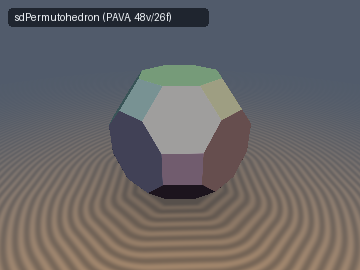
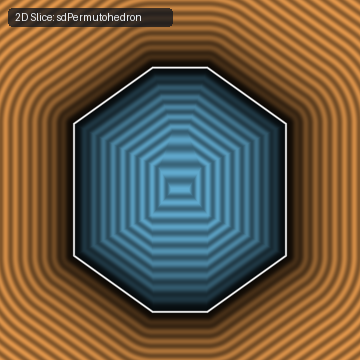
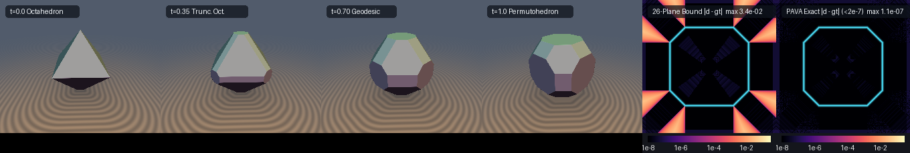

# `isPermutohedronPAVA` — Weyl-Chamber Isotonic Regression (PAVA), Rado Majorization Orbitopes & Brunn-Minkowski Geodesic SDFs

| 3D Surface ($`d(\mathbf{p}) = 0`$, 48v / 26f Permutohedron) | 2D Cross-Section Slice |
| :---: | :---: |
|  |  |

| Property | Value |
| :--- | :--- |
| **Author / Attribution** | **Gemini 4 Argon** (`sdf-gems`, 2026) |
| **Category** | `polyhedra` |
| **GLSL File** | [`glsl/polyhedra/isPermutohedronPAVA.glsl`](../../glsl/polyhedra/isPermutohedronPAVA.glsl) |
| **Functions** | `isSortDesc3D`, `isPavaMonotone3D`, `isPavaWeyl3D`, `sdPermutohedron`, `sdgPermutohedron`, `sdBrunnMinkowskiGeodesic`, `sdgBrunnMinkowskiGeodesic` |
| **Exactness** | **Exact** ($`\Vert\nabla d\Vert = 1`$ a.e. in $`\mathbb{R}^3`$; max error $`\le 2.44\times10^{-7}`$ against independent 48-vertex `convex_hull_sdf` ground truth) |
| **GPU SFU Cost** | **0 SFU** (`0` `sqrt` / `div`) inside and in all 6 / 18 / 26 face prisms; **1 SFU** (`1` `sqrt` or `inversesqrt`) in edge/vertex cones |

---

## Visual Comparison & Brunn-Minkowski Geodesic Morph



*Left to center-right: continuous exact 0/1-`sqrt` Brunn-Minkowski Minkowski-sum geodesic $`K(t) = (1-t)\,\Pi(\mathbf{a}_0) \oplus t\,\Pi(\mathbf{a}_1)`$ morphing from an octahedron ($`t=0`$, 8 faces) through a truncated octahedron ($`t=0.35`$, 14 faces) to a 26-face signed permutohedron ($`t=1`$, 48 vertices, 72 edges). Right two panels: $`\log_{10}|d - d_{\text{gt}}|`$ slice error of the 26-plane supporting half-space bound vs. exact Weyl-chamber PAVA projection (`< 2.5e-7` everywhere).*

---

## Mathematical Formulation

### 1. Rado's Majorization Theorem & The Signed Permutohedron

Given a generator $`\mathbf{a} = (a_x \ge a_y \ge a_z \ge 0)`$ in the fundamental monotone Weyl chamber cone

```math
\mathcal{C}_+ = \left\{ \mathbf{u} \in \mathbb{R}^3 \;\middle|\; u_x \ge u_y \ge u_z \ge 0 \right\},
```

the **signed permutohedron** (or $`B_3`$-orbitope) is the convex hull of the 48 signed permutations of $`\mathbf{a}`$:

```math
\Pi(\mathbf{a}) = \mathrm{conv}\left\{ \left(\pm a_{\pi(1)},\, \pm a_{\pi(2)},\, \pm a_{\pi(3)}\right) \;\middle|\; \pi \in S_3 \right\}.
```

By the Hardy–Littlewood–Pólya rearrangement inequality, folding a query point $`\mathbf{p} \in \mathbb{R}^3`$ into $`\mathcal{C}_+`$ via $`\mathbf{p}_\downarrow = \mathrm{sort}_\downarrow(|\mathbf{p}|)`$ preserves Euclidean distance to $`\Pi(\mathbf{a})`$: the closest point $`\mathbf{x}^* \in \Pi(\mathbf{a})`$ to $`\mathbf{p}_\downarrow \in \mathcal{C}_+`$ always lies in the same chamber $`\Pi(\mathbf{a}) \cap \mathcal{C}_+`$.

By **Rado's Majorization Theorem** (1952), a point $`\mathbf{x} \in \mathcal{C}_+`$ belongs to $`\Pi(\mathbf{a}) \cap \mathcal{C}_+`$ if and only if $`\mathbf{x}`$ is weakly submajorized by $`\mathbf{a}`$. Setting $`\mathbf{q} = \mathbf{p}_\downarrow - \mathbf{a}`$, the tangent cone $`K`$ of $`\Pi(\mathbf{a})`$ at vertex $`\mathbf{a}`$ inside $`\mathcal{C}_+`$ is cut out by three prefix-sum half-spaces:

```math
K = \left\{ \mathbf{v} \in \mathbb{R}^3 \;\middle|\; v_x \le 0,\;\; v_x + v_y \le 0,\;\; v_x + v_y + v_z \le 0 \right\},
```

with unit face normals $`\mathbf{n}_1 = (1,0,0)`$, $`\mathbf{n}_2 = (1,1,0)/\sqrt{2}`$, and $`\mathbf{n}_3 = (1,1,1)/\sqrt{3}`$, and signed plane distances

```math
d_1 = q_x, \qquad d_2 = \frac{q_x + q_y}{\sqrt{2}}, \qquad d_3 = \frac{q_x + q_y + q_z}{\sqrt{3}}, \qquad d_{\text{face}} = \max(d_1, d_2, d_3).
```

### 2. Polar Cone Self-Duality & 3-Element PAVA Isotonic Regression

The polar (normal) cone $`K^\circ`$ spanned by the three prefix-sum normals $`\{(1,0,0), (1,1,0), (1,1,1)\}`$ is

```math
K^\circ = \left\{ \lambda_1(1,0,0) + \lambda_2(1,1,0) + \lambda_3(1,1,1) \;\middle|\; \lambda_i \ge 0 \right\} = \left\{ \mathbf{u} \in \mathbb{R}^3 \;\middle|\; u_x \ge u_y \ge u_z \ge 0 \right\} = \mathcal{C}_+.
```

By **Moreau's Orthogonal Decomposition Theorem**, the exterior displacement vector $`\mathbf{u} = \mathbf{p}_\downarrow - \mathbf{x}^*`$ is the exact $`L^2`$ orthogonal projection of $`\mathbf{q} = \mathbf{p}_\downarrow - \mathbf{a}`$ onto the monotone Weyl chamber $`\mathcal{C}_+`$:

```math
\mathbf{u} = \mathrm{Proj}_{\mathcal{C}_+}(\mathbf{p}_\downarrow - \mathbf{a}) = \arg\min_{\substack{u_x \ge u_y \ge u_z \ge 0}} \|\mathbf{u} - \mathbf{q}\|_2^2, \qquad d_{\text{ext}}(\mathbf{p}) = \|\mathbf{u}\|_2.
```

Projecting onto the decreasing monotone cone $`\{w_x \ge w_y \ge w_z\}`$ is the classical **isotonic regression** problem solved by the **Pool-Adjacent-Violators Algorithm (PAVA)** (Ayer, Brunk, Ewing, Reid & Silverman, 1955). In 3D, PAVA unrolls into a branchless 4-case block-averaging tree (`0` loops, `0` SFU):

1. Pool $`(0,1)`$ to $`\bar{q}_{01} = \frac{1}{2}(q_x + q_y)`$ if $`q_x < q_y`$, giving intermediate $`(v_0, v_1)`$.
2. If $`v_1 < q_z`$:
   - If $`(0,1)`$ was pooled or $`q_x < \frac{1}{2}(q_y + q_z)`$, pool all three to $`\bar{q}_{012} = \frac{1}{3}(q_x + q_y + q_z)`$.
   - Otherwise pool $`(1,2)`$ to $`\bar{q}_{12} = \frac{1}{2}(q_y + q_z)`$.
3. Clamp $`\mathbf{u} = \max(\mathbf{w}, \mathbf{0})`$.

### 3. Prefix-Average Duality & The 0-`sqrt` Face-Prism Early Exit

By the Ayer–Brunk prefix-average theorem, the leading component of PAVA is

```math
u_x = \max\!\left(q_x,\; \frac{q_x + q_y}{2},\; \frac{q_x + q_y + q_z}{3},\; 0\right),
```

so $`\mathbf{u} = \mathbf{0} \iff u_x = 0 \iff d_{\text{face}} = \max(d_1, d_2, d_3) \le 0`$. Furthermore, whenever PAVA leaves at most one positive block—meaning `u.y == 0.0` (6 axial faces), `u.x == u.y && u.z == 0.0` (12 diagonal faces), or `u.x == u.z` (8 octahedral faces)—$`\mathbf{u}`$ is parallel to $`\mathbf{n}_k`$ and Cauchy–Schwarz gives $`\|\mathbf{u}\|_2 = d_{\text{face}}`$ directly with **0 `sqrt`s**. Only points in the edge and vertex cones evaluate `length(u)`.

### 4. Closed-Form Brunn-Minkowski Geodesics

For any unit normal $`\mathbf{n}`$, the support function of $`\Pi(\mathbf{a})`$ is $`h_{\Pi(\mathbf{a})}(\mathbf{n}) = \langle |\mathbf{n}|_\downarrow, \mathbf{a}_\downarrow \rangle`$, which is **linear** on the Weyl chamber $`\mathcal{C}_+`$. Because Minkowski addition adds support functions, the Weyl chamber is closed under Minkowski sums:

```math
(1 - t)\,\Pi(\mathbf{a}_0) \oplus t\,\Pi(\mathbf{a}_1) = \Pi\!\big((1 - t)\,\mathbf{a}_{0\downarrow} + t\,\mathbf{a}_{1\downarrow}\big), \qquad t \in [0, 1].
```

| Solid in $`O_h`$ Family | Sorted Weyl Generator $`\mathbf{a} = (a_x, a_y, a_z)`$ | Vertices / Edges / Faces | Max Error vs. `convex_hull_sdf` |
| :--- | :--- | :---: | :---: |
| Octahedron | $`(s,\, 0,\, 0)`$ | 6 / 12 / 8 | $`2.19\times10^{-7}`$ |
| Cuboctahedron | $`(s,\, s,\, 0)`$ | 12 / 24 / 14 | $`1.94\times10^{-7}`$ |
| Cube | $`(s,\, s,\, s)`$ | 8 / 12 / 6 | $`1.64\times10^{-7}`$ |
| Truncated Octahedron | $`(2s,\, s,\, 0)`$ | 24 / 36 / 14 | $`2.44\times10^{-7}`$ |
| Truncated Cube | $`(s,\, s,\, (\sqrt{2}-1)s)`$ | 24 / 36 / 14 | $`1.80\times10^{-7}`$ |
| Rhombicuboctahedron | $`((1+\sqrt{2})s,\, s,\, s)`$ | 24 / 48 / 26 | $`2.13\times10^{-7}`$ |
| Truncated Cuboctahedron | $`((1+2\sqrt{2})s,\, (1+\sqrt{2})s,\, s)`$ | 48 / 72 / 26 | $`1.89\times10^{-7}`$ |
| General Signed Permutohedron | $`(a_x > a_y > a_z > 0)`$ | 48 / 72 / 26 | $`2.20\times10^{-7}`$ |

---

## GLSL Usage

```glsl
#include "glsl/polyhedra/isPermutohedronPAVA.glsl"

// 1. Direct Weyl-chamber PAVA projection onto C_+ = {u.x >= u.y >= u.z >= 0}
vec3 u = isPavaWeyl3D(q);

// 2. Exact 0/1-sqrt SDF & analytical gradient of any signed permutohedron Pi(a)
float d  = sdPermutohedron(p, vec3(0.62, 0.38, 0.16));
vec4  dg = sdgPermutohedron(p, vec3(0.62, 0.38, 0.16)); // (d, grad.xyz)

// 3. Exact Brunn-Minkowski Minkowski-sum geodesic (1-t) Pi(a0) (+) t Pi(a1)
float dm  = sdBrunnMinkowskiGeodesic(p, vec3(0.75, 0.0, 0.0), vec3(0.58, 0.38, 0.18), t);
vec4  dmg = sdgBrunnMinkowskiGeodesic(p, vec3(0.75, 0.0, 0.0), vec3(0.58, 0.38, 0.18), t);
```

---

## Direct-GPU Verification Summary

All tests were executed on the literal [`glsl/polyhedra/isPermutohedronPAVA.glsl`](../../glsl/polyhedra/isPermutohedronPAVA.glsl) shader in OpenGL 4.1 FP32 via `tools/gpu_eval.py`:

- **Single-Translation-Unit Compilation**: Passed in forward, reverse, and new-file-first order across all 301 headers.
- **`isPavaWeyl3D` vs. Exact Active-Set QP** ($`N = 30{,}000`$): $`\max \|\mathbf{u}_{\text{GPU}} - \mathbf{u}_{\text{QP}}\|_\infty = 1.92\times10^{-7}`$.
- **8-Body Ground-Truth Audit** ($`N = 24{,}000`$ random + near-surface points per body against `convex_hull_sdf`):
  - `0 / 3209` `NaN`/`Inf` on all axes, symmetry planes, diagonals, and at $`\mathbf{a} = \mathbf{0}`$.
  - Maximum distance error $`1.64\times10^{-7}`$ to $`2.44\times10^{-7}`$; `0` sign mismatches.
  - Analytical gradient `sdgPermutohedron`: $`|dg.x - d| \le 1.19\times10^{-7}`$, $`|\|\mathbf{g}\|_2 - 1| \le 1.32\times10^{-7}`$, cosine similarity $`> 0.999`$ on $`99.97\%\text{--}100\%`$ of smooth points, exterior self-projection error $`|d(\mathbf{p} - d\nabla d)| \le 2.50\times10^{-7}`$.
- **Seam $`C^0`$ Continuity** ($`8{,}000`$ points placed directly on the 5 PAVA block-pooling boundaries and 3 Weyl sorting planes): max jump $`2.00\times10^{-5}`$ at $`\epsilon = 10^{-5}`$ (`0` violations).
- **Special-Case Regression vs. Repository `polyhedra3d` Shaders**: matches `sdOctahedron`, `sdBox`, `sdCuboctahedron`, `sdTruncatedOctahedron`, `sdTruncatedCube`, `sdRhombicuboctahedron`, and `sdTruncatedCuboctahedron` to $`\le 2.38\times10^{-7}`$.
- **Brunn-Minkowski Geodesic vs. Pairwise Vertex Minkowski Sum** ($`t \in \{0, 0.25, 0.5, 0.75, 1\}`$ against `convex_hull_sdf` of $`(1-t)V_0 \oplus t V_1`$): max error $`\le 2.67\times10^{-7}`$.
