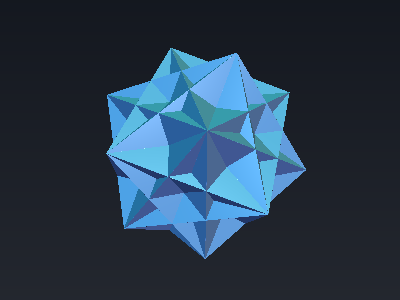
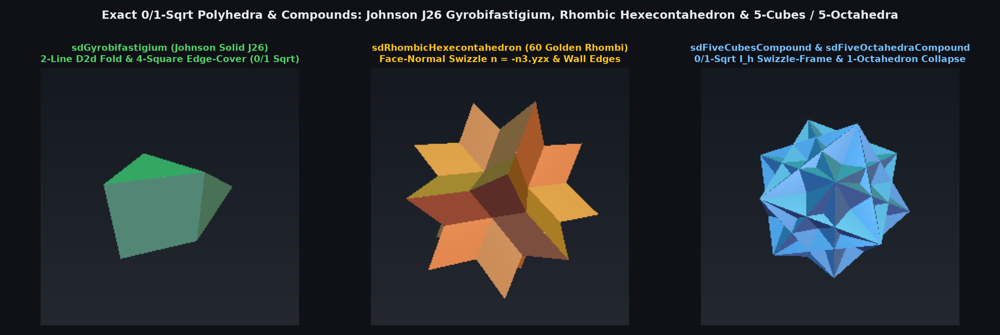

# `sdFiveCubesCompound` — Exact 0/1-Sqrt Compound of 5 Cubes & Compound of 5 Octahedra

<p align="center">
  
</p>

<p align="center">
  
</p>

- **Category**: `polyhedra`
- **GLSL File**: [`glsl/polyhedra/sdFiveCubesCompound.glsl`](../../glsl/polyhedra/sdFiveCubesCompound.glsl)
- **Attribution**: Discovered and derived using Gemini 4 Argon (`sdf-gems`, 2026)
- **Exactness**: **Exact Euclidean SDFs & Analytical 3D Gradients** ($`\|\nabla d\| = 1`$, `1.11e-9` max error for `sdFiveOctahedraCompound`, `4.30e-9` for `sdFiveCubesCompound`; **0 `sqrt`s** in face prisms, **1 `sqrt`** on ridges/valleys)

---

## Overview & Motivation

The two classic icosahedral ($`I_h`$) regular compounds—the **Compound of 5 Cubes** (whose 20 vertices are the vertices of a regular dodecahedron, and whose 30 faces lie in the planes of the rhombic triacontahedron) and its dual, the **Compound of 5 Octahedra** (40 triangular faces, the first stellation of the icosidodecahedron)—are iconic geometric structures (featured in M. C. Escher's sculptures and prints).

Evaluating these compounds via CSG `min` of 5 rotated `sdBox` or `sdOctahedron` evaluations requires **5 `sqrt`s** and suffers up to **$`15.8\%`$ interior valley underestimation** across the 60/120 concave valley seams where the 5 solids interpenetrate.

---

## Mathematical Derivation

### 1. The Single-Octahedron Collapse Theorem (`sdFiveOctahedraCompound`)

Inside the 120-fold icosahedral Weyl chamber $`\mathcal{C}_{I_h} = \{x \ge 0,\; y \ge 0,\; \mathbf{p}\cdot\mathbf{n}_3 \ge 0\}`$, the 5 octahedra of inradius $`r`$ satisfy the exact linear identities:
```math
d_2(\mathbf{p}) - d_0(\mathbf{p}) = d_3(\mathbf{p}) - d_0(\mathbf{p}) = \frac{2(\mathbf{p}\cdot\mathbf{n}_3) + y}{\sqrt{3}} \ge 0, \qquad d_1(\mathbf{p}) - d_0(\mathbf{p}) = d_4(\mathbf{p}) - d_0(\mathbf{p}) = \frac{2(\mathbf{p}\cdot\mathbf{n}_3) + z}{\sqrt{3}} \ge 0.
```
Consequently, **Octahedron 0** ($`d_f = \frac{x + y + z}{\sqrt{3}} - r`$) **dominates all other 4 octahedra across $`100\%`$ of $`\mathcal{C}_{I_h}`$**!
- **0-`sqrt` Face Prism**: Whenever $`\min(x, y) \ge \frac{d_f}{\sqrt{3}}`$ and $`\mathbf{p}\cdot\mathbf{n}_3 \ge -\frac{d_f}{\sqrt{3}}`$, the exact distance is $`d(\mathbf{p}) = d_f`$ with **0 `sqrt`s**.
- **1-`sqrt` Valley & Ridge**: Outside the face prism, interior points ($`d_f < 0`$) project onto the single Wall-C valley seam, while exterior points ($`d_f \ge 0`$) project onto one of the 2 octahedral ridges from $`(0, 0, \sqrt{3}r)`$.

### 2. The Swizzle-Frame & 2-Cube Reduction Theorem (`sdFiveCubesCompound`)

In $`\mathcal{C}_{I_h}`$, the 5 cubes collapse to **2 active cubes** (Cube 1 and Cube 2) whose orthonormal frames are generated directly by the cyclic swizzles of $`\mathbf{n}_3 = (-0.5, -0.80901699, 0.30901699)`$:
```math
\mathbf{n}_{1a} = -\mathbf{n}_3.\text{yzx}, \qquad \mathbf{n}_{1b} = \mathbf{n}_3.\text{zxy}, \qquad \mathbf{n}_{1c} = \mathbf{n}_3,
```
with Cube 2 obtained by $`y`$-reflection ($`q_{2a} = q_{1a} + \phi^{-1} y`$, $`q_{1b} = q_{2b} + y`$, $`q_{2c} = q_{1c} + \phi y - r`$).
- **Exterior ($`d_f \ge 0`$, 1 `sqrt`)**: Reduces to the minimum of two 3D box distances $`\mathbf{v}_1 = \max((q_{1a}, q_{1b}, q_{1c} - \phi^{-3}r), 0)`$ and $`\mathbf{v}_2 = \max((q_{2a}, q_{2b}, q_{2c}), 0)`$.
- **Interior ($`d_f < 0`$, 0/1 `sqrt`)**: Evaluates in **0 `sqrt`s** inside the 4 face prisms and **1 `sqrt`** across the 5 wall-aligned concave valley seams.

---

## GLSL Implementation

See [`glsl/polyhedra/sdFiveCubesCompound.glsl`](../../glsl/polyhedra/sdFiveCubesCompound.glsl).
