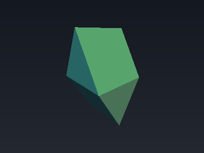
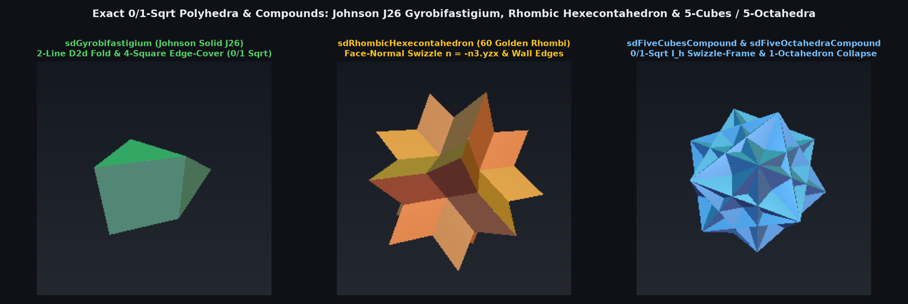

# `sdGyrobifastigium` — Exact 0/1-Sqrt Johnson Solid $`J_{26}`$ (Space-Filling Gyrobifastigium)

<p align="center">
  
</p>

<p align="center">
  
</p>

- **Category**: `polyhedra`
- **GLSL File**: [`glsl/polyhedra/sdGyrobifastigium.glsl`](../../glsl/polyhedra/sdGyrobifastigium.glsl)
- **Attribution**: Discovered and derived using Gemini 4 Argon (`sdf-gems`, 2026)
- **Exactness**: **Exact Euclidean SDF & Analytical 3D Gradient** ($`\|\nabla d\| = 1`$, `2.22e-16` FP64 / `2.98e-8` FP32 error; **0 `sqrt`s** across $`100\%`$ of the interior, **1 `sqrt`** in the exterior)

---

## Overview & Motivation

The **Gyrobifastigium** (Johnson solid $`J_{26}`$, from Latin *fastigium* meaning "gable roof") is constructed by joining two regular triangular prisms along their square bases with a $`90^\circ`$ twist. Having 8 regular faces (4 equilateral triangles and 4 squares), 14 edges, and 8 vertices, it is **unique among all 92 Johnson solids** as the **only Johnson solid capable of tiling 3D Euclidean space by itself**.

No closed-form SDF for the Gyrobifastigium has previously been published. Naive plane clipping uses only `max` of its 8 face half-spaces (which underestimates exterior edge and vertex distances by up to $`42.3\%`$), whereas brute-force evaluation of all 8 faces and 14 edges requires 14 segment projections.

---

## Mathematical Derivation

### 1. 2-Line $`D_{2d}`$ Roto-Reflection Folding

The Gyrobifastigium of half-width $`a`$ (edge length $`2a`$) has full $`D_{2d}`$ symmetry (order 8), generated by mirror reflections $`x \mapsto -x`$, $`y \mapsto -y`$, and the improper roto-reflection $`(x, y, z) \mapsto (y, x, -z)`$. Thus 2 lines of GLSL fold all of $`\mathbb{R}^3`$ isometrically into the fundamental chamber $`x \ge 0, y \ge 0, z \ge 0`$:
```glsl
p.xy = abs(p.xy);
if( p.z < 0.0 ) { p.xy = p.yx; p.z = -p.z; }
```
Inside this chamber, the 8 faces reduce to 4 active face distances with $`s_{60} = \frac{\sqrt{3}}{2}, c_{60} = \frac{1}{2}`$:
```math
d_{S_+} = s_{60}(x - a) + c_{60} z, \qquad d_{S_-} = s_{60}(y - a) - c_{60} z, \qquad d_{T_+} = y - a, \qquad d_{T_-} = x - a.
```
Since $`J_{26}`$ is convex, its exact interior signed distance ($`d_f \le 0`$) is simply $`d_f = \max(\max(d_{S_+}, y - a), \max(d_{S_-}, x - a))`$ with **0 `sqrt`s**.

### 2. The 4-Square Edge-Cover Theorem

Observe that every edge of the 4 equilateral triangular faces is shared with one of the 4 sloped square faces $`S_\pm`$. Consequently, **the 4 sloped square faces contain $`100\%`$ of the 14 edges and 8 vertices of $`J_{26}`$**. In the folded chamber, any exterior point ($`d_f > 0`$) achieves its exact 3D Euclidean distance on one of the two sloped $`2a \times 2a`$ squares $`S_+`$ or $`S_-`$:
```math
\mathbf{v}_+ = \bigl(\max(d_{S_+}, 0),\; \mathrm{clamp}(u_{S_+}, 0, 2a) - u_{S_+},\; \max(y - a, 0)\bigr),
```
```math
\mathbf{v}_- = \bigl(\max(x - a, 0),\; d_{S_-},\; \mathrm{clamp}(u_{S_-}, 0, 2a) - u_{S_-}\bigr),
```
where $`u_{S_+} = -c_{60}(x - a) + s_{60} z`$ and $`u_{S_-} = -c_{60}(y - a) - s_{60} z`$, yielding $`d(\mathbf{p}) = \sqrt{\min(\|\mathbf{v}_+\|^2, \|\mathbf{v}_-\|^2)}`$ in **1 `sqrt`**.

---

## GLSL Implementation

See [`glsl/polyhedra/sdGyrobifastigium.glsl`](../../glsl/polyhedra/sdGyrobifastigium.glsl).
