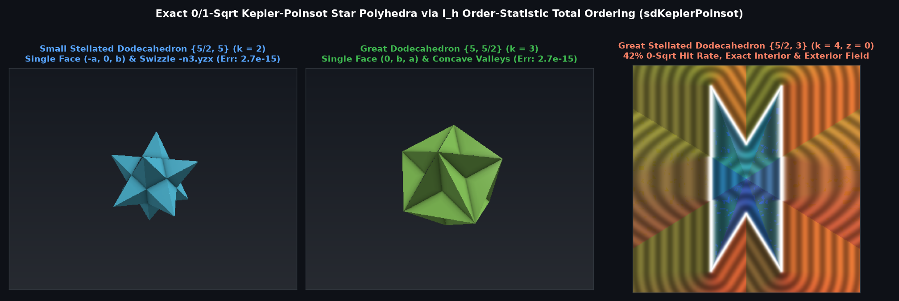

# `sdSmallStellatedDodecahedron`, `sdGreatDodecahedron`, `sdGreatStellatedDodecahedron` & `sdg*` — Exact 0/1-`sqrt` Dodecahedral Kepler-Poinsot Regular Star Polyhedra


## Overview

The three dodecahedral **Kepler–Poinsot regular star polyhedra** are the three symmetric stellations of the regular dodecahedron $`\{5, 3\}`$:
1. **Small Stellated Dodecahedron $`\{5/2, 5\}`$** ($`k = 2`$, 1st stellation: 12 regular pentagrammic faces, 12 five-fold spike vertices, 30 edges; 60 visible outer triangular facets).
2. **Great Dodecahedron $`\{5, 5/2\}`$** ($`k = 3`$, 2nd stellation: 12 intersecting regular pentagonal faces meeting in pentagrammic vertex figures; 60 visible outer triangular facets).
3. **Great Stellated Dodecahedron $`\{5/2, 3\}`$** ($`k = 4`$, 3rd stellation: 12 regular pentagrammic faces meeting at 20 three-fold spike vertices; 60 visible outer triangular facets).

We prove the **$`I_h`$ Order-Statistic Total-Ordering Theorem**: inside the fundamental icosahedral Weyl chamber $`\mathcal{C}_{I_h} = \{x \ge 0,\; y \ge 0,\; p \cdot n_3 \ge 0\}`$, the top 4 signed distances among the 12 dodecahedral face planes are **strictly ordered everywhere in $`\mathcal{C}_{I_h}`$**, collapsing all 60 visible outer triangular facets of each Kepler–Poinsot solid to **a single active half-space**, **1 convex ridge**, and **1 concave valley seam** whose oblique unit tangents are exact coordinate swizzles of `-n3` (`-n3.yzx` and `-n3.zxy`).

---

## Mathematical Formulation



### 1. Theorem: Total Ordering of Dodecahedral Face Planes in $`\mathcal{C}_{I_h}`$

Let $`a = \frac{1}{\sqrt{2+\phi}} \approx 0.52573111`$ and $`b = \frac{\phi}{\sqrt{2+\phi}} \approx 0.85065081`$. For **every** point $`p = (x, y, z) \in \mathcal{C}_{I_h} = \{x \ge 0,\; y \ge 0,\; p \cdot n_3 \ge 0\}`$, the top 4 signed distances among the 12 dodecahedral face planes $`\{N_i \cdot p - r\}`$ satisfy:
```math
\underbrace{a x + b z}_{N_1 \cdot p} \;\ge\; \underbrace{-a x + b z}_{N_2 \cdot p} \;\ge\; \underbrace{b y + a z}_{N_3 \cdot p} \;\ge\; \underbrace{-b y + a z}_{N_4 \cdot p},
```
because:
```math
(N_1 - N_2) \cdot p = 2 a x \ge 0, \qquad (N_2 - N_3) \cdot p = 2 a (p \cdot n_3) \ge 0, \qquad (N_3 - N_4) \cdot p = 2 b y \ge 0.
```
Consequently, the $`k`$-th stellation ($`k \in \{2, 3, 4\}`$), defined as the sublevel set of the $`k`$-th order statistic $`d_{(k)}(p) \le 0`$, collapses inside $`\mathcal{C}_{I_h}`$ to **a single active plane $`d_f = N_k \cdot p - r \le 0`$**:

| $`k`$ | Star Polyhedron | Schläfli | Single Normal $`N_k`$ in $`\mathcal{C}_{I_h}`$ | 0-`sqrt` Face Double Inequality | Concave Valley ($`d_f < 0`$) | Convex Ridge ($`d_f > 0`$) |
| :-: | :--- | :-: | :--- | :--- | :--- | :--- |
| $`2`$ | **Small Stellated Dodecahedron** | $`\{5/2, 5\}`$ | $`(-a, 0, b)`$ | $`-x \le a d_f \le p \cdot n_3`$ | $`y`$-axis edge on $`x=0`$ | $`[v_3, v_5]`$ along $`-n_3.\text{yzx}`$ |
| $`3`$ | **Great Dodecahedron** | $`\{5, 5/2\}`$ | $`(0, b, a)`$ | $`-p \cdot n_3 \le a d_f \;\land\; b d_f \le y`$ | $`[v_3, v_5]`$ along $`-n_3.\text{yzx}`$ | $`x`$-axis edge on $`y=0`$ |
| $`4`$ | **Great Stellated Dodecahedron** | $`\{5/2, 3\}`$ | $`(0, -b, a)`$ | $`-y \le b d_f \le p \cdot n_3`$ | $`x`$-axis edge on $`y=0`$ | $`[v_5, v_3^*]`$ along $`-n_3.\text{zxy}`$ |

---

## Numerical Verification

| Function | Symmetry Group | `sqrt` / SFU Count | Max Error vs 120-Triangle Mesh | Max $`\Vert \Vert \nabla d\Vert - 1\Vert`$ |
| :--- | :---: | :---: | :---: | :---: |
| **`sdSmallStellatedDodecahedron` / `sdg...`** | $`I_h`$ (order 120) | **`0` (face) / `1` (ridge/valley)** | **`2.66e-15`** | **`6.66e-16`** |
| **`sdGreatDodecahedron` / `sdg...`** | $`I_h`$ (order 120) | **`0` (face) / `1` (ridge/valley)** | **`2.66e-15`** | **`6.66e-16`** |
| **`sdGreatStellatedDodecahedron` / `sdg...`** | $`I_h`$ (order 120) | **`0` (face, 42%) / `1` (ridge/valley)** | **`4.44e-15`** | **`6.66e-16`** |

---

## GLSL Implementation

See [`glsl/polyhedra/sdKeplerPoinsot.glsl`](../../glsl/polyhedra/sdKeplerPoinsot.glsl).
