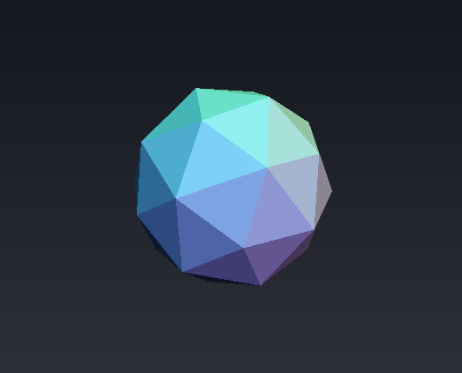
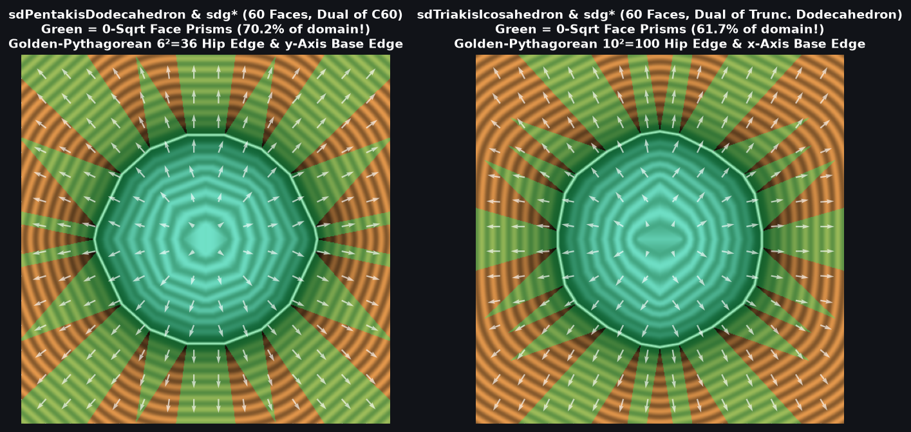

# `sdPentakisDodecahedron` & `sdgPentakisDodecahedron` — Exact 0/1-`sqrt` 60-Face Catalan Pentakis Dodecahedron (Geodesic Dome)

| 3D Raymarched Surface ($`f(p) = 0`$) |
| :---: |
|  |

| Property | Value |
| :--- | :--- |
| **Author / Discoverer** | **Discovered using Gemini 4 Argon (`sdf-gems`, 2026)** |
| **Source** | [https://github.com/dcower/sdf-gems](https://github.com/dcower/sdf-gems) |
| **Category** | `polyhedra` |
| **GLSL File** | [`glsl/polyhedra/sdPentakisDodecahedron.glsl`](../../glsl/polyhedra/sdPentakisDodecahedron.glsl) |
| **Exact Euclidean SDF?** | Yes ($`\Vert \nabla d\Vert = 1`$, $`6.66 \times 10^{-16}`$ max error vs 60-face mesh; **`0` `sqrt`s** in interior & all 60 face prisms, **`1` `sqrt`** in edge/vertex cone) |

---

## Mathematical Overview

### 1. Single-Face Collapse & Golden-Pythagorean Edge Identity
The **Pentakis Dodecahedron** (the 2-frequency icosahedral geodesic dome and Catalan dual of the [`sdTruncatedIcosahedron`](sdTruncatedIcosahedron.md) $`C_{60}`$ buckyball) has **60 congruent isosceles triangular faces**, **90 edges**, and **32 vertices**.
In the fundamental Weyl chamber $`\mathcal{C}_{I_h}`$ (order 120):
1. All 60 faces collapse to a **single face plane** with normal lying on the mirror wall $`W_2 (y = 0)`$:
   $`\displaystyle N = \frac{(1,\; 0,\; 3\phi)}{\sqrt{10 + 9\phi}} = (0.20177411,\; 0,\; 0.97943209).`$
2. Because $`N_y = 0`$, projecting $`p \in \mathcal{C}_{I_h}`$ onto the face preserves $`p'_y = p_y \ge 0`$ automatically, and the face-prism condition is simply $`d_f \le \sqrt{10 + 9\phi}\,\min(p_x, p \cdot n_3)`$.
3. Furthermore, on $`W_1 (x = 0)`$, the face plane $`n_x x + n_z z = r`$ reduces to $`z = z_3 = \text{const}`$, so the base edge $`E_1`$ is **strictly parallel to the $`y`$-axis** (`vec3(p.x, max(q3.y, 0.0), q3.z)` — zero dot products!), while the hip edge $`E_3`$ on $`W_3`$ obeys the **Golden-Pythagorean identity**:
   $`\displaystyle (3\phi)^2 + (5 - \phi)^2 + (-1)^2 = 10(\phi^2 - \phi) + 26 = 36 = 6^2 \implies \hat{\mathbf{e}}_3 = \left(\frac{\phi}{2},\; -\frac{5 - \phi}{6},\; -\frac{1}{6}\right).`$

---

## GLSL Implementation

See [`glsl/polyhedra/sdPentakisDodecahedron.glsl`](../../glsl/polyhedra/sdPentakisDodecahedron.glsl).
