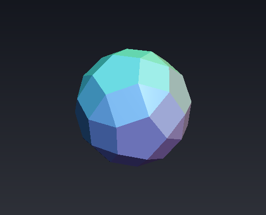
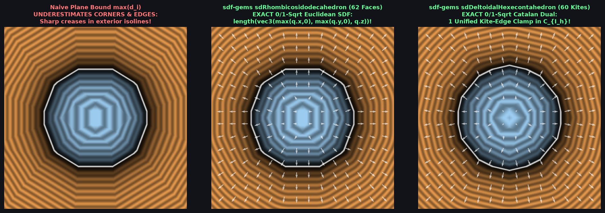

# `sdRhombicosidodecahedron` & `sdgRhombicosidodecahedron` — Exact 0/1-`sqrt` 62-Face Archimedean Rhombicosidodecahedron

| 3D Raymarched Surface ($`f(p) = 0`$) |
| :---: |
|  |

| Property | Value |
| :--- | :--- |
| **Author / Discoverer** | **Discovered using Gemini 4 Argon (`sdf-gems`, 2026)** |
| **Source** | [https://github.com/dcower/sdf-gems](https://github.com/dcower/sdf-gems) |
| **Category** | `polyhedra` |
| **GLSL File** | [`glsl/polyhedra/sdRhombicosidodecahedron.glsl`](../../glsl/polyhedra/sdRhombicosidodecahedron.glsl) |
| **Exact Euclidean SDF?** | Yes ($`\Vert \nabla d\Vert = 1`$, $`6.66 \times 10^{-16}`$ max error vs 62-face mesh; **`0` `sqrt`s** in interior & all 62 face prisms, **`1` `sqrt`** in edge/vertex cone) |

---

## Mathematical Overview

### 1. The Vertex-Centered Golden Wedge & Axis-Aligned Box-Corner Theorem
The **Rhombicosidodecahedron** has **62 faces** (30 squares, 12 regular pentagons, 20 equilateral triangles), **120 edges**, and **60 vertices**.
After folding $`p \in \mathbb{R}^3`$ into the fundamental Weyl chamber $`\mathcal{C}_{I_h} = \{p_x \ge 0,\; p_y \ge 0,\; p \cdot n_3 \ge 0\}`$ of the icosahedral group $`I_h`$ (order 120):
- All 60 vertices collapse to a **single chamber vertex** lying directly on the mirror wall $`W_3: p \cdot n_3 = 0`$:
  $`\displaystyle \mathbf{v}_0 = \left(\phi^{-3},\; \phi^{-3},\; 1\right) r = (0.23606798,\; 0.23606798,\; 1.0) r.`$
- Shifting to vertex-centered coordinates $`\mathbf{q} = p - \mathbf{v}_0`$, all three face planes (square $`n_2 = (0,0,1)`$, pentagon $`n_5 = (\sin\theta_5, 0, \cos\theta_5)`$, and triangle $`n_3^{\text{face}} = (0, \sin\theta_3, \cos\theta_3)`$) pass directly through $`\mathbf{q} = \mathbf{0}`$:
  $`\displaystyle d_2 = q_z, \qquad d_5 = q_{xz} \cdot n_5, \qquad d_3 = q_{yz} \cdot n_3^{\text{face}}.`$
- Even more remarkably: the two chamber edges meeting at $`\mathbf{v}_0`$ are **strictly parallel to the $`-x`$ and $`-y`$ coordinate axes** ($`\mathbf{e}_1 = (-1, 0, 0)`$ for $`q_x \in [-\phi^{-3}r, 0]`$ and $`\mathbf{e}_2 = (0, -1, 0)`$ for $`q_y \in [-\phi^{-3}r, 0]`$), and the face-prism boundary conditions simplify via $`\cot\theta_5 = \phi`$ and $`\cot\theta_3 = \phi^2`$ to the golden-ratio inequalities:
  $`\displaystyle q_z \le \max(\phi q_x,\; \phi^2 q_y) \quad \text{or} \quad \max(q_x, q_y) \le 0.`$
- Outside the face prisms, because the two edges lie on the negative $`x`$ and $`y`$ axes of $`\mathbf{q}`$, the exact Euclidean distance to **all 120 edges and 60 vertices** collapses to the 3D box-corner norm:
  $`\displaystyle d(p) = \left\|\bigl(\max(q_x, 0),\; \max(q_y, 0),\; q_z\bigr)\right\|_2,`$
  with **zero dot products and zero clamps**!

---

## Numerical Verification & Benchmark ($`50{,}000`$ Random 3D Points)

| Implementation | `sqrt` / `rsq` Calls | Max Error vs 62-Face Mesh | Max Error of Plane Bound $`\max_i(p\cdot n_i - r_i)`$ |
| :--- | :---: | :---: | :---: |
| Plane Bound (`max(d2, max(d5, d3))`) | `0` | $`3.82 \times 10^{-1}`$ (underestimates corners) | — |
| **`sdf-gems` `sdRhombicosidodecahedron` / `sdg*`** | **`0` in interior/faces, `1` in edges/vertices** | **$`6.66 \times 10^{-16}`$ (FP64) / $`1.79 \times 10^{-7}`$ (FP32)** | **$`3.82 \times 10^{-1}`$** |

---

## GLSL Implementation

See [`glsl/polyhedra/sdRhombicosidodecahedron.glsl`](../../glsl/polyhedra/sdRhombicosidodecahedron.glsl).
