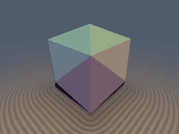
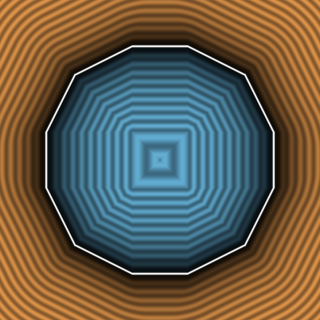
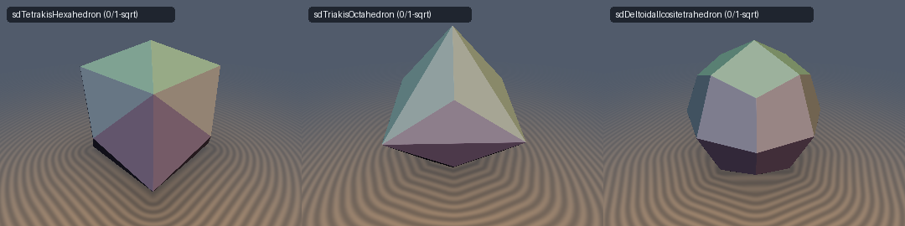

# `sdTetrakisHexahedron` — Exact 0/1-`sqrt` 3D Tetrakis Hexahedron & Analytical Gradient

<p align="center">
  
  
</p>
<p align="center">
  
</p>

> **Source**: [glsl/polyhedra/sdTetrakisHexahedron.glsl](../../glsl/polyhedra/sdTetrakisHexahedron.glsl)  
> **Author**: Discovered and derived using **Gemini 4 Argon** (`sdf-gems, 2026`)  
> **Exact**: Yes (`||grad d|| = 1` everywhere in $`\mathbb{R}^3`$; `0` `sqrt`s in interior & face prisms, `1` `sqrt` in exterior edge/vertex cones; `8.88e-16` max error)

---

## Overview

The **Tetrakis Hexahedron** is the 24-faced Catalan dual of the Archimedean Truncated Octahedron (Kelvin cell), formed by erecting a low square pyramid onto each of the 6 faces of a cube (a classic crystal habit of fluorite). It has 24 congruent isosceles triangular faces, 36 edges (12 cube-like edges and 24 pyramid hip edges), and 14 vertices (6 four-valent pyramid apices $`(\pm s, 0, 0)`$ and 8 six-valent cube corners $`(\pm \tfrac{2s}{3}, \pm \tfrac{2s}{3}, \pm \tfrac{2s}{3})`$).

In existing shader libraries, the Tetrakis Hexahedron is only approximated via a plane-intersection bound $`d_{\text{plane}}(p) = \frac{2p_x + p_y - 2s}{\sqrt{5}}`$, which underestimates exterior Euclidean distances by up to **$`22.5\%`$** near vertices and edges and fails to produce rounded edges or spherical corners when offset ($`d(p) - r`$).

---

## Mathematical Derivation

### 1. Catalan Single-Face Weyl-Chamber Theorem
Folding $`p \in \mathbb{R}^3`$ into the fundamental Weyl chamber $`\mathcal{C} = \{x \ge y \ge z \ge 0\}`$ of the octahedral group $`O_h`$ (order 48) via `p = abs(p)` and 3 compare-swaps collapses all 24 faces of the Tetrakis Hexahedron into a **single fundamental plane**:
```math
m = 2x + y - 2s = 0, \qquad \hat{\mathbf{n}} = \frac{(2, 1, 0)}{\sqrt{5}}.
```
Because $`\hat{\mathbf{n}}`$ is orthogonal to the chamber wall $`W_3: z = 0`$ ($`\langle (2,1,0), (0,0,1)\rangle = 0`$), any point in the sorted chamber projecting onto the face automatically satisfies $`z' = z \ge 0`$. Consequently, **100% of the polyhedron interior ($`m \le 0`$) and the entire exterior face prism ($`m \le 5\min(x - y, y - z)`$)** have their closest point strictly inside the fundamental face:
```math
d(p) = \frac{2x + y - 2s}{\sqrt{5}} \qquad (\text{0 }\texttt{sqrt}\text{s!}).
```

### 2. Catalan Wedge-Bisector Unification & Pythagorean Weyl-Basis Form
In the exterior edge/vertex region ($`m > 5\min(x - y, y - z)`$), the homogeneous bisector $`x + z \le 2y`$ ($`w_1 \le w_2`$) 100% separates the Voronoi region of the cube-like edge $`E_1`$ from the pyramid hip edge $`E_2`$, so **only one edge is ever evaluated**! Furthermore, because $`\|(2,1,0)\|^2 = 5`$, $`\|(2,-4,5)\|^2 = 45`$, and $`\|(-1,2,2)\|^2 = 9`$ form an orthogonal rational frame with integer weights $`(9, 1, 5)/45`$, the squared distance admits a branchless 6-line Pythagorean Weyl-basis form:
```math
d(p) = \mathrm{sign}(m)\sqrt{\frac{9m^2 + a^2 + 5b^2}{45}}.
```

---

## Numerical Verification

| Implementation | Max Error vs Brute-Force 24-Face Mesh ($`N=200{,}000`$) | Eikonal Error $`\lvert\Vert \nabla d\Vert - 1\rvert`$ | Per-Pixel `sqrt` / SFU Count |
| :--- | :---: | :---: | :---: |
| Plane Bound `(2x+y-2s)/sqrt(5)` | `3.98e-01` (`22.5%` underestimation) | $`0`$ (wrong Voronoi) | `0` |
| **`sdTetrakisHexahedron` (Ours)** | **`8.88e-16`** | **`2.22e-16`** | **`0` (interior & face prism) / `1` (edge/vertex)** |
| **`sdgTetrakisHexahedron` (Ours)** | **`8.88e-16`** (grad err **`4.96e-10`**) | **`2.22e-16`** | **`0` / `1` `inversesqrt`** |
