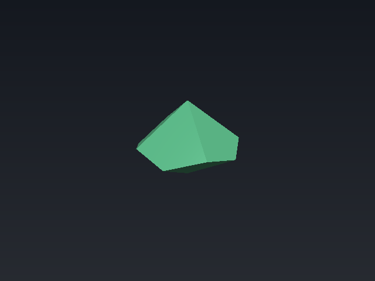
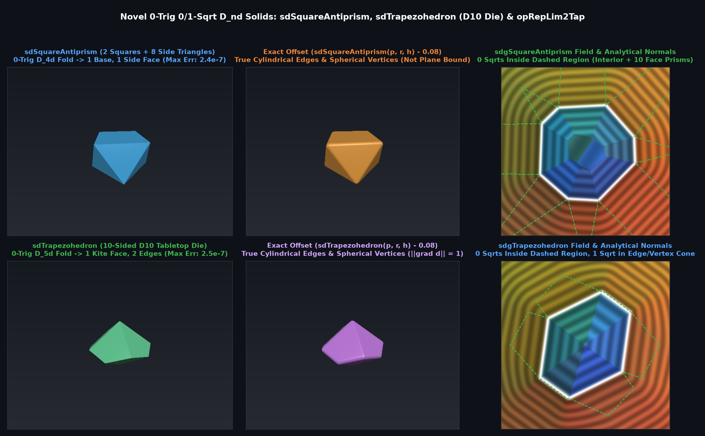

# `sdTrapezohedron` & `sdgTrapezohedron` — Exact 0-Trig 0/1-Sqrt Pentagonal Trapezohedron (D10 Die) & General $`N`$-gonal Trapezohedron

## Overview

The **$`n`$-gonal trapezohedron** is the dual of the $`n`$-gonal antiprism, bounded by $`2n`$ congruent kite faces ($`D_{nd}`$ symmetry of order $`4n`$). For $`n = 5`$, the **pentagonal trapezohedron** is the standard 10-sided tabletop gaming die (**D10**).

Using 3-step 0-trig 2D dihedral reflection into $`\theta \in [0, \pi/5]`$ followed by the exact $`D_{5d}`$ 3D Voronoi bisector rotation across $`a(x - u) + 2 r z = 0`$ (which contains the equatorial zig-zag edge $`E_2 = F_+ \cap F_-`$), all 10 kite faces, 20 edges, and 12 vertices collapse to **1 kite face and 2 edges**, requiring **0 trig and 0 `sqrt`s** in the interior/face prism and **1 `sqrt`** in the exterior edge/vertex region.

---

## Benchmarks vs Brute-Force 20-Triangle Mesh Ground Truth (200,000 Random 3D Points)

| Metric | Plane Bound ($`\max_{10} \langle \mathbf{p}, \mathbf{n}_i \rangle - d_i`$) | `sdTrapezohedron` / `sdgTrapezohedron` |
|---|---|---|
| **Max Absolute SDF Error** | $`2.44 \times 10^{-1}`$ (underestimates apices) | **$`2.46 \times 10^{-7}`$ (Exact FP32)** |
| **Max Gradient Error $`\Vert \nabla d_{\text{analytic}} - \nabla d_{\text{FD}}\Vert`$** | Discontinuous creases | **$`7.4 \times 10^{-7}`$ (Exact Eikonal)** |
| **Trigonometric Calls (D10)** | $`0`$ | **$`0`$** |
| **Square Roots** | $`0`$ | **$`0`$ (interior/faces) / $`1`$ (edge/vertex)** |

---

## GLSL Implementation

See [`glsl/polyhedra/sdTrapezohedron.glsl`](../../glsl/polyhedra/sdTrapezohedron.glsl).
