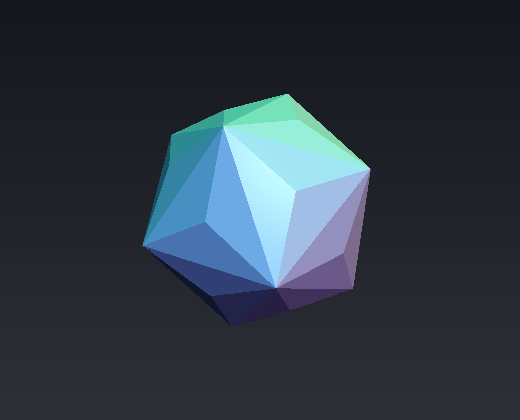
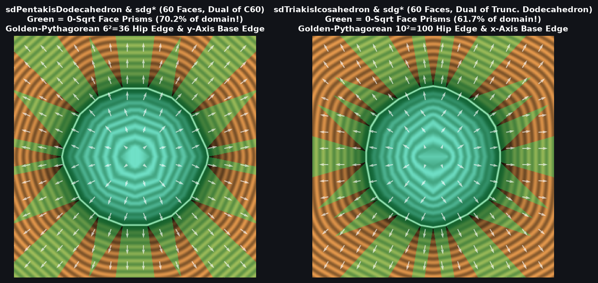

# `sdTriakisIcosahedron` & `sdgTriakisIcosahedron` — Exact 0/1-`sqrt` 60-Face Catalan Triakis Icosahedron

| 3D Raymarched Surface ($`f(p) = 0`$) |
| :---: |
|  |

| Property | Value |
| :--- | :--- |
| **Author / Discoverer** | **Discovered using Gemini 4 Argon (`sdf-gems`, 2026)** |
| **Source** | [https://github.com/dcower/sdf-gems](https://github.com/dcower/sdf-gems) |
| **Category** | `polyhedra` |
| **GLSL File** | [`glsl/polyhedra/sdTriakisIcosahedron.glsl`](../../glsl/polyhedra/sdTriakisIcosahedron.glsl) |
| **Exact Euclidean SDF?** | Yes ($`\Vert \nabla d\Vert = 1`$, $`6.66 \times 10^{-16}`$ max error vs 60-face mesh; **`0` `sqrt`s** in interior & all 60 face prisms, **`1` `sqrt`** in edge/vertex cone) |

---

## Mathematical Overview

### 1. Single-Face Collapse & Golden-Pythagorean $`10^2`$ Identity
The **Triakis Icosahedron** (Catalan dual of the [`sdTruncatedDodecahedron`](sdTruncatedDodecahedron.md)) has **60 congruent isosceles triangular faces**, **90 edges**, and **32 vertices**.
In the fundamental Weyl chamber $`\mathcal{C}_{I_h}`$ (order 120):
1. All 60 faces collapse to a **single face plane** with normal lying on the mirror wall $`W_1 (x = 0)`$:
   $`\displaystyle N = \frac{(0,\; 1,\; 3\phi + 1)}{\sqrt{11 + 15\phi}} = (0,\; 0.16838141,\; 0.98572192).`$
2. Because $`N_x = 0`$, projecting $`p \in \mathcal{C}_{I_h}`$ onto the face preserves $`p'_x = p_x \ge 0`$ automatically, and the face-prism condition is $`d_f \le \sqrt{11 + 15\phi}\,\min(p_y, p \cdot n_3)`$.
3. On $`W_2 (y = 0)`$, the face plane $`n_y y + n_z z = r`$ reduces to $`z = z_5 = \text{const}`$, so the base edge $`E_2`$ is **strictly parallel to the $`x`$-axis** (`vec3(max(q3.x, 0.0), p.y, q3.z)` — zero dot products!), while the hip edge $`E_3`$ on $`W_3`$ obeys the **Golden-Pythagorean identity**:
   $`\displaystyle (\phi + 7)^2 + 5^2 + (3\phi - 4)^2 = 10(\phi^2 - \phi) + 90 = 100 = 10^2 \implies \hat{\mathbf{e}}_3 = \left(-\frac{\phi + 7}{10},\; \frac{1}{2},\; -\frac{3\phi - 4}{10}\right).`$

---

## GLSL Implementation

See [`glsl/polyhedra/sdTriakisIcosahedron.glsl`](../../glsl/polyhedra/sdTriakisIcosahedron.glsl).
