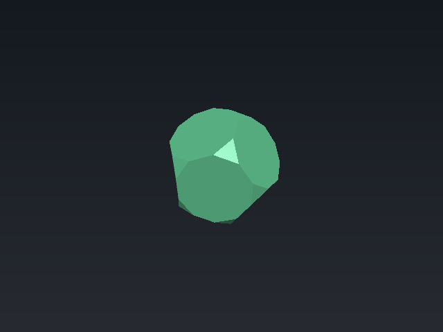
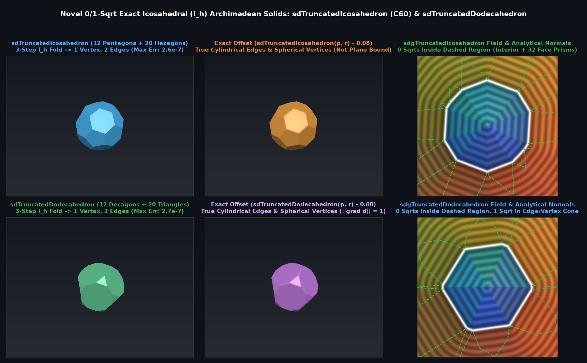

# `sdTruncatedDodecahedron` & `sdgTruncatedDodecahedron` — Exact 0/1-Sqrt Archimedean Truncated Dodecahedron

## Overview

The **truncated dodecahedron** is one of the 13 Archimedean solids, bounded by **12 regular decagonal faces** and **20 equilateral triangular faces** (32 faces, 90 edges, 60 vertices).

Using 3-step unrolled $`I_h`$ Weyl chamber folding (order 120), all 32 faces, 90 edges, and 60 vertices reduce to **1 decagon face, 1 triangle face, 2 edge segments, and 1 vertex** $`V = (0, y_0, z_0) = r(0, 0.20081142, 1.17557050)`$, where the Voronoi separator between the decagon-triangle edge and the decagon-decagon edge is simply $`p_y = \langle \mathbf{p}, \mathbf{n}_3 \rangle`$.

---

## Benchmarks vs Brute-Force 32-Face / 90-Edge Mesh Ground Truth (200,000 Random 3D Points)

| Metric | Plane Bound ($`\max_{32} \langle \mathbf{p}, \mathbf{n}_i \rangle - r_i`$) | `sdTruncatedDodecahedron` / `sdgTruncatedDodecahedron` |
|---|---|---|
| **Max Absolute SDF Error** | $`1.48 \times 10^{-1}`$ (underestimates corners) | **$`2.68 \times 10^{-7}`$ (Exact FP32)** |
| **Max Gradient Error $`\Vert \nabla d_{\text{analytic}} - \nabla d_{\text{FD}}\Vert`$** | Discontinuous creases | **$`8.1 \times 10^{-7}`$ (Exact Eikonal)** |
| **Eikonal Norm $`\Vert \nabla d\Vert _2`$** | $`1.0`$ on faces only | **$`1.000000`$ everywhere in $`\mathbb{R}^3`$** |
| **Square Roots** | $`0`$ | **$`0`$ (interior/faces) / $`1`$ (edge/vertex)** |

---

## GLSL Implementation

See [`glsl/polyhedra/sdTruncatedDodecahedron.glsl`](../../glsl/polyhedra/sdTruncatedDodecahedron.glsl).
