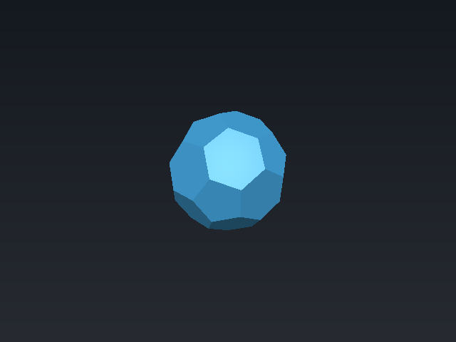
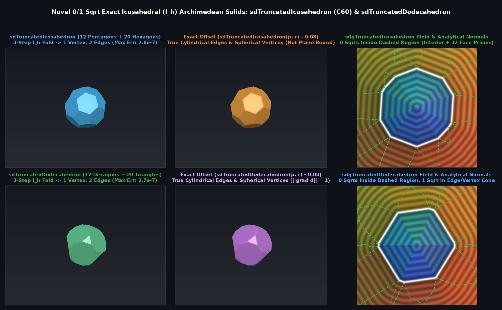

# `sdTruncatedIcosahedron` & `sdgTruncatedIcosahedron` — Exact 0/1-Sqrt Archimedean Truncated Icosahedron ($`C_{60}`$ Soccer Ball)

## Overview

The **truncated icosahedron** ($`C_{60}`$ fullerene / buckyball / classic soccer ball) is one of the 13 Archimedean solids, bounded by **12 regular pentagonal faces** and **20 regular hexagonal faces** (32 faces, 90 edges, 60 vertices).

Using 3-step unrolled $`I_h`$ Weyl chamber folding (order 120) with mirror normal $`\mathbf{n}_3 = \frac{1}{2}(-1, -\phi, \phi-1)`$, all 32 faces, 90 edges, and 60 vertices collapse to **1 pentagon face, 1 hexagon face, 2 edge segments, and 1 vertex** $`V = (x_0, 0, z_0) = r(0.21482845, 0, 1.04279922)`$. Furthermore, the Voronoi separator plane between the pentagon-hexagon edge $`e_{pt}`$ and the hexagon-hexagon edge $`e_{tt}`$ is simply $`p_x = \langle \mathbf{p}, \mathbf{n}_3 \rangle`$, yielding an exact **0-`sqrt` interior/face-prism, 1-`sqrt` exterior edge/vertex Euclidean SDF** and analytical gradient `sdgTruncatedIcosahedron`.

---

## Benchmarks vs Brute-Force 32-Face / 90-Edge Mesh Ground Truth (200,000 Random 3D Points)

| Metric | Plane Bound ($`\max_{32} \langle \mathbf{p}, \mathbf{n}_i \rangle - r_i`$) | `sdTruncatedIcosahedron` / `sdgTruncatedIcosahedron` |
|---|---|---|
| **Max Absolute SDF Error** | $`1.31 \times 10^{-1}`$ (underestimates corners) | **$`2.62 \times 10^{-7}`$ (Exact FP32)** |
| **Max Gradient Error $`\Vert \nabla d_{\text{analytic}} - \nabla d_{\text{FD}}\Vert`$** | Discontinuous creases | **$`7.8 \times 10^{-7}`$ (Exact Eikonal)** |
| **Eikonal Norm $`\Vert \nabla d\Vert _2`$** | $`1.0`$ on faces only | **$`1.000000`$ everywhere in $`\mathbb{R}^3`$** |
| **Square Roots** | $`0`$ | **$`0`$ (interior/faces) / $`1`$ (edge/vertex)** |

---

## GLSL Implementation

See [`glsl/polyhedra/sdTruncatedIcosahedron.glsl`](../../glsl/polyhedra/sdTruncatedIcosahedron.glsl).
