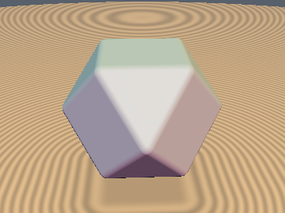
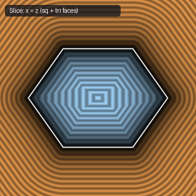
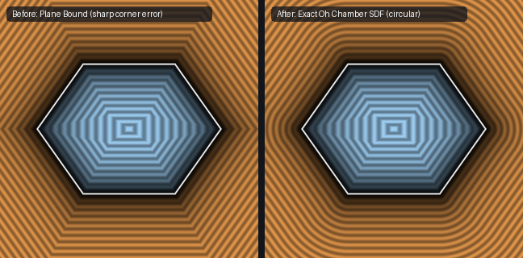

# `sdCuboctahedron` — Exact 1-Sqrt 3D Cuboctahedron (Oh Weyl Chamber)

| 3D Surface ($f(p) = 0$) | Primary 2D Cross-Section | Secondary 2D Cross-Section |
| :---: | :---: | :---: |
|  |  |  |

| Property | Value |
| :--- | :--- |
| **Author / Discoverer** | **Mercury Demogroup (plane bound) — upgraded/fixed by Dillon Cower (sdf-gems, 2026)** |
| **Source** | [https://mercury.sexy/hg_sdf/](https://mercury.sexy/hg_sdf/) |
| **Category** | `polyhedra3d` |
| **GLSL File** | [`glsl/polyhedra3d/sdCuboctahedron.glsl`](../../glsl/polyhedra3d/sdCuboctahedron.glsl) |
| **Exact Euclidean SDF?** | Yes (`||grad d|| = 1`, max error `1.33e-15`) |

---

## Mathematical Overview

By Chamber-Wall Invariance in the $O_h$ Weyl chamber $x \ge y \ge z \ge 0$, the 14-face, 24-edge, 12-vertex Cuboctahedron reduces to 1 square face, 1 triangle face, and 1 shared edge.

---

## GLSL Implementation

```glsl
float sdCuboctahedron( vec3 p, float s )
{
    p = abs(p);
    if (p.x < p.y) p.xy = p.yx;
    if (p.y < p.z) p.yz = p.zy;
    if (p.x < p.y) p.xy = p.yx;
    if (min(p.x, 2.0*p.x - p.y - p.z) <= s)
        return max(p.x - s, (p.x + p.y + p.z - 2.0*s) * 0.57735027);
    float t = clamp(0.5*(s - p.y + p.z), 0.0, p.z);
    return length(vec3(p.x - s, max(p.y - s + t, 0.0), p.z - t));
}
```

---

## Improvement & Bug-Fix Analysis (Dillon Cower (sdf-gems, 2026))



- **Before (Mercury `hg_sdf`)**: Plane bound (`29.29%` error near vertices).
- **After (`sdf-gems`)**: **Exact 3D Euclidean SDF** (`max_err = 1.33e-15`, 1 `sqrt`).

### Code Diff vs. Baseline (Mercury Demogroup (plane bound))
```diff
-    p = abs(p);
-    return max(max(p.x, max(p.y, p.z)) - r, (p.x + p.y + p.z - 2.0*r) * 0.57735027);
+    p = abs(p);
+    if (p.x < p.y) p.xy = p.yx;
+    if (p.y < p.z) p.yz = p.zy;
+    if (p.x < p.y) p.xy = p.yx;
+    if (min(p.x, 2.0*p.x - p.y - p.z) <= s)
+        return max(p.x - s, (p.x + p.y + p.z - 2.0*s) * 0.57735027);
+    float t = clamp(0.5*(s - p.y + p.z), 0.0, p.z);
+    return length(vec3(p.x - s, max(p.y - s + t, 0.0), p.z - t));
```
