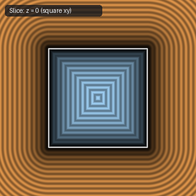

# `sdCuboctahedron` — 3D Cuboctahedron (GDF Plane Bound)

| 3D Surface ($f(p) = 0$) | Primary 2D Cross-Section | Secondary 2D Cross-Section |
| :---: | :---: | :---: |
|  |  |  |

| Property | Value |
| :--- | :--- |
| **Author / Discoverer** | **Mercury Demogroup** |
| **Source** | [https://mercury.sexy/hg_sdf/](https://mercury.sexy/hg_sdf/) |
| **Category** | `polyhedra3d` |
| **GLSL File** | [`glsl/polyhedra3d/sdCuboctahedron.glsl`](../../glsl/polyhedra3d/sdCuboctahedron.glsl) |
| **Exact Euclidean SDF?** | No (Plane Bound) |

---

## Mathematical Overview

Evaluates the maximum of the 6 cube planes and 8 octahedron planes of a cuboctahedron.

---

## GLSL Implementation

```glsl
float sdCuboctahedron( vec3 p, float r )
{
    p = abs(p);
    return max(max(p.x, max(p.y, p.z)) - r, (p.x + p.y + p.z - 2.0*r) * 0.57735027);
}
```
