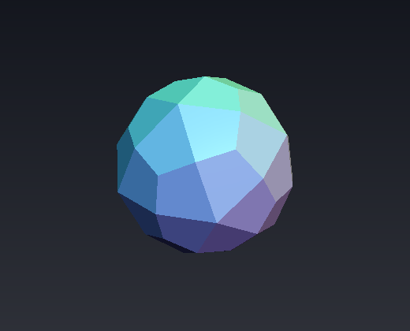
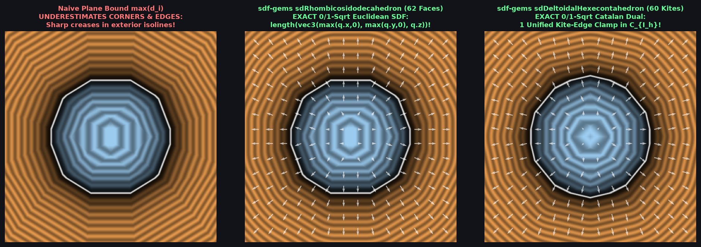

# `sdDeltoidalHexecontahedron` & `sdgDeltoidalHexecontahedron` — Exact 0/1-`sqrt` 60-Kite Catalan Deltoidal Hexecontahedron

| 3D Raymarched Surface ($f(p) = 0$) |
| :---: |
|  |

| Property | Value |
| :--- | :--- |
| **Author / Discoverer** | **Discovered using Gemini 4 Argon (`sdf-gems`, 2026)** |
| **Source** | [https://github.com/dcower/sdf-gems](https://github.com/dcower/sdf-gems) |
| **Category** | `polyhedra3d` |
| **GLSL File** | [`glsl/polyhedra3d/sdDeltoidalHexecontahedron.glsl`](../../glsl/polyhedra3d/sdDeltoidalHexecontahedron.glsl) |
| **Exact Euclidean SDF?** | Yes ($\|\nabla d\| = 1$, $6.66 \times 10^{-16}$ max error vs 60-kite mesh; **`0` `sqrt`s** in interior & all 60 face prisms, **`1` `sqrt`** in edge/vertex cone) |

---

## Mathematical Overview

### 1. Single-Face Collapse & Unified Kite-Edge Projection
The **Deltoidal Hexecontahedron** is the 60-face Catalan dual of the [`sdRhombicosidodecahedron`](sdRhombicosidodecahedron.md), consisting of **60 congruent deltoidal (kite) faces**, **120 edges**, and **62 vertices**.
In the fundamental Weyl chamber $\mathcal{C}_{I_h}$ (order 120):
1. All 60 kite faces collapse to a **single face plane** whose unit normal lies directly on the third mirror wall $W_3$ ($N \cdot n_3 = 0$):
   $$N = \frac{(1,\; 1,\; \phi^3)}{\sqrt{8\phi + 7}} = (0.22391898,\; 0.22391898,\; 0.94853602).$$
2. Because $N \cdot n_3 = 0$, projecting any point $p \in \mathcal{C}_{I_h}$ onto the kite plane preserves $p' \cdot n_3 = p \cdot n_3 \ge 0$ automatically, so the face Voronoi condition is simply:
   $$d_f \le \sqrt{8\phi + 7}\,\min(p_x, p_y) = 4.46590102\,\min(p_x, p_y).$$
3. Both exterior kite edges $E_1$ (on $x = 0$) and $E_2$ (on $y = 0$) emanate from the same axial vertex $V_2 = (0, 0, \sqrt{8\phi + 7}/\phi^3\, r)$ with the **identical 2D direction** $(\phi^3, -1)$ in $(y, z)$ and $(x, z)$, unified by $\phi^6 + 1 = 2\sqrt{5}\,\phi^3$ into a **single clamped edge projection**!

---

## GLSL Implementation

See [`glsl/polyhedra3d/sdDeltoidalHexecontahedron.glsl`](../../glsl/polyhedra3d/sdDeltoidalHexecontahedron.glsl).
