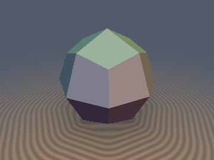
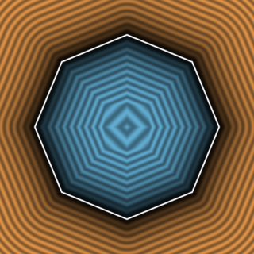
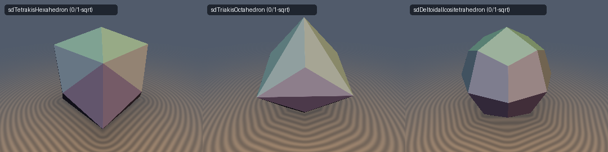

# `sdDeltoidalIcositetrahedron` — Exact 0/1-`sqrt` 3D Deltoidal Icositetrahedron & Analytical Gradient

<p align="center">
  
  
</p>
<p align="center">
  
</p>

> **Source**: [glsl/polyhedra3d/sdDeltoidalIcositetrahedron.glsl](../../glsl/polyhedra3d/sdDeltoidalIcositetrahedron.glsl)  
> **Author**: Discovered and derived using **Gemini 4 Argon** (`sdf-gems, 2026`)  
> **Exact**: Yes (`||grad d|| = 1` everywhere in $`\mathbb{R}^3`$; `0` `sqrt`s in interior & face prisms, `1` `sqrt` in exterior edge/vertex cones; `8.88e-16` max error)

---

## Overview

The **Deltoidal Icositetrahedron** (trapezikositetrahedron) is the 24-faced Catalan dual of the Archimedean Rhombicuboctahedron and a classic crystal habit of garnet and leucite. It has 24 congruent kite (deltoid) faces, 48 edges, and 26 vertices (6 axial vertices at $`(\pm s, 0, 0)`$, 12 face-diagonal vertices at $`(\pm \tfrac{s}{\sqrt{2}}, \pm \tfrac{s}{\sqrt{2}}, 0)`$, and 8 body-diagonal vertices at $`(\pm a, \pm a, \pm a)`$ with $`a = \tfrac{2\sqrt{2}-1}{3}s`$).

---

## Mathematical Derivation

### 1. Catalan Single-Face Weyl-Chamber Theorem
In the sorted octahedral Weyl chamber $`x \ge y \ge z \ge 0`$, all 24 kite faces fold into the single plane:
```math
m = x + (\sqrt{2} - 1)(y + z) - s = 0, \qquad \hat{\mathbf{n}} = \frac{(1, k, k)}{\sqrt{1 + 2k^2}}, \quad k = \sqrt{2} - 1.
```
Because $`\hat{\mathbf{n}}`$ is orthogonal to the chamber wall $`W_2: y = z`$ ($`\langle (1, k, k), (0, 1, -1)\rangle = 0`$), the fundamental triangle inside the chamber is half of one kite face bounded by $`V_1 = (s, 0, 0)`$, $`V_2 = (\tfrac{s}{\sqrt{2}}, \tfrac{s}{\sqrt{2}}, 0)`$, and $`V_3 = (a, a, a)`$, and 100% of the interior ($`m \le 0`$) and face prism ($`\max(w_1, w_2) \le 0`$) require **0 `sqrt`s**.

### 2. Catalan Wedge-Bisector Unification
The two active exterior boundary edges in the chamber are:
- **Upper Kite Edge $`E_1`$** (on chamber wall $`x = y`$) from $`V_2`$ to $`V_3`$, with $`w_1 = -k x + y - (1 - k)z`$,
- **Lower Kite Edge $`E_3`$** (on chamber wall $`z = 0`$) from $`V_1`$ to $`V_2`$, with $`w_2 = k(x + k y - s) - (1 + 2k^2)z`$.

The comparison $`w_1 > w_2`$ is the exact Voronoi plane at $`V_2`$, selecting the single closest kite edge prior to clamping.

---

## Numerical Verification

| Implementation | Max Error vs Brute-Force 24-Face Mesh ($`N=200{,}000`$) | Eikonal Error $`\lvert\Vert \nabla d\Vert - 1\rvert`$ | Per-Pixel `sqrt` / SFU Count |
| :--- | :---: | :---: | :---: |
| Plane Bound `(x+k(y+z)-s)/sqrt(1+2k^2)` | `2.41e-01` (`13.6%` underestimation) | $`0`$ (wrong Voronoi) | `0` |
| **`sdDeltoidalIcositetrahedron` (Ours)** | **`8.88e-16`** | **`1.11e-16`** | **`0` (interior & face prism) / `1` (edge/vertex)** |
| **`sdgDeltoidalIcositetrahedron` (Ours)** | **`8.88e-16`** (grad err **`4.44e-16`**) | **`1.11e-16`** | **`0` / `1` `inversesqrt`** |
