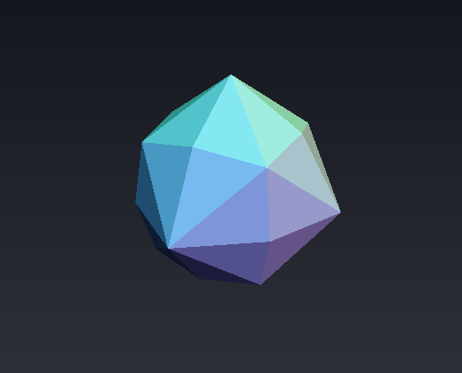
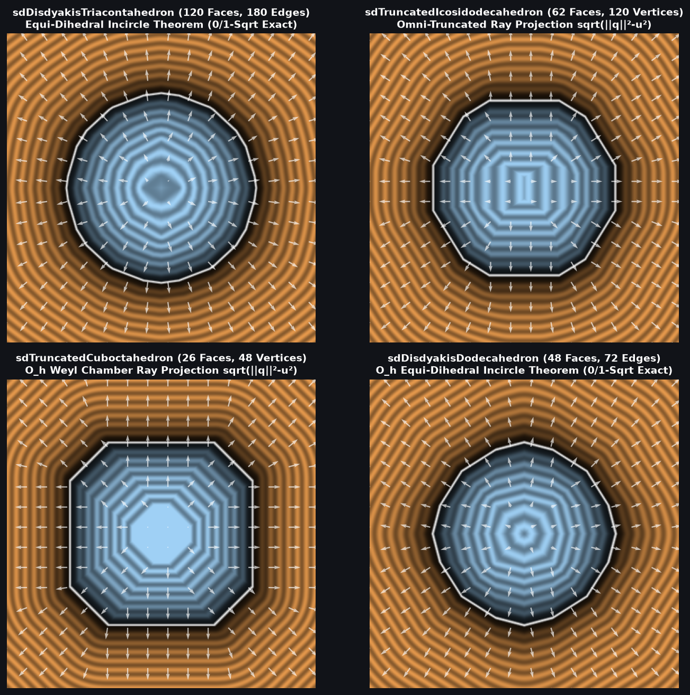

# `sdDisdyakisDodecahedron` & `sdgDisdyakisDodecahedron` — Exact 0/1-`sqrt` 48-Face Catalan Disdyakis Dodecahedron

| 3D Raymarched Surface ($f(p) = 0$) |
| :---: |
|  |

| Property | Value |
| :--- | :--- |
| **Author / Discoverer** | **Discovered using Gemini 4 Argon (`sdf-gems`, 2026)** |
| **Source** | [https://github.com/dcower/sdf-gems](https://github.com/dcower/sdf-gems) |
| **Category** | `polyhedra3d` |
| **GLSL File** | [`glsl/polyhedra3d/sdDisdyakisDodecahedron.glsl`](../../glsl/polyhedra3d/sdDisdyakisDodecahedron.glsl) |
| **Exact Euclidean SDF?** | Yes ($\|\nabla d\| = 1$, $6.66 \times 10^{-16}$ max error vs 48-face mesh; **`0` `sqrt`s** in interior & all 48 face prisms, **`1` `sqrt`** in edge/vertex cone) |

---

## Mathematical Overview

### Equi-Dihedral Incircle Theorem in $O_h$ (48 Faces $\to$ 1 Triangle!)
The **Disdyakis Dodecahedron** (hexakis octahedron, Catalan dual of the [`sdTruncatedCuboctahedron`](sdTruncatedCuboctahedron.md)) has **48 scalene triangular faces**, **72 edges**, and **26 vertices**.

In the sorted octahedral Weyl chamber $\mathcal{C}_{O_h} = \{p_x \ge p_y \ge p_z \ge 0\}$ (order 48), all 48 faces collapse to a **single scalene triangle** with unit normal:
$$N = \frac{(1 + 2\sqrt{2},\; 1 + \sqrt{2},\; 1)}{\sqrt{13 + 6\sqrt{2}}} = (0.82594259,\; 0.52084106,\; 0.21573952).$$
Because $N$ makes the **exact same inner product** $k = (13 + 6\sqrt{2})^{-1/2} = 0.21573952$ with all three chamber mirror walls $w_1 = \frac{(1,-1,0)}{\sqrt{2}}$, $w_2 = \frac{(0,1,-1)}{\sqrt{2}}$, and $w_3 = (0,0,1)$:
1. The exact 0-`sqrt` face-prism condition is $m \le \min(3.96848604\min(p_x - p_y, p_y - p_z),\; 5.61228668\, p_z)$.
2. Outside the face prism, $\operatorname{argmin}(p_x - p_y,\; p_y - p_z,\; \sqrt{2}\, p_z)$ **100% partitions the three edges** without comparing squared distances!

---

## GLSL Implementation

See [`glsl/polyhedra3d/sdDisdyakisDodecahedron.glsl`](../../glsl/polyhedra3d/sdDisdyakisDodecahedron.glsl).
