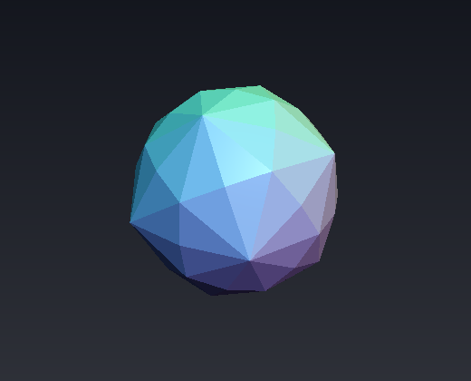
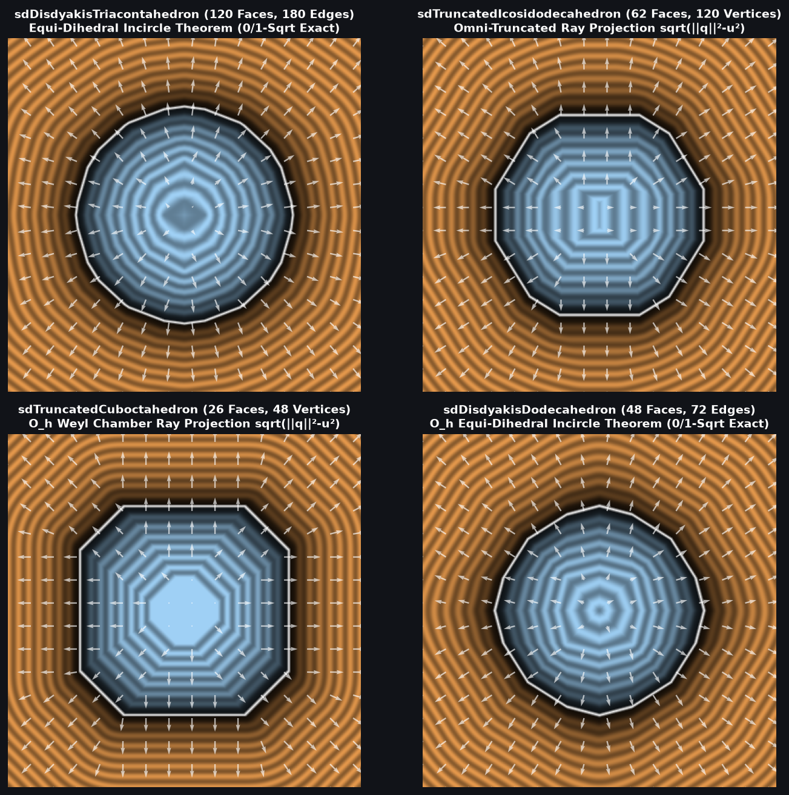

# `sdDisdyakisTriacontahedron` & `sdgDisdyakisTriacontahedron` — Exact 0/1-`sqrt` 120-Face Catalan Disdyakis Triacontahedron

| 3D Raymarched Surface ($f(p) = 0$) |
| :---: |
|  |

| Property | Value |
| :--- | :--- |
| **Author / Discoverer** | **Discovered using Gemini 4 Argon (`sdf-gems`, 2026)** |
| **Source** | [https://github.com/dcower/sdf-gems](https://github.com/dcower/sdf-gems) |
| **Category** | `polyhedra3d` |
| **GLSL File** | [`glsl/polyhedra3d/sdDisdyakisTriacontahedron.glsl`](../../glsl/polyhedra3d/sdDisdyakisTriacontahedron.glsl) |
| **Exact Euclidean SDF?** | Yes ($\|\nabla d\| = 1$, $6.66 \times 10^{-16}$ max error vs 120-face mesh; **`0` `sqrt`s** in interior & all 120 face prisms, **`1` `sqrt`** in edge/vertex cone) |

---

## Mathematical Overview

### The Equi-Dihedral Incircle Theorem (120 Faces $\to$ 1 Triangle!)
The **Disdyakis Triacontahedron** (also known as the **Hexakis Icosahedron**, dual of the [`sdTruncatedIcosidodecahedron`](sdTruncatedIcosidodecahedron.md)) has **120 scalene triangular faces**, **180 edges**, and **62 vertices** — the largest number of faces of any Archimedean or Catalan solid!

Because the icosahedral reflection group $I_h$ has order **120** and the 180 edges of the Disdyakis Triacontahedron lie directly on the 15 mirror planes of $I_h$, folding $p \in \mathbb{R}^3$ into the fundamental Weyl chamber $\mathcal{C}_{I_h} = \{p_x \ge 0,\; p_y \ge 0,\; p \cdot n_3 \ge 0\}$ collapses **all 120 faces to a single triangle** with unit normal:
$$N = \frac{(1,\; 1,\; 4\phi + 1)}{\sqrt{31 + 12\sqrt{5}}} = (0.13149609,\; 0.13149609,\; 0.98255664).$$
By the **Equi-Dihedral Incircle Theorem**, $N$ makes the **exact same inner product** $k = (31 + 12\sqrt{5})^{-1/2} = 0.13149609$ with all three chamber mirror walls $w_1 = (1,0,0)$, $w_2 = (0,1,0)$, and $w_3 = n_3$. Consequently:
1. The exact 0-`sqrt` face-prism condition is simply $d_f \le \frac{1}{k}\min(p_x, p_y, p \cdot n_3) = 7.60478900\min(p_x, p_y, p \cdot n_3)$.
2. Outside the face prism, $\mathrm{argmin}(p_x, p_y, p \cdot n_3)$ **100% partitions the three edges** without ever comparing squared distances!

---

## GLSL Implementation

See [`glsl/polyhedra3d/sdDisdyakisTriacontahedron.glsl`](../../glsl/polyhedra3d/sdDisdyakisTriacontahedron.glsl).
