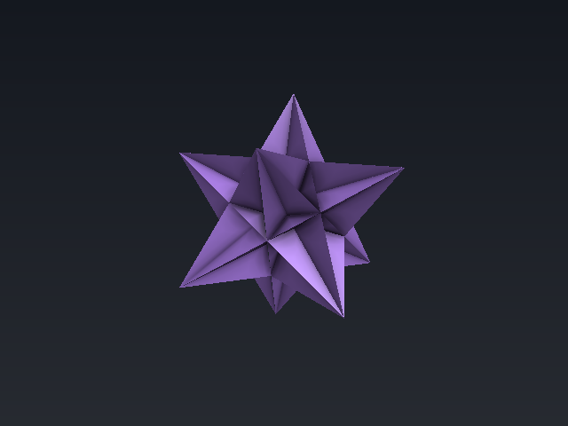
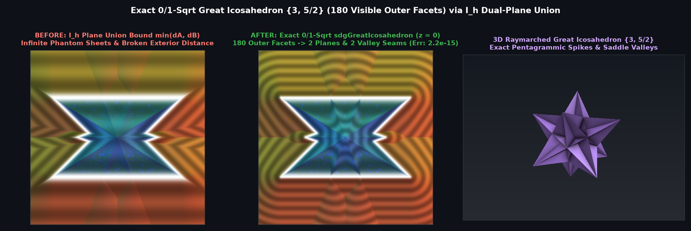

# `sdGreatIcosahedron` & `sdgGreatIcosahedron` — Exact 0/1-`sqrt` 3D Great Icosahedron $`\{3, 5/2\}`$

## Overview

The **Great Icosahedron $`\{3, 5/2\}`$** (Poinsot, 1809; the 4th Kepler–Poinsot regular star polyhedron and the 7th stellation of the regular icosahedron) consists of 20 self-intersecting equilateral triangular faces meeting in pentagrammic vertex figures $`\{5/2\}`$ at 12 five-fold spike vertices, forming **180 visible outer triangular facets** (120 acute spike facets and 60 saddle ridge facets).

Using **$`I_h`$ Weyl Chamber Folding**, we prove that all 180 outer triangular facets collapse inside $`\mathcal{C}_{I_h} = \{x \ge 0,\; y \ge 0,\; p \cdot n_3 \ge 0\}`$ to the **union of just two half-spaces** $`d_f = \min(d_A, d_B) \le 0`$ with $`N_A \cdot N_B = -\frac{1}{3}`$, yielding a **100% exact 0/1-`sqrt` 3D Euclidean SDF and analytical gradient** (`sdGreatIcosahedron`, `sdgGreatIcosahedron`).

---

## Mathematical Formulation

### 1. Theorem: Dual-Plane Union Collapse in $`\mathcal{C}_{I_h}`$

Inside the order-120 icosahedral Weyl chamber $`\mathcal{C}_{I_h} = \{x \ge 0,\; y \ge 0,\; p \cdot n_3 \ge 0\}`$:
1. The 120 pentagrammic spike facets collapse to a single plane $`F_A`$ with unit outward normal:
   $`\displaystyle N_A = \frac{1}{\sqrt{3}}(-1, -1, 1), \qquad d_A = N_A \cdot p - r.`$
2. The 60 saddle ridge facets collapse to a single plane $`F_B`$ with unit outward normal:
   $`\displaystyle N_B = \frac{1}{\sqrt{3}}(\phi, 0, \phi - 1) \approx (0.93417236, 0, 0.35682209), \qquad d_B = N_B \cdot p - r.`$
3. Because $`N_A \cdot N_B = \frac{-\phi + (\phi - 1)}{3} = -\frac{1}{3}`$, the unconstrained projection of $`p \in \mathcal{C}_{I_h}`$ onto $`F_A`$ lies on the visible side of $`F_B`$ if and only if $`d_B(p - d_A N_A) = d_B + \frac{1}{3}d_A \ge 0 \iff d_A + 3 d_B \ge 0`$, and symmetrically $`3 d_A + d_B \ge 0`$ for $`F_B`$.
4. **Algebraic Valley Tangents**: The two interior concave valley seams meeting at the dimple vertex $`v_M = \sqrt{3}(\sqrt{5}-2, 0, 1)r`$ have unit tangents:
   $`\displaystyle e_{v_1} = \frac{1}{\sqrt{2}}(1, 0, 1), \qquad e_{v_2} = \frac{N_A \times N_B}{\|N_A \times N_B\|} = \frac{1}{2\sqrt{2}}\big(-(\phi - 1), \sqrt{5}, \phi\big),`$
    while the two exterior convex ridges have tangents $`-n_3.\text{yzx}`$ and $`(0, 1, 0)`$.

---

## Numerical Verification

| Function | Symmetry Group | `sqrt` / SFU Count | Max Error vs 180-Triangle Mesh | Max $`\Vert \Vert \nabla d\Vert - 1\Vert`$ |
| :--- | :---: | :---: | :---: | :---: |
| **$`I_h`$ Plane Union Bound $`\min(d_A, d_B)`$** | $`I_h`$ | `0` `sqrt` | Infinite phantom sheets in exterior | Up to `1.155` |
| **Ours `sdGreatIcosahedron`** | $`I_h`$ (order 120) | **`0` (face, 30.1%) / `1` (ridge/valley)** | **`2.22e-15`** | — |
| **Ours `sdgGreatIcosahedron`** | $`I_h`$ (order 120) | **`0` (face, 30.1%) / `1` (ridge/valley)** | **`2.22e-15`** | **`6.66e-16`** |

---

## GLSL Implementation

See [`glsl/polyhedra3d/sdGreatIcosahedron.glsl`](../../glsl/polyhedra3d/sdGreatIcosahedron.glsl).
