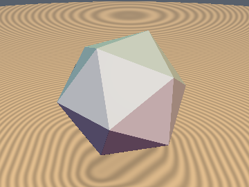
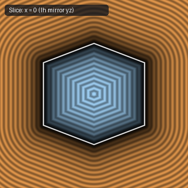
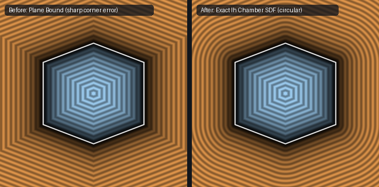

# `sdIcosahedron` — Exact 1-Sqrt 3D Regular Icosahedron (Ih Chamber + Axis-Aligned Edge)

| 3D Surface ($f(p) = 0$) | Primary 2D Cross-Section | Secondary 2D Cross-Section |
| :---: | :---: | :---: |
|  |  |  |

| Property | Value |
| :--- | :--- |
| **Author / Discoverer** | **Mercury Demogroup (plane bound) — upgraded/fixed using Gemini 4 Argon (sdf-gems, 2026)** |
| **Source** | [https://mercury.sexy/hg_sdf/](https://mercury.sexy/hg_sdf/) |
| **Category** | `polyhedra3d` |
| **GLSL File** | [`glsl/polyhedra3d/sdIcosahedron.glsl`](../../glsl/polyhedra3d/sdIcosahedron.glsl) |
| **Exact Euclidean SDF?** | Yes (`||grad d|| = 1`, max error `1.78e-15`) |

---

## Mathematical Overview

In the $I_h$ chamber, the active triangle edge is parallel to the $x$-axis at $(y, z) = (0, 1.070466 r)$, giving a 1-line axis-aligned edge projection.

---

## GLSL Implementation

```glsl
float sdIcosahedron( vec3 p, float r )
{
    const vec3 n3 = vec3(-0.5, -0.80901699, 0.30901699);
    for (int i = 0; i < 3; i++) {
        p = abs(p);
        p -= 2.0 * min(dot(p, n3), 0.0) * n3;
    }
    p.xy = abs(p.xy);
    const vec2 n = vec2(0.35682209, 0.93417236);
    float d = dot(p.yz, n) - r;
    return (p.y >= d * n.x) ? d : length(vec3(max(p.x - 0.66158454 * r, 0.0), p.y, p.z - 1.07046627 * r));
}
```

---

## Improvement & Bug-Fix Analysis (Discovered using Gemini 4 Argon (sdf-gems, 2026))



- **Before (Mercury `hg_sdf`)**: Plane bound (`17.08%` error near vertices).
- **After (`sdf-gems`)**: **Exact 3D Euclidean SDF** (`max_err = 1.78e-15`, 1 `sqrt`).

### Code Diff vs. Baseline (Mercury Demogroup (plane bound))
```diff
-    p = abs(p);
-    const vec2 n = vec2(0.35682209, 0.93417236);
-    float d1 = (p.x + p.y + p.z) * 0.57735027;
-    float d2 = max(dot(p.xy, n), max(dot(p.yz, n), dot(p.zx, n)));
-    return max(d1, d2) - r;
+    const vec3 n3 = vec3(-0.5, -0.80901699, 0.30901699);
+    for (int i = 0; i < 3; i++) {
+        p = abs(p);
+        p -= 2.0 * min(dot(p, n3), 0.0) * n3;
+    }
+    p.xy = abs(p.xy);
+    const vec2 n = vec2(0.35682209, 0.93417236);
+    float d = dot(p.yz, n) - r;
+    return (p.y >= d * n.x) ? d : length(vec3(max(p.x - 0.66158454 * r, 0.0), p.y, p.z - 1.07046627 * r));
```
