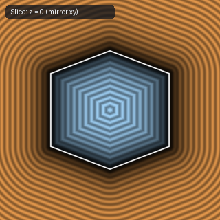

# `sdIcosahedron` — 3D Regular Icosahedron (GDF Plane Bound)

| 3D Surface ($f(p) = 0$) | Primary 2D Cross-Section | Secondary 2D Cross-Section |
| :---: | :---: | :---: |
|  |  |  |

| Property | Value |
| :--- | :--- |
| **Author / Discoverer** | **Mercury Demogroup** |
| **Source** | [https://mercury.sexy/hg_sdf/](https://mercury.sexy/hg_sdf/) |
| **Category** | `polyhedra3d` |
| **GLSL File** | [`glsl/polyhedra3d/sdIcosahedron.glsl`](../../glsl/polyhedra3d/sdIcosahedron.glsl) |
| **Exact Euclidean SDF?** | No (Plane Bound) |

---

## Mathematical Overview

Evaluates the maximum of the 20 triangular face planes of a regular icosahedron.

---

## GLSL Implementation

```glsl
float sdIcosahedron( vec3 p, float r )
{
    p = abs(p);
    const vec2 n = vec2(0.35682209, 0.93417236);
    float d1 = (p.x + p.y + p.z) * 0.57735027;
    float d2 = max(dot(p.xy, n), max(dot(p.yz, n), dot(p.zx, n)));
    return max(d1, d2) - r;
}
```
