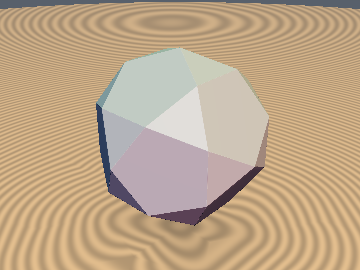
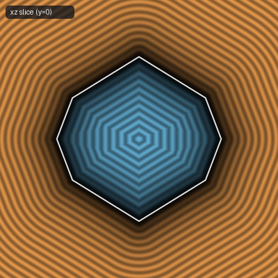
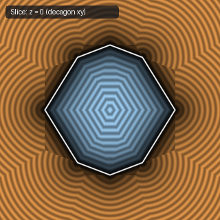

# `sdIcosidodecahedron` — Exact 1-Sqrt 3D Archimedean Icosidodecahedron

| 3D Surface ($f(p) = 0$) | Primary 2D Cross-Section | Secondary 2D Cross-Section |
| :---: | :---: | :---: |
|  |  |  |

| Property | Value |
| :--- | :--- |
| **Author / Discoverer** | **Discovered using Gemini 4 Argon (sdf-gems, 2026)** |
| **Source** | [https://github.com/dcower/sdf-gems](https://github.com/dcower/sdf-gems) |
| **Category** | `polyhedra3d` |
| **GLSL File** | [`glsl/polyhedra3d/sdIcosidodecahedron.glsl`](../../glsl/polyhedra3d/sdIcosidodecahedron.glsl) |
| **Exact Euclidean SDF?** | Yes (`||grad d|| = 1`, max error `2.22e-15`) |

---

## Mathematical Overview

Computes the exact Euclidean SDF of the 32-face, 60-edge, 30-vertex Archimedean Icosidodecahedron in 1 `sqrt` via $I_h$ chamber folding.

---

## GLSL Implementation

```glsl
float sdIcosidodecahedron( vec3 p, float r )
{
    const vec3 n3 = vec3(-0.5, -0.80901699, 0.30901699);
    for (int i = 0; i < 3; i++) {
        p = abs(p);
        p -= 2.0 * min(dot(p, n3), 0.0) * n3;
    }
    p.xy = abs(p.xy);
    const vec2 np = vec2(0.52573111, 0.85065081);
    const vec2 nt = vec2(0.35682209, 0.93417236);
    float dp = dot(p.xz, np) - r;
    float dt = dot(p.yz, nt) - 1.09818549 * r;
    const vec3 v0 = vec3(0.0, 0.0, 1.17557050);
    const vec3 e  = vec3(0.36327126, 0.58778525, -0.22451399);
    float t = clamp(dot(p - v0 * r, e) / dot(e, e), 0.0, 1.0);
    vec3  q = p - (v0 + t * e) * r;
    return (max(p.x - dp*np.x, p.y - dt*nt.x) >= 0.0 && (dp <= 0.0 || dt <= 0.0))
           ? max(dp, dt)
           : sign(max(dp, dt)) * length(q);
}
```
