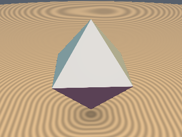
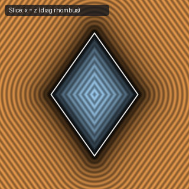
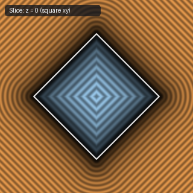

# `sdOctahedron` — Exact 3D Regular Octahedron (4-Line Branchless Pythagorean Weyl-Basis Form)

| 3D Surface ($f(p) = 0$) | Primary 2D Cross-Section | Secondary 2D Cross-Section |
| :---: | :---: | :---: |
|  |  |  |

| Property | Value |
| :--- | :--- |
| **Author / Discoverer** | **Inigo Quilez — upgraded/fixed by Dillon Cower (sdf-gems, 2026)** |
| **Source** | [https://iquilezles.org/articles/distfunctions/](https://iquilezles.org/articles/distfunctions/) |
| **Category** | `polyhedra3d` |
| **GLSL File** | [`glsl/polyhedra3d/sdOctahedron.glsl`](../../glsl/polyhedra3d/sdOctahedron.glsl) |
| **Exact Euclidean SDF?** | Yes (`||grad d|| = 1`, 0 branches) |

---

## Mathematical Overview

In the orthonormal Weyl flag basis $\{\frac{(1,1,1)}{\sqrt{3}}, \frac{(1,1,-2)}{\sqrt{6}}, \frac{(1,-1,0)}{\sqrt{2}}\}$, the Pythagorean identity $1^2 + (\sqrt{2})^2 = (\sqrt{3})^2$ decouples the face, edge, and vertex distances into orthogonal 1D clamping terms with integer weights $(2, 1, 3)$.

---

## GLSL Implementation

```glsl
float sdOctahedron( vec3 p, float s )
{
    p = abs(p);
    float m = p.x + p.y + p.z - s, z = min(p.x, min(p.y, p.z));
    float a = max(m - 3.0*z, 0.0);
    float b = max(2.0*max(p.x, max(p.y, p.z)) + z - m - 2.0*s, 0.0);
    return sign(m) * sqrt((2.0*m*m + a*a + 3.0*b*b) / 6.0);
}
```

---

## Improvement & Bug-Fix Analysis (Dillon Cower (sdf-gems, 2026))

- **Before (IQ `sdOctahedron`)**: 4 `if/else` branches, exterior-only early return.
- **After (`sdf-gems` `sdOctahedron`)**: **0 branches, 4 lines**, exact interior & exterior (`max_err = 8.88e-16`).

### Code Diff vs. Baseline (Inigo Quilez)
```diff
-    float m = p.x + p.y + p.z - s;
-    vec3 q;
-         if( 3.0*p.x < m ) q = p.xyz;
-    else if( 3.0*p.y < m ) q = p.yzx;
-    else if( 3.0*p.z < m ) q = p.zxy;
-    else return m*0.57735027;
-
-    float k = clamp(0.5*(q.z - q.y + s), 0.0, s);
-    return length(vec3(q.x, q.y - s + k, q.z - k));
+    float m = p.x + p.y + p.z - s, z = min(p.x, min(p.y, p.z));
+    float a = max(m - 3.0*z, 0.0);
+    float b = max(2.0*max(p.x, max(p.y, p.z)) + z - m - 2.0*s, 0.0);
+    return sign(m) * sqrt((2.0*m*m + a*a + 3.0*b*b) / 6.0);
```
