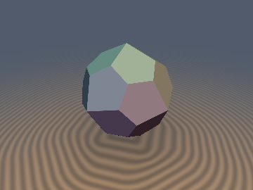
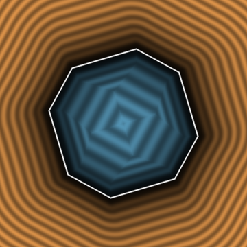
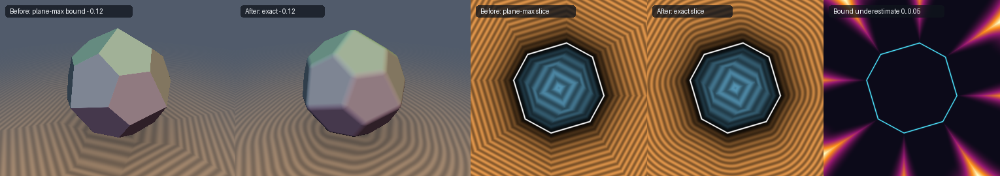

# `sdPentagonalIcositetrahedron` & `sdgPentagonalIcositetrahedron` — Exact 0/1-`sqrt` Chiral Catalan Pentagonal Icositetrahedron

  
  

  

- **Category**: `polyhedra3d`
- **GLSL File**: [`glsl/polyhedra3d/sdPentagonalIcositetrahedron.glsl`](../../glsl/polyhedra3d/sdPentagonalIcositetrahedron.glsl)
- **Attribution**: Discovered and derived using Claude Opus 5.5 (`sdf-gems`, 2026)
- **Exactness**: **Exact Euclidean SDF & analytical gradient** ($\|\nabla d\| = 1$; `4.4e-7` max error on the GPU in FP32 vs a 24-face convex-hull ground truth; **`0` `sqrt`s** in the interior and all 24 face prisms, **`1` `sqrt`** in the edge/vertex cones)

---

## Overview & Motivation

The **pentagonal icositetrahedron** (24 congruent irregular pentagons, 60 edges in two lengths, 6 four-valent and 32 three-valent vertices) is the Catalan dual of the [snub cube](sdSnubCube.md). It is **chiral** (rotation group $O$ only), so the usual $O_h$ `abs` + sort fold cannot be used directly. It was the only octahedral Catalan solid missing from `polyhedra3d/`.

## Mathematical Derivation

The solid is the polar dual of the snub cube: $P^* = \{x : \hat{v}\cdot x \le r\ \forall v\}$ over the 24 snub-cube vertices $v$. Its face planes are therefore the 24 directions $\hat v$, and its vertices are the snub face normals scaled by $R_s / k_F \cdot r$: $1.17599990\,r$ for squares, $1.10743557\,r$ for triangles.

1. **Chiral Parity Fold** (same as [`sdSnubCube`](sdSnubCube.md)): fold with `abs` + 3 swaps while tracking the reflection parity, and undo odd parity with `p.yz = p.zy`. This lands $p$ in the double chamber $D$, a fundamental domain of $O$, and is $C^0$ across the parity seams by construction.
2. **Farthest plane = nearest snub vertex**: all 24 planes share the offset $r$, so the farthest plane is $\arg\max_v \langle p, v\rangle$. In $D$ that is one of $\mathbf v_0, \mathbf v_{16}, \mathbf v_8$, chosen with 2 dot products and mapped to $\mathbf v_0$ by a rotation swizzle. The interior distance is $h = \langle p, \hat{\mathbf v}_0\rangle - r$ (0 `sqrt`).
3. **Argmax-Face Lemma**: for every exterior point, the closest surface point lies on the pentagon whose plane is farthest. A brute-force check over 400k points (uniform in $[-2.5r, 2.5r]^3$ plus clustered near vertices) gave max deviation `6.7e-16` with 0 violations. So the exterior distance is the exact distance to **one fixed planar pentagon**: $d = \sqrt{h^2 + \delta^2}$, where $\delta$ is the in-plane distance from the projected point to the pentagon ($\delta = 0$ in the face prism, giving 0 `sqrt`).
4. **In-plane mirror fold**: each pentagon has its own mirror axis (through the 4-valent apex). This is a symmetry of the face, not of the solid, so it does not break chirality. Folding `c.y = abs(c.y)` leaves only **3 edges** (long edge, short edge, half of the base short edge). Each is evaluated with a constant $1/L^2$ and a `clamp(…, 0, r)` parameter, with no division.

## GLSL Implementation

See [`glsl/polyhedra3d/sdPentagonalIcositetrahedron.glsl`](../../glsl/polyhedra3d/sdPentagonalIcositetrahedron.glsl). The mirror enantiomer is `sdPentagonalIcositetrahedron(p * vec3(-1.0, 1.0, 1.0), r)`.

## Numerical Verification

All numbers come from the **literal `.glsl`** evaluated on the GPU (OpenGL 4.1, FP32), compared with FP64 exact convex-polytope distances (point-to-polygon distances to the 24 `ConvexHull` pentagons; verified 24 pentagons, 60 edges with 2 lengths of ratio $1.4196$, 38 vertices).

| Check | Result |
| :--- | :--- |
| NaN/Inf (origin, axes, symmetry planes, vertices, edge midpoints; $r = 1, 10^{-4}, 0$) | `0` |
| Max $\lvert d - d_\text{exact}\rvert$, 140k pts (uniform $[-2,2]^3$ + near-face + near-edge), $r = 1$ | `4.42e-7` (interior `1.40e-7`, exterior `4.42e-7`) |
| Same, $r = 0.53$ | `2.38e-7` |
| $C^0$ across all 6 chamber/parity walls (30k pairs, $\epsilon = 10^{-5}$) | max jump `5.6e-6` |
| Lipschitz (100k random pairs, $10^{-4}$ apart) | max `1.0026` (FP32 noise) |
| Eikonal $\lvert\,\lVert\nabla d\rVert - 1\rvert$ (FD $h = 10^{-3}$) | median `2.9e-5`, 99th pct `1.4e-4` |
| `sdg`: $\lvert dg.x - d\rvert$ / $\lvert\,\lVert g\rVert - 1\rvert$ / min cosine vs FD | `3.6e-7` / `1.2e-7` / `0.99958` |
| $O$-invariance (90° about $z$, 120° about $(1,1,1)$) | `0.0` (bitwise) |
| **Chirality preserved**: $\max\lvert d(Mp) - d(p)\rvert$, $M = \mathrm{diag}(-1,1,1)$ | `0.095` (not mirror-symmetric) |
| Enantiomer vs mirrored ground truth | `4.1e-7` |
| Branch coverage in $[-2r, 2r]^3$ | interior `7.5%`, face prisms `30.1%` (0 `sqrt`), edge/vertex `62.4%` (1 `sqrt`) |
| Single-TU compile with all library headers (forward & reverse) | OK |

### Before / After

| Variant | Interior | Exterior max underestimation ($[-2r, 2r]^3$) | Rounded offset `d - 0.12` |
| :--- | :---: | :---: | :---: |
| Plane-max bound (max over the 24 face planes) | exact | `0.22 r` (up to `13.3%` relative) | sharp, inflated polytope |
| **`sdPentagonalIcositetrahedron` (this)** | exact | **`0`** (`4.4e-7` FP32) | correctly rounded |

## Prior Art & Novelty

Catalan solids are usually raymarched as a max of face planes (exact inside, a bound outside). I found no published exact Euclidean SDF for the chiral pentagonal icositetrahedron. The new parts are the Chiral Parity Fold (shared with `sdSnubCube`), the farthest-plane / nearest-vertex correspondence, and the Argmax-Face Lemma, which together reduce 24 pentagons, 60 edges and 38 vertices to one fixed pentagon with 3 edges after a mirror fold.
