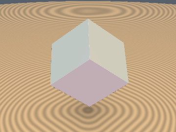
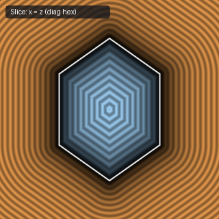
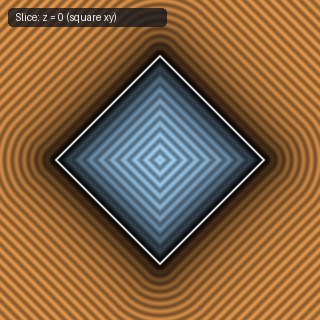
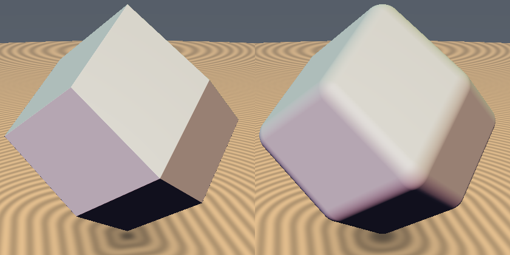

# `sdRhombicDodecahedron` — Exact 4-Line Branchless 3D Rhombic Dodecahedron (FCC Voronoi Cell)

| 3D Surface ($f(p) = 0$) | Primary 2D Cross-Section | Secondary 2D Cross-Section |
| :---: | :---: | :---: |
|  |  |  |

| Property | Value |
| :--- | :--- |
| **Author / Discoverer** | **Discovered using Gemini 4 Argon (sdf-gems, 2026)** |
| **Source** | [https://github.com/dcower/sdf-gems](https://github.com/dcower/sdf-gems) |
| **Category** | `polyhedra3d` |
| **GLSL File** | [`glsl/polyhedra3d/sdRhombicDodecahedron.glsl`](../../glsl/polyhedra3d/sdRhombicDodecahedron.glsl) |
| **Exact Euclidean SDF?** | Yes (`||grad d|| = 1`, max error `8.88e-16`) |

---

## Mathematical Overview

In the orthonormal Weyl flag basis $\{\frac{(1,1,1)}{\sqrt{3}}, \frac{(1,1,-2)}{\sqrt{6}}, \frac{(1,-1,0)}{\sqrt{2}}\}$, the Rhombic Dodecahedron (12 rhombic faces, 24 edges, 14 vertices; Catalan solid and Voronoi cell of the FCC lattice) decouples into orthogonal 1D clamping terms with integer weights $(3, 1, 2)$ — the exact dual permutation of the Regular Octahedron's $(2, 1, 3)$!



---

## GLSL Implementation

```glsl
float sdRhombicDodecahedron( vec3 p, float s )
{
    p = abs(p);
    float x = max(p.x, max(p.y, p.z)), z = min(p.x, min(p.y, p.z));
    float y = p.x + p.y + p.z - x - z, m = x + y - s;
    float a = max(x - y + 2.0*z - s, 0.0);
    float b = max(abs(y + z - x + 0.25*s) - 0.75*s, 0.0);
    return sign(m) * sqrt((3.0*m*m + a*a + 2.0*b*b) / 6.0);
}
```
