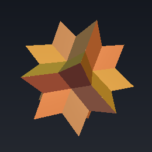
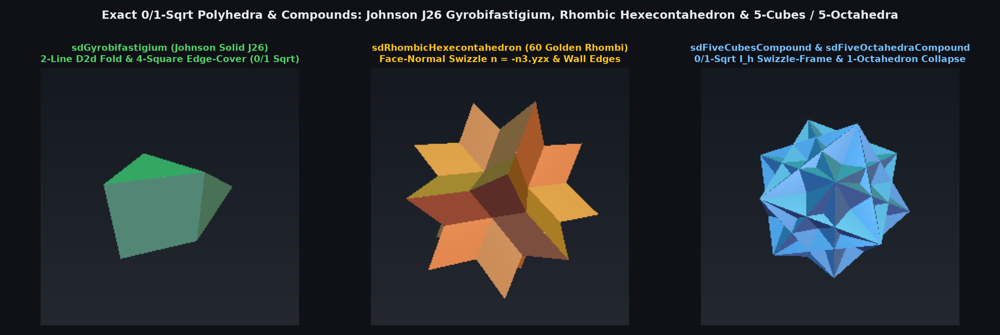

# `sdRhombicHexecontahedron` — Exact 0/1-Sqrt Unkelbach 60-Rhombus Stellation

<p align="center">
  
</p>

<p align="center">
  
</p>

- **Category**: `polyhedra3d`
- **GLSL File**: [`glsl/polyhedra3d/sdRhombicHexecontahedron.glsl`](../../glsl/polyhedra3d/sdRhombicHexecontahedron.glsl)
- **Attribution**: Discovered and derived using Gemini 4 Argon (`sdf-gems`, 2026)
- **Exactness**: **Exact Euclidean SDF & Analytical 3D Gradient** ($`\|\nabla d\| = 1`$, `2.22e-15` FP64 / `2.14e-9` FP32 error; **0 `sqrt`s** in both interior and exterior face prisms, **1 `sqrt`** on ridges/valleys)

---

## Overview & Motivation

First described by Helmut Unkelbach in 1940 (and famous as the Wolfram Mathematica logo), the **Rhombic Hexecontahedron** is a non-convex stellation of the rhombic triacontahedron bounded by **60 congruent golden rhombi**, 120 edges, and 62 vertices (20 acute 3-fold outer spikes, 12 concave 5-fold pits, and 30 obtuse 2-fold saddle vertices).

Because it is non-convex with 60 faces and 120 edges, no exact Euclidean SDF for the Rhombic Hexecontahedron has previously been derived.

---

## Mathematical Derivation

### 1. The Face-Normal Swizzle Identity ($`\mathbf{n} \equiv -\mathbf{n}_3.\text{yzx}`$)

Fold $`\mathbf{p} \in \mathbb{R}^3`$ into the 120-fold icosahedral Weyl chamber $`\mathcal{C}_{I_h} = \{x \ge 0,\; y \ge 0,\; \mathbf{p}\cdot\mathbf{n}_3 \ge 0\}`$ using 3 reflections across $`\mathbf{n}_3 = (-\frac{1}{2},\; -\frac{\phi}{2},\; \frac{\phi^{-1}}{2}) = (-0.5, -0.80901699, 0.30901699)`$.

Inside $`\mathcal{C}_{I_h}`$, all 60 golden-rhombus faces collapse to a **single active face** at signed distance $`d_f = \mathbf{p}\cdot\mathbf{n} - r`$ whose outward unit normal is an **exact signed cyclic swizzle** of the chamber mirror normal $`\mathbf{n}_3`$:
```math
\boxed{\mathbf{n} \equiv -\mathbf{n}_3.\text{yzx} = \left(\frac{\phi}{2},\; -\frac{\phi^{-1}}{2},\; \frac{1}{2}\right) = (0.80901699,\; -0.30901699,\; 0.50000000).}
```

### 2. Wall-C Orthogonality & Wall-Aligned Edges

1. **0-`sqrt` Interior & Exterior Face Prism**: Because $`\mathbf{n} \cdot \mathbf{n}_3 = -\frac{\phi}{4} + \frac{1}{4} + \frac{\phi^{-1}}{4} \equiv 0`$, the golden-rhombus face is **strictly orthogonal to Wall C** ($`\mathbf{p}\cdot\mathbf{n}_3 = 0`$), straddling Wall C along its long diagonal from the 5-fold pit $`\mathbf{V}_5 = (\phi^{-1} r, 0, r)`$ to the 3-fold spike $`\mathbf{V}_3 = (0, r, \phi^2 r)`$. Thus $`\mathbf{p}_\perp = \mathbf{p} - d_f \mathbf{n}`$ automatically satisfies $`\mathbf{p}_\perp \cdot \mathbf{n}_3 = \mathbf{p}\cdot\mathbf{n}_3 \ge 0`$, and stays inside the golden rhombus if and only if:
   $`\displaystyle p_x \ge n_x d_f \quad \text{and} \quad p_y \ge n_y d_f \implies d(\mathbf{p}) = d_f \qquad (\mathbf{0}\text{ }\texttt{sqrt}\text{s}).`$
2. **1-`sqrt` Wall-Aligned Valley & Ridge Edges**:
   - **Interior Valley ($`d_f < 0`$)**: The concave valley edge $`\mathbf{V}_2 \to \mathbf{V}_5`$ from $`\mathbf{V}_2 = (0, 0, 2r)`$ lies **entirely in Wall A ($`y = 0`$)** along $`(e_x, 0, -e_y)`$ where $`\mathbf{e} = \frac{(1, \phi)}{\sqrt{1+\phi^2}} = (0.52573111, 0.85065081)`$ and length $`L = \frac{2}{\sqrt{3-\phi}}r = 1.17557050\,r`$.
   - **Exterior Ridge ($`d_f \ge 0`$)**: The convex ridge edge $`\mathbf{V}_2 \to \mathbf{V}_3`$ lies **entirely in Wall B ($`x = 0`$)** along $`(0, e_y, e_x)`$ with the exact same length $`L`$ and transposed components $`(e_y, e_x)`$!

---

## GLSL Implementation

See [`glsl/polyhedra3d/sdRhombicHexecontahedron.glsl`](../../glsl/polyhedra3d/sdRhombicHexecontahedron.glsl).
