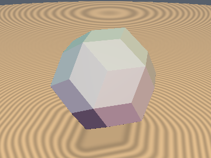
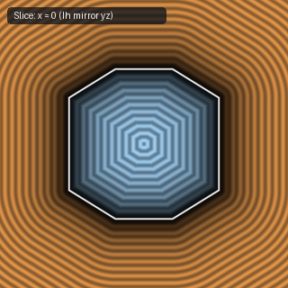
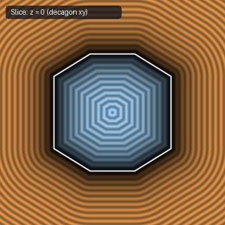

# `sdRhombicTriacontahedron` — Exact 1-Sqrt 3D Catalan Rhombic Triacontahedron

| 3D Surface ($f(p) = 0$) | Primary 2D Cross-Section | Secondary 2D Cross-Section |
| :---: | :---: | :---: |
|  |  |  |

| Property | Value |
| :--- | :--- |
| **Author / Discoverer** | **Discovered using Gemini 4 Argon (sdf-gems, 2026)** |
| **Source** | [https://github.com/dcower/sdf-gems](https://github.com/dcower/sdf-gems) |
| **Category** | `polyhedra3d` |
| **GLSL File** | [`glsl/polyhedra3d/sdRhombicTriacontahedron.glsl`](../../glsl/polyhedra3d/sdRhombicTriacontahedron.glsl) |
| **Exact Euclidean SDF?** | Yes (`||grad d|| = 1`, max error `2.22e-15`) |

---

## Mathematical Overview

Folds $p$ into the icosahedral $I_h$ Weyl chamber (where the rhombic face normal is aligned with the $z$-axis!) and projects onto the single golden-ratio rhombic edge.

---

## GLSL Implementation

```glsl
float sdRhombicTriacontahedron( vec3 p, float r )
{
    const vec3 n3 = vec3(-0.5, -0.80901699, 0.30901699);
    for (int i = 0; i < 3; i++) {
        p = abs(p);
        p -= 2.0 * min(dot(p, n3), 0.0) * n3;
    }
    p.xy = abs(p.xy);
    if (p.x + 1.61803399 * p.y <= 0.61803399 * r) return p.z - r;
    float t = clamp((p.y - 1.61803399 * (p.x - 0.61803399 * r)) * 0.27639320, 0.0, 0.38196601 * r);
    return length(vec3(p.x - 0.61803399 * r + 1.61803399 * t, p.y - t, p.z - r));
}
```
