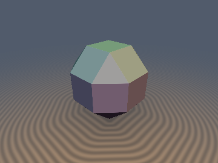
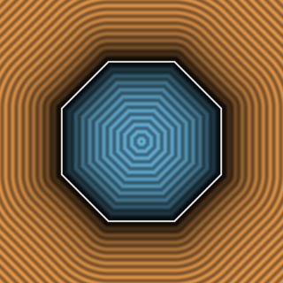
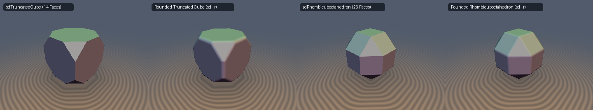

# `sdRhombicuboctahedron` — Exact 0/1-`sqrt` 3D Archimedean Rhombicuboctahedron & Analytical Gradient

  
  

  

> **Source**: [glsl/polyhedra3d/sdRhombicuboctahedron.glsl](../../glsl/polyhedra3d/sdRhombicuboctahedron.glsl)  
> **Author**: Discovered and derived using **Gemini 4 Argon** (`sdf-gems, 2026`)  
> **Exact**: Yes (`||grad d|| = 1` everywhere in $\mathbb{R}^3$; `0` `sqrt`s in interior & triangular face prisms, `1` `sqrt` in 2D octagon chain; `1.33e-15` max error)

---

## Overview

The **Archimedean Small Rhombicuboctahedron** has 26 faces (6 axial squares $|x| \le s$, 12 diagonal squares $|x| + |y| \le \sqrt{2}s$, and 8 corner equilateral triangles $|x| + |y| + |z| \le (2\sqrt{2} - 1)s$), 48 edges, and 24 vertices at permutations of $(\pm s, \pm(\sqrt{2} - 1)s, \pm(\sqrt{2} - 1)s)$.

Standard 13-plane intersection bounds underestimate exterior Euclidean distances by up to **$11.3\%$** near vertices and fail to produce rounded edges or spherical corners when offset ($d(p) - r$).

---

## Mathematical Derivation

### 1. Weyl-Chamber Reduction & Interior / Triangle-Face Early Exit (`0` `sqrt`s)
Folding $p \in \mathbb{R}^3$ into the fundamental Weyl chamber $\mathcal{C}_{O_h} = \{x \ge y \ge z \ge 0\}$ of $O_h$ (order 48) reduces all 26 faces, 48 edges, and 24 vertices to:
- **Axial Square Face $F_1$**: $d_1 = x - s$,
- **Diagonal Square Face $F_2$**: $d_2 = (x + y - \sqrt{2}s)/\sqrt{2}$,
- **Triangular Face $F_3$**: $d_3 = (x + y + z - (2\sqrt{2} - 1)s)/\sqrt{3}$,
- **2 Edges $E_1, E_2$** and **1 Vertex $\mathbf{v}_0 = (s, (\sqrt{2} - 1)s, (\sqrt{2} - 1)s)$**.

Whenever $p$ lies in the polyhedron interior ($d_m := \max(d_1, d_2, d_3) \le 0$) or in the exterior triangular face prism ($d_3 > 0$ and $x + y - 2z \le (2 - \sqrt{2})s$), the exact signed distance is $d_m$ with **zero `sqrt`s**!

### 2. 2D Octagon Chain Unification Theorem
Outside the triangular face Voronoi region, all 5 remaining exterior regions (the axial square $F_1$, diagonal square $F_2$, both edges $E_1, E_2$, and vertex $\mathbf{v}_0$) decouple into $z$-clamping at $(\sqrt{2} - 1)s$ and a 2D clipped octagon chain in $(x, y)$ with a **single clamped parameter**:
$$t = \mathrm{clamp}\!\big(\tfrac{1}{2}(x + y - \sqrt{2}s),\; 0,\; \max(y - (\sqrt{2} - 1)s, 0)\big),$$
giving the exact 3D Euclidean difference vector and analytical gradient in 1 `length` / `inversesqrt`:
$$\mathbf{v} = \big(\max(t, x - s),\; t,\; \max(z - (\sqrt{2} - 1)s, 0)\big), \qquad d(p) = \|\mathbf{v}\|_2, \qquad \nabla d = \frac{\mathbf{v}}{\|\mathbf{v}\|_2}.$$

---

## Numerical Verification

| Implementation | Max Error vs Brute-Force 26-Face Mesh ($N=200{,}000$) | Eikonal Error $\lvert\|\nabla d\| - 1\rvert$ | Per-Pixel `sqrt` / SFU Count |
| :--- | :---: | :---: | :---: |
| Plane Bound `max(d1, d2, d3)` | `1.85e-01` (`11.3%` underestimation) | $0$ (wrong Voronoi) | `0` |
| **`sdRhombicuboctahedron` (Ours)** | **`1.33e-15`** | **`3.33e-16`** | **`0` (interior & triangle prism) / `1` (octagon chain)** |
| **`sdgRhombicuboctahedron` (Ours)** | **`1.33e-15`** (grad err **`7.10e-10`**) | **`3.33e-16`** | **`0` / `1` `inversesqrt`** |
