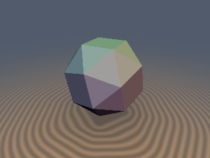
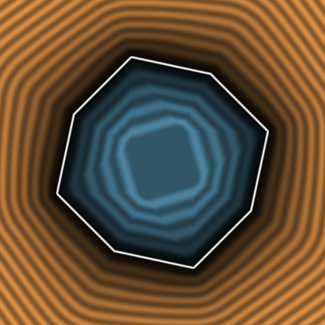
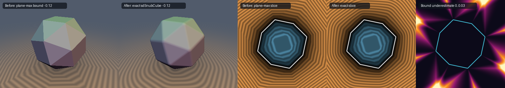

# `sdSnubCube` & `sdgSnubCube` — Exact 0/1-`sqrt` Chiral Archimedean Snub Cube via the Chiral Parity Fold

<p align="center">
  
  
</p>

<p align="center">
  
</p>

- **Category**: `polyhedra3d`
- **GLSL File**: [`glsl/polyhedra3d/sdSnubCube.glsl`](../../glsl/polyhedra3d/sdSnubCube.glsl)
- **Attribution**: Discovered and derived using Claude Opus 5.5 (`sdf-gems`, 2026)
- **Exactness**: **Exact Euclidean SDF & analytical gradient** ($`\|\nabla d\| = 1`$; `2.8e-14` max error in FP64, `2.8e-7` on the GPU in FP32 vs a 38-face convex-hull ground truth; **`0` `sqrt`s** in the interior and all 38 face prisms, **`1` `sqrt`** in the edge/vertex cones)

---

## Overview & Motivation

The **snub cube** (6 squares, 8 + 24 equilateral triangles, 60 edges, 24 vertices) is, together with the snub dodecahedron, one of the two **chiral** Archimedean solids: its symmetry group is the rotation group $`O`$ (order 24) only — it has **no mirror planes**, and exists in two enantiomorphic forms. It was the last octahedral Archimedean solid missing from `polyhedra3d/`.

Every other octahedral solid in this library is built on the same trick: fold $`p`$ into the $`O_h`$ Weyl chamber $`\mathcal{C} = \{x \ge y \ge z \ge 0\}`$ with `abs` and a 3-swap sort, then solve a tiny local problem. That fold applies all 48 symmetries of $`O_h`$, including the 24 reflections, so applying it directly to a chiral solid **makes it mirror-symmetric** (the result is the union/intersection of both enantiomers, not a snub cube).

The usual workaround (Wythoff / plane-intersection style) evaluates only face planes:
```glsl
// Before: plane-max bound (exact inside, underestimates outside by up to ~9.7%)
d = max_i (dot(p, n_i) - k_i);   // over all 38 face planes (or a folded subset)
```
This is exact inside but is only a bound outside: near edges and vertices it underestimates, so offsets (`d - r`) come out sharp instead of rounded and exterior isolines get polygonal corners.

## Mathematical Derivation

Let $`t \approx 1.83928676`$ be the tribonacci constant ($`t^3 = t^2 + t + 1`$). The vertices are the even permutations of $`(\pm 1, \pm 1/t, \pm t)`$ with an even number of plus signs and the odd permutations with an odd number of plus signs, scaled by $`r/t`$, so that the 6 squares have inradius $`r`$. Write $`a = 1/t^2`$, $`b = 1/t`$, and $`\mathbf{v}_0 = (1, a, b)\,r`$.

### 1. The Chiral Parity Fold

Folding with `abs` + sort applies some $`g \in O_h`$ with $`g p = q \in \mathcal{C}`$, and $`\det g = (-1)^{\#\text{sign flips} + \#\text{swaps}}`$. Track that parity:

- **Even** ($`g \in O`$): $`d_S(p) = d_S(q)`$ because $`S`$ is $`O`$-invariant.
- **Odd**: pick a fixed wall reflection $`\sigma`$ (here `p.yz = p.zy`). Then $`\sigma g \in O`$, so $`d_S(p) = d_S(\sigma q)`$.

So the fold lands in the **double chamber** $`D = \mathcal{C} \cup \sigma\mathcal{C}`$, a fundamental domain of the rotation group $`O`$. On the walls of $`\mathcal{C}`$ the point is fixed by a reflection $`g'`$, so both parities give the same value ($`d_S(\sigma q) = d_S(\sigma g' q) = d_S(q)`$). That makes the fold $`C^0`$ across every parity seam by construction.

```glsl
bool odd = (p.x < 0.0) ^^ (p.y < 0.0) ^^ (p.z < 0.0);
p = abs(p);
if( p.x < p.y ) { p.xy = p.yx; odd = !odd; }
if( p.y < p.z ) { p.yz = p.zy; odd = !odd; }
if( p.x < p.y ) { p.xy = p.yx; odd = !odd; }
if( odd ) p.yz = p.zy;
```

The choice of $`\sigma`$ matters. For this enantiomer the odd image $`\sigma_{yz}\mathcal{C}`$ lies **entirely inside the vertex-Voronoi cell of $`\mathbf{v}_0`$**, while each even chamber is shared by the cells of 3 vertices ($`\mathbf{v}_0`$, $`\mathbf{v}_{16} = (b, 1, a)r`$, $`\mathbf{v}_8 = (1, b, -a)r`$).

### 2. Interior: 5 planes of a single vertex star

Brute-force candidate analysis (400k points, radii 0 to 200) shows that for all $`p \in D`$ the maximising face plane is always one of the **5 faces of the star of $`\mathbf{v}_0`$**: the square $`x = r`$, the axial triangle $`n = (1,1,1)/\sqrt3`$, and 3 snub triangles $`n = (c_1, c_3, c_2), (c_3, c_2, c_1), (c_1, -c_2, c_3)`$ with $`(c_1, c_2, c_3) = (0.79846143, 0.17066344, 0.57735027)`$, all at inradius $`K r = 1.06191270\,r`$. In a convex polytope the interior distance is the max of the plane distances, so the interior uses **0 `sqrt`**.

### 3. Exterior: the Nearest-Vertex Tangent-Cone Lemma

*For every exterior point, the closest surface point lies in the star (incident faces, edges, or the vertex itself) of the closest vertex.* (Proof sketch below. Also checked by brute force: the FP64 algorithm built on this lemma matches the exact convex-hull distance to `2.8e-14` over 200k points, with 0 violations.) Two facts give this. All edges have equal length $`L`$, so the apex of every adjacent triangle is $`\frac{\sqrt3}{2}L`$ from an edge, while a point on a face or edge is at most $`L/\sqrt2`$ (square) or $`L/\sqrt3`$ (triangle) from that feature's own vertices. And moving along an outward normal only adds distance $`2h\,|n\cdot(w - x)|`$ to off-feature vertices. Since $`p - x`$ then lies in the normal cone of $`x`$ for both the polytope and the **tangent cone $`K_{v}`$** at that vertex, the projection onto $`K_v`$ coincides with the projection onto the polytope:
```math
d_S(p) = \mathrm{dist}(p, K_{v^*}), \qquad v^* = \arg\max_v \langle p, v\rangle.
```
In $`D`$, $`v^* \in \{\mathbf{v}_0, \mathbf{v}_{16}, \mathbf{v}_8\}`$, found with 2 dot products and mapped to $`\mathbf{v}_0`$ by a proper-rotation swizzle (`p.yzx` or `vec3(p.x, -p.z, p.y)`). The exact distance to the 5-face cone at $`\mathbf{v}_0`$ is then:

- a **face wedge** (2 linear tests plus $`h_i > 0`$): $`d = h_i`$ (0 `sqrt`);
- otherwise the nearest **edge ray** $`e_j`$ or the vertex: $`d = \|q - u\,e_j\|`$ with $`u = \max(0, \max_j q\cdot e_j)`$ (1 `sqrt`). This direct form avoids the FP32 cancellation of $`\sqrt{|q|^2 - u^2}`$.

> [!NOTE]
> The nearest-vertex lemma holds **only in the exterior**. Inside, the nearest face is not always incident to the nearest vertex (up to `0.03` error if you assume it), which is why the interior uses the fixed 5-plane star of $`\mathbf{v}_0`$ in $`D`$ instead.

The mirror-image enantiomer is `sdSnubCube(p * vec3(-1.0, 1.0, 1.0), r)`.

## GLSL Implementation

See [`glsl/polyhedra3d/sdSnubCube.glsl`](../../glsl/polyhedra3d/sdSnubCube.glsl). `sdgSnubCube` returns `vec4(d, grad)`: the gradient is the active face normal or the normalised edge/vertex offset, mapped back through the rotation swizzle, the parity swap, the sort and the signs.

## Numerical Verification

All numbers below come from evaluating the **literal `.glsl`** on the GPU (OpenGL 4.1, FP32, transform feedback), compared with an FP64 exact convex-polytope distance (exact point-to-polygon distances to the 38 `scipy.spatial.ConvexHull` faces; verified 24 vertices, 60 equal edges, 6 squares + 32 triangles).

| Check | Result |
| :--- | :--- |
| NaN/Inf (origin, axes, planes $`x{=}y`$, $`x{=}y{=}z`$, $`x{=}{-}y`$, vertices, edge midpoints; $`r = 1, 10^{-4}, 0`$) | `0` |
| Self-projection $`\lvert d(\mathbf{p} - d\,\nabla d)\rvert`$ (40k points projected exactly onto the surface) | `3.2e-7` (the face tests accept $`h > -10^{-5}r`$ so the FP32 rounding shell on the faces cannot fall through to the edge branch) |
| Max $`\lvert d - d_\text{exact}\rvert`$, 140k pts (uniform $`[-2,2]^3`$ + near-face + near-edge), $`r = 1`$ | `2.83e-7` (interior `2.02e-7`, exterior `2.83e-7`) |
| Same, $`r = 0.53`$ | `1.95e-7` |
| FP64 NumPy mirror of the algorithm, 200k pts out to $`\lvert p\rvert \approx 150`$ | `2.8e-14` |
| $`C^0`$ across all 6 chamber/parity walls (30k pairs, $`\epsilon = 10^{-5}`$) | max jump `5.8e-6` |
| Lipschitz $`\lvert d(a) - d(b)\rvert / \lvert a - b\rvert`$ (100k random pairs) | max `1.0014` |
| Eikonal $`\lvert\,\lVert\nabla d\rVert - 1\rvert`$ (FD $`h = 10^{-3}`$) | median `1.7e-5`, 99th pct `9.7e-5` |
| `sdg`: $`\lvert dg.x - d\rvert`$ / $`\lvert\,\lVert g\rVert - 1\rvert`$ | `2.4e-7` / `1.3e-7` |
| `sdg` cosine vs FD gradient | min `0.990`, only `0.01%` of points < 0.999 (FD stencils straddling seams) |
| $`O`$-invariance (90° about $`z`$, 120° about $`(1,1,1)`$) | `0.0` (bitwise) |
| **Chirality preserved**: $`\max \lvert d(Mp) - d(p)\rvert`$, $`M = \mathrm{diag}(-1,1,1)`$ | `0.101` (not mirror-symmetric) |
| Enantiomer `sdSnubCube(p*vec3(-1,1,1))` vs mirrored-vertex ground truth | `2.6e-7` |
| Branch coverage in $`[-2r, 2r]^3`$ | interior `8.3%`, face prisms `33.9%` (0 `sqrt`), edge/vertex `57.8%` (1 `sqrt`) |
| Single-TU compile with all 200 library headers (forward & reverse) | OK |

### Before / After

| Variant | Interior | Exterior max underestimation ($`[-2r, 2r]^3`$) | Rounded offset `d - 0.12` |
| :--- | :---: | :---: | :---: |
| Plane-max bound (folded 5-plane max, equivalent to all 38 planes) | exact | `0.107 r` (up to `9.6%` relative; tends to `9.7%` far out) | sharp, inflated polytope |
| **`sdSnubCube` (this)** | exact | **`0`** (`2.8e-7` FP32) | correctly rounded edges & vertices |

The comparison image shows (left to right): the plane-max bound offset by `0.12` (sharp), the exact SDF offset by `0.12` (rounded), slices at $`z = 0.54r`$ for both, and the bound's underestimation heatmap, whose spokes are visibly chiral (no mirror symmetry).

## Prior Art & Novelty

Snub polyhedra have been raymarched before, mainly through Wythoff/kaleidoscopic-fold constructions in the fractal and Shadertoy community (e.g. knighty's polyhedra DEs). These give a **plane-intersection distance bound** that is exact only inside. I found no published **exact** Euclidean SDF for the snub cube, and no description of the reflection-parity-tracking fold that reuses the cheap $`O_h`$ `abs` + sort network for a chiral solid. What is new here:
1. The **Chiral Parity Fold**: $`O_h`$ fold + parity bit + one wall swizzle → a fundamental domain of $`O`$, with $`C^0`$ continuity guaranteed by the wall-fixing argument.
2. The **Nearest-Vertex Tangent-Cone Lemma** for the exterior, which reduces the 60-edge / 38-face problem to one fixed 5-face cone after a 3-way swizzle.
3. A 0/1-`sqrt` exact SDF and analytical gradient.
