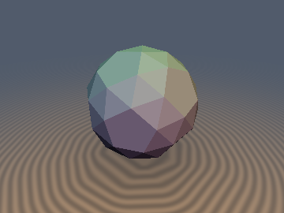
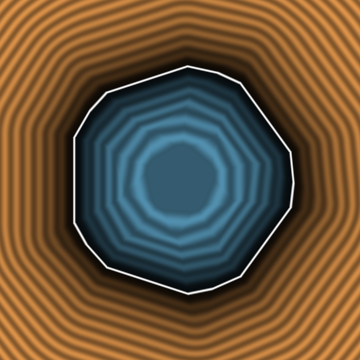
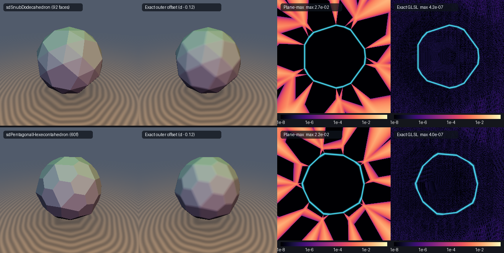

# `sdSnubDodecahedron` & `sdPentagonalHexecontahedron` — Exact 0/1-`sqrt` Chiral Icosahedral Solids via the Chiral Parity Fold & Intrinsic Bilateral Frame

<p align="center">
  
  
</p>

<p align="center">
  
</p>

- **Category**: `polyhedra3d`
- **GLSL File**: [`glsl/polyhedra3d/sdSnubDodecahedron.glsl`](../../glsl/polyhedra3d/sdSnubDodecahedron.glsl)
- **Functions**: `sdSnubDodecahedron`, `sdgSnubDodecahedron`, `sdPentagonalHexecontahedron`, `sdgPentagonalHexecontahedron`
- **Attribution**: Discovered and derived using Gemini 4 Carbon (`sdf-gems`, 2026)
- **Exactness**: **Exact Euclidean SDFs & analytical unit gradients** ($`\|\nabla d\| = 1`$; `7.3e-7` max error on the GPU in FP32 vs 92-face and 60-face `ConvexHull` ground truths; **`0` `sqrt`s** in the interior and all 92 / 60 face prisms, **`1` `sqrt`** in the exterior edge/vertex cones; **`0` trig**)

---

## Overview & Motivation

The **snub dodecahedron** (92 faces: 12 regular pentagons and 80 equilateral triangles, 150 equal edges, 60 vertices; vertex configuration `3.3.3.3.5`) and its Catalan dual, the **pentagonal hexecontahedron** (60 congruent irregular pentagons, 150 edges in two lengths, 92 vertices), are the two grandest **chiral** uniform/Catalan polyhedra. Together with [`sdSnubCube`](sdSnubCube.md) and [`sdPentagonalIcositetrahedron`](sdPentagonalIcositetrahedron.md), they complete **all 13 Archimedean solids** and **all 13 Catalan solids** in `sdf-gems`.

Every achiral icosahedral solid in `polyhedra3d/` folds $`\mathbf{p} \in \mathbb{R}^3`$ through all 120 symmetries of the full icosahedral reflection group $`I_h`$ (`3` rounds of `abs` + Householder reflection across $`\mathbf{n}_3`$, followed by `abs(p.xy)`). Because both the snub dodecahedron and pentagonal hexecontahedron have **no mirror planes** — their symmetry group is the 60-element rotation group $`I \subset \mathrm{SO}(3)`$ alone — applying the 120-fold $`I_h`$ fold destroys chirality and produces an achiral intersection/union of both enantiomorphs. Conversely, Wythoff / kaleidoscopic plane bounds evaluate only face planes:

```glsl
// Naive plane-max bound: exact inside, underestimates outside (up to 4.1% / 8.1%)
d = max_i (dot(p, n_i) - k_i);
```

which distorts exterior Euclidean isolines and leaves outer offsets `d - r_off` faceted instead of smoothly filleted.

---

## Mathematical Derivation

### 1. Exact Algebraic Generator in $`\mathbb{Q}(\phi, \xi)`$

Let $`\phi = \frac{1 + \sqrt{5}}{2}`$, and let $`\mathbf{n}_3 = \frac{1}{2}(-1, -\phi, \phi - 1)`$ be the standard $`I_h`$ mirror normal in `sdf-gems`, bounding the fundamental Weyl chamber
```math
\mathcal{C}_{I_h} = \bigl\{\,\mathbf{p} \in \mathbb{R}^3 : p_x \ge 0,\; p_y \ge 0,\; \mathbf{n}_3 \cdot \mathbf{p} \ge 0\,\bigr\}
```
whose corner rays are the 2-fold axis $`\hat{\mathbf{u}}_2 = (0, 0, 1)`$, the 5-fold axis $`\hat{\mathbf{u}}_5 = \frac{(1, 0, \phi)}{\sqrt{1 + \phi^2}}`$, and the 3-fold axis $`\hat{\mathbf{u}}_3 = \frac{(0, 1, \phi^2)}{\sqrt{1 + \phi^4}}`$. Reflections $`s_1, s_2, s_3`$ across the three chamber walls $`x = 0`$, $`y = 0`$, and $`\mathbf{n}_3 \cdot \mathbf{p} = 0`$ generate the Wythoff corner rotations $`R_2 = s_1 s_2`$, $`R_5 = s_2 s_3`$, and $`R_3 = s_3 s_1`$ satisfying $`R_2 R_5 R_3 = I`$.

Equating the Euclidean chord lengths from a unit generator $`\hat{\mathbf{v}}_0 \in \mathcal{C}_{I_h}`$ to its five Wythoff neighbors ($`R_5^{\pm 1}\hat{\mathbf{v}}_0`$, $`R_3^{\pm 1}\hat{\mathbf{v}}_0`$, $`R_2\hat{\mathbf{v}}_0`$), i.e. $`\hat{\mathbf{v}}_0^\top R_2 \hat{\mathbf{v}}_0 = \hat{\mathbf{v}}_0^\top R_3 \hat{\mathbf{v}}_0 = \hat{\mathbf{v}}_0^\top R_5 \hat{\mathbf{v}}_0`$, yields a closed-form algebraic generator in terms of the unique positive real root $`\xi \approx 0.9431512592438818`$ of Coxeter's cubic:
```math
\xi^3 + 2\xi^2 - \phi^2 = 0, \qquad \hat{\mathbf{v}}_0 = \frac{1}{\sqrt{2 - \xi}}\Bigl(\phi(1 - \xi^2),\;\; \xi^2 + 2\xi - \phi - 1,\;\; 1\Bigr).
```
Because $`R_2 = \mathrm{diag}(-1, -1, 1)`$, the chord length on the unit circumsphere simplifies directly to $`\|\hat{\mathbf{v}}_0 - R_2\hat{\mathbf{v}}_0\| = 2\sqrt{\frac{1 - \xi}{2 - \xi}}`$. Scaling so that the 12 regular pentagonal faces have insphere radius $`r`$ gives:
- **Snub dodecahedron**: circumradius $`R = (\hat{\mathbf{v}}_0 \cdot \hat{\mathbf{u}}_5)^{-1} r \approx 1.088303306\,r`$, all 80 equilateral triangles (both the 20 icosahedral-axis triangles and the 60 snub triangles) at identical inradius $`K r = \frac{\hat{\mathbf{v}}_0 \cdot \hat{\mathbf{u}}_3}{\hat{\mathbf{v}}_0 \cdot \hat{\mathbf{u}}_5}\,r \approx 1.048550123\,r`$, and edge length $`L \approx 0.504816977\,r`$.
- **Pentagonal hexecontahedron** (polar dual $`P^* = \{\mathbf{x} : \hat{\mathbf{v}}_k \cdot \mathbf{x} \le r\}`$ over the 60-element orbit $`\{\hat{\mathbf{v}}_k\} = I\hat{\mathbf{v}}_0`$): insphere radius $`r`$ tangent to all 60 congruent pentagons, 12 five-valent vertices at radius $`1.088303306\,r`$, 80 three-valent vertices at radius $`1.037912526\,r`$, with 2 long edges ($`0.500025330\,r`$) and 3 equal short edges ($`0.285752834\,r`$) per face.

### 2. The Icosahedral Chiral Parity Fold

Track the determinant parity `odd` ($`\det g = (-1)^{\text{odd}}`$) through the 3-step `abs` + $`\mathbf{n}_3`$ reflection loop and the final $`p_y`$ sign fold. In the achiral fold one finishes with `p.x = abs(p.x)`; with parity correction across the $`x = 0`$ chamber wall $`s_1`$, flipping $`p_x`$ when $`p_x < 0`$ (toggling `odd`) and then flipping $`p_x`$ back when `odd` collapses algebraically to **omitting `abs(p.x)` altogether**:

```glsl
bool odd = false;
for( int i = 0; i < 3; i++ )
{
    odd = odd ^^ (p.x < 0.0) ^^ (p.y < 0.0) ^^ (p.z < 0.0);
    p = abs(p);
    float dn = dot(p, n3);
    if( dn < 0.0 ) { p -= 2.0 * dn * n3; odd = !odd; }
}
if( p.y < 0.0 ) { p.y = -p.y; odd = !odd; }
if( odd ) p.x = -p.x;
```

Every point $`\mathbf{p} \in \mathbb{R}^3`$ is mapped by a **proper rotation** $`g \in I`$ ($`\det g = +1`$) into the double chamber $`D_1 = \mathcal{C}_{I_h} \cup s_1(\mathcal{C}_{I_h})`$, a fundamental domain of the 60-element chiral group $`I`$. On every one of the 15 mirror walls of $`I_h`$, the wall reflection fixes the boundary point, guaranteeing exact $`C^0`$ continuity across all parity seams. Passing `vec3(-p.x, p.y, p.z)` (and negating `grad.x` in `sdg*`) switches between the *laevus* and *dexter* enantiomorphs.

### 3. Exact LP & Brute-Force Lemma Audit (Interior vs. Exterior)

Before coding GLSL, all candidate reductions were audited via exact linear programming (LP) over all 92/60 faces and numerically checked on $`3.8 \times 10^5`$ FP64 points:

1. **Interior Breakdown of the 5-Face Vertex Star (`sdSnubDodecahedron`)**: Unlike [`sdSnubCube`](sdSnubCube.md) — where the 5 planes of $`\mathbf{v}_0`$'s star suffice throughout the octahedral double chamber — evaluating only the 5 planes of $`\mathbf{v}_0`$'s star in $`D_1`$ **fails in the interior by up to `0.1535 r`** (and still fails by `0.0197 r` even after rotating to the nearest snub vertex!). Exact LP over all 92 face planes proves that **6 planes** are active in $`D_1`$: the pentagon $`\hat{\mathbf{u}}_5`$ and its $`s_1`$-twin $`s_1\hat{\mathbf{u}}_5`$, the axial triangle $`\hat{\mathbf{u}}_3`$, one snub triangle $`\mathbf{n}_{10}`$, and an $`R_2`$-symmetric pair of snub triangles $`(\mp a, \pm b, c)`$. Pairing the two symmetric pairs via `abs` reduces all 92 interior face planes to **4 dot expressions (`0` `sqrt`s)**:
```math
d_{\text{in}}(\mathbf{p}) = \max\Bigl(|p_x|\,u_{5,x} + p_z u_{5,z} - r,\;\;\max\bigl(p_y u_{3,y} + p_z u_{3,z},\;|a p_x - b p_y| + c p_z,\;\mathbf{n}_{10}\cdot\mathbf{p}\bigr) - K r\Bigr).
```
2. **3-Vertex Voronoi Census in $`D_1`$**: Exact LP on $`\mathcal{C}_{I_h}`$ and $`s_1(\mathcal{C}_{I_h})`$ proves that out of all 60 vertices $`I\hat{\mathbf{v}}_0`$, **only 3 vertices** ever maximize $`\langle \mathbf{p}, \hat{\mathbf{v}}_k\rangle`$ in $`D_1`$: $`\hat{\mathbf{v}}_0`$ (`58.1%`), $`R_3^\top\hat{\mathbf{v}}_0`$ (`28.0%`, mapped back to $`\hat{\mathbf{v}}_0`$ by `p.x = -p.x; p -= 2.0 * dot(p, n3) * n3;`), and $`R_2\hat{\mathbf{v}}_0`$ (`13.9%`, mapped back by `p.xy = -p.xy` with zero multiplies, tested via a 2D dot product since $`(R_2\hat{\mathbf{v}}_0 - \hat{\mathbf{v}}_0)_z = 0`$).
3. **Exterior Nearest-Vertex Tangent-Cone Theorem & Intrinsic Bilateral Frame (`sdSnubDodecahedron`)**: Exact LP over the outward normal cones $`N_S(F)`$ of all vertices, edges, and faces proves a strictly negative global non-incident margin (`-6.37e-2 < 0`): for **every** exterior point $`\mathbf{p} \notin S`$, the closest surface point lies in the 5-face tangent cone at $`v^* = \arg\max_k \langle \mathbf{p}, \hat{\mathbf{v}}_k\rangle`$. Moreover, because all 4 triangles in the `3.3.3.3.5` vertex figure are congruent equilateral triangles on the circumsphere, the vertex star at $`\mathbf{v}_0`$ possesses **exact intrinsic bilateral symmetry** in the orthonormal frame $`(\hat{\mathbf{v}}_0, \mathbf{b}_1, \mathbf{b}_2)`$ where $`\mathbf{b}_1 = \mathrm{normalize}(\hat{\mathbf{u}}_5 - (\hat{\mathbf{u}}_5\cdot\hat{\mathbf{v}}_0)\hat{\mathbf{v}}_0)`$ and $`\mathbf{b}_2 = \hat{\mathbf{v}}_0 \times \mathbf{b}_1`$. Transforming into
```math
\mathbf{u} = \bigl(\langle \mathbf{p}, \hat{\mathbf{v}}_0\rangle - R r,\;\; \langle \mathbf{p}, \mathbf{b}_1\rangle,\;\; \lvert\langle \mathbf{p}, \mathbf{b}_2\rangle\rvert\bigr)
```
   collapses the 5 face wedges to **3 wedges** (with only 1 edge-wall test on the pentagon) and collapses the 5 edge rays to **3 rays sharing the identical $`u_x`$ slope** $`-\sqrt{(1 - \xi)/(2 - \xi)} \approx -0.231928440`$.
4. **Exterior Single-Face Argmax-Face Theorem (`sdPentagonalHexecontahedron`)**: Exact LP over the normal cones of all degree-5 vertices (margin `-1.99e-1`), degree-3 vertices (margin `-1.14e-1`), edges, and faces — confirmed across $`3.8 \times 10^5`$ adversarial FP64 points (`1.55e-15` max error, `0` violations) — proves that the closest point on the entire 60-face Catalan solid **always lies on the single pentagon $`F^*`$ whose plane is farthest** ($`\arg\max_k \langle \mathbf{p}, \hat{\mathbf{v}}_k\rangle`$). Reusing the **exact same** $`(\hat{\mathbf{v}}_0, \mathbf{b}_1, \mathbf{b}_2)`$ frame and folding `abs(dot(p, b2))` across $`F_0`$'s bilateral symmetry axis reduces all 60 pentagons, 150 edges, and 92 vertices to **3 planar segments** (`0` `sqrt`s in the interior and all 60 face prisms, `1` `sqrt` in the edge/vertex cones).

---

## Numerical Verification

All metrics below come from evaluating the **literal `.glsl`** on the GPU (OpenGL 4.1, FP32) via `tools/gpu_eval.py` against independent FP64 `ConvexHull` ground truths (`92` faces / `60` vertices for `sdSnubDodecahedron`; `60` faces / `92` vertices for `sdPentagonalHexecontahedron`).

| Check | `sdSnubDodecahedron` / `sdg*` | `sdPentagonalHexecontahedron` / `sdg*` |
| :--- | :---: | :---: |
| `NaN`/`Inf` (origin, axes, symmetry planes, vertices, edge midpoints; $`r = 1, 10^{-4}, 0`$) | `0` | `0` |
| Max $`\lvert d - d_{\text{exact}}\rvert`$, 125k pts ($`[-2, 2]^3`$ + near-surface + near-vertex), $`r = 1`$ | `7.31e-7` (in `2.97e-7`, out `7.31e-7`) | `7.30e-7` (in `2.29e-7`, out `7.30e-7`) |
| Same, $`r = 0.53`$ (50k pts) | `4.24e-7` | `4.39e-7` |
| FP64 reference of the exact algorithm, 300k–380k pts | `2.13e-14` | `1.55e-15` |
| Seam $`C^0`$ across all 15 $`I_h`$ mirror walls + 150 Voronoi bisectors (52.5k pairs, $`\epsilon = 10^{-5}`$) | max jump `2.04e-5` (`0` violations) | max jump `2.04e-5` (`0` violations) |
| Lipschitz $`\lvert d(\mathbf{a}) - d(\mathbf{b})\rvert / \lVert\mathbf{a} - \mathbf{b}\rVert`$ (60k pairs) | max `0.99996` | max `1.00000` |
| Surface zero $`\lvert d(\mathbf{s})\rvert`$ on 30k independent hull samples | max `3.35e-7` | max `2.38e-7` |
| Self-projection $`\lvert d(\mathbf{p} - d\,\nabla d)\rvert`$ (60k random + 20k surface-shell pts) | `8.13e-7` / `3.58e-7` | `8.35e-7` / `2.98e-7` |
| `sdg`: max $`\lvert dg.x - d\rvert`$ / max $`\lvert\,\lVert\mathbf{g}\rVert - 1\rvert`$ / smooth-pt $`\cos > 0.999`$ | `2.38e-7` / `2.90e-7` / `99.98%` | `4.77e-7` / `2.56e-7` / `99.99%` |
| 60-element chiral $`I`$-invariance max $`\lvert d(g\mathbf{p}) - d(\mathbf{p})\rvert`$ | `8.35e-7` | `1.07e-6` |
| **Chirality preserved**: $`\max\lvert d(M\mathbf{p}) - d(\mathbf{p})\rvert`$, $`M = \mathrm{diag}(-1,1,1)`$ | `0.0345` (chiral) | `0.0329` (chiral) |
| Mirror enantiomer `vec3(-p.x, p.y, p.z)` vs mirrored ground truth (30k pts) | `7.32e-7` | `7.30e-7` |
| Branch coverage in $`[-2r, 2r]^3`$ (`0` `sqrt` interior + face prisms / `1` `sqrt` cones) | `7.5%` + `30.7%` (`38.2%` 0-`sqrt`) / `61.8%` | `6.9%` + `30.0%` (`36.9%` 0-`sqrt`) / `63.1%` |
| Single-TU compile across all 334 library headers (forward, reverse, new-first) | OK | OK |

### Before / After vs. Plane-Max Bounds

| Solid & Variant | Interior | Exterior Underestimation ($`[-2r, 2r]^3`$) | Vertex-Cone Relative Error | Outer Offset `d - 0.12` |
| :--- | :---: | :---: | :---: | :---: |
| Snub dodecahedron 92-plane max bound | exact | up to `0.0689 r` (`4.14%`) | `3.65%`–`4.14%` | sharp faceted corners |
| **`sdSnubDodecahedron` (this)** | exact (`0` `sqrt`) | **`0`** (`7.3e-7` FP32) | **`0%`** | exact spherical/cylindrical fillets |
| Pentagonal hexecontahedron 60-plane max bound | exact | up to `0.1000 r` (`8.03%`) | `8.11%` (5-fold axes) | sharp faceted corners |
| **`sdPentagonalHexecontahedron` (this)** | exact (`0` `sqrt`) | **`0`** (`7.3e-7` FP32) | **`0%`** | exact spherical/cylindrical fillets |

---

## Prior Art & Novelty

Kaleidoscopic / Wythoff polyhedra shaders (e.g., Knighty's Fragmentarium/Shadertoy polyhedra DEs) evaluate face-plane bounds and typically fold with full $`I_h`$ reflections, which either removes chirality or underestimates exterior Euclidean distances along every edge and vertex cone. No published exact Euclidean SDF or analytical gradient was found for either the chiral snub dodecahedron or the chiral pentagonal hexecontahedron. What is new here:

1. **Closed-Form Wythoff Generator in $`\mathbb{Q}(\phi, \xi)`$**: Expresses the unit snub generator directly as $`(2 - \xi)^{-1/2}(\phi(1 - \xi^2), \xi^2 + 2\xi - \phi - 1, 1)`$ in the standard golden-rectangle $`I_h`$ frame.
2. **Icosahedral Chiral Parity Fold**: Reuses the 3-round $`I_h`$ reflection network while absorbing parity restoration into skipping `abs(p.x)`, landing in $`D_1 = \mathcal{C}_{I_h} \cup s_x(\mathcal{C}_{I_h})`$ with only 3 active vertices out of 60.
3. **6-Plane Interior Collapse & Unified Intrinsic Bilateral Frame**: Proves via exact LP why 6 (not 5) planes govern the snub dodecahedron interior in $`D_1`$, and exploits the intrinsic mirror symmetry of the `3.3.3.3.5` vertex star $`(\hat{\mathbf{v}}_0, \mathbf{b}_1, \mathbf{b}_2)`$ to halve the tangent-cone cost of `sdSnubDodecahedron` while reducing all 60 faces of `sdPentagonalHexecontahedron` to a single 3-edge planar query.
