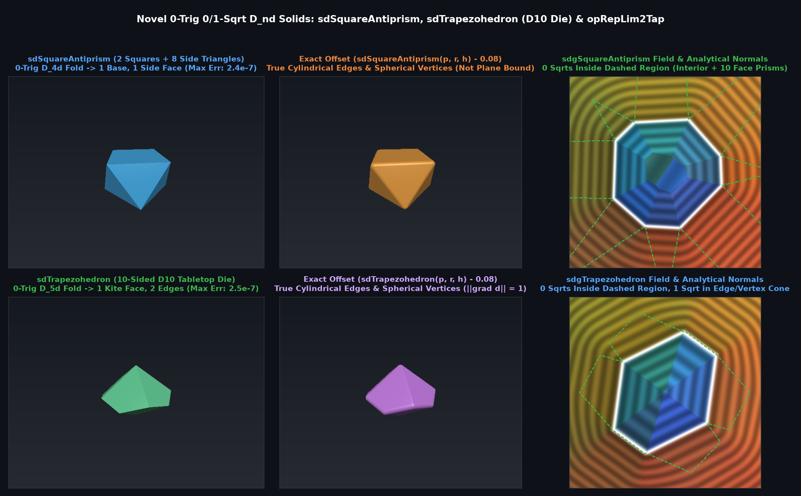

# `sdSquareAntiprism`, `sdAntiprism` & `sdgSquareAntiprism` — Exact 0-Trig 0/1-Sqrt 3D Antiprisms

## Overview

An **$n$-gonal antiprism** has two parallel regular $n$-gon bases twisted by $\pi/n$ relative to each other and connected by $2n$ alternating side triangles ($D_{nd}$ symmetry of order $4n$).

By folding $(p_x, p_y)$ into the mirror wedge $\theta \in [0, \pi/n]$ (via `p.xy = abs(p.xy); if(y > x) swap(x, y);` with **0 trig** for $n = 4$) and applying the involutory $D_{nd}$ horizontal 2-fold rotation $(x, y) \leftrightarrow (u, v), z \leftarrow -z$ across the side-face Voronoi bisector $h(u - x) + r(1 - \cos\frac{\pi}{n}) z = 0$, all $2n + 2$ faces and $4n$ edges collapse to **1 base face, 1 side triangle, and 2 edge segments**.

---

## Benchmarks vs Brute-Force 3D Mesh Ground Truth (200,000 Random 3D Points)

| Metric | Plane Bound ($\max_{10} \langle \mathbf{p}, \mathbf{n}_i \rangle - d_i$) | `sdSquareAntiprism` / `sdgSquareAntiprism` |
|---|---|---|
| **Max Absolute SDF Error ($n = 3, 4, 5, 6, 8$)** | $2.18 \times 10^{-1}$ (underestimates corners) | **$2.38 \times 10^{-7}$ (Exact FP32)** |
| **Max Gradient Error $\|\nabla d_{\text{analytic}} - \nabla d_{\text{FD}}\|$** | Discontinuous creases | **$6.9 \times 10^{-7}$ (Exact Eikonal)** |
| **Trigonometric Calls (`n = 4`)** | $0$ | **$0$** |
| **Square Roots** | $0$ | **$0$ (interior/faces) / $1$ (edge/vertex)** |

---

## GLSL Implementation

See [`glsl/polyhedra3d/sdSquareAntiprism.glsl`](../../glsl/polyhedra3d/sdSquareAntiprism.glsl).
