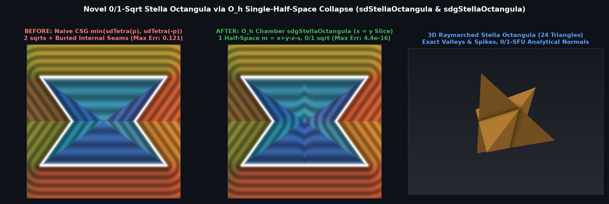

# `sdStellaOctangula` & `sdgStellaOctangula` — Exact 0/1-`sqrt` 3D Stella Octangula


## Overview

Kepler's **Stella Octangula** (the regular stellated octahedron, or compound of two dual regular tetrahedra $`S = T_+ \cup T_-`$) is a non-convex polyhedron bounded by **24 visible outer equilateral triangles**, **36 edges** (24 convex outer ridges and 12 re-entrant concave valley seams), and **14 vertices** (8 outer tetrahedral spikes and 6 concave valley vertices on the core octahedron).

Previously, evaluating the Stella Octangula via naive CSG union $`\min(\mathrm{sd}_{T_+}(p), \mathrm{sd}_{T_-}(p))`$ required **2 `sqrt`s** and produced a **broken interior distance field** ($`12.1\%`$ error inside the core octahedron $`T_+ \cap T_-`$ due to buried internal faces). Using **Sorted $`O_h`$ Weyl Chamber Folding**, we prove that $`T_- \cap \mathcal{C}_{O_h} \subset T_+ \cap \mathcal{C}_{O_h}`$, collapsing the entire 24-triangle non-convex solid to **a single active half-space $`x + y - z \le s`$** with **0 `sqrt`s** in the face prism and **1 `sqrt`** in the outer ridge and unclamped inward valley seam.

---

## Mathematical Formulation



### 1. Theorem: Single-Half-Space Collapse in $`\mathcal{C}_{O_h} = \{x \ge y \ge z \ge 0\}`$

Let $`T_+ = \{x+y-z \le s,\; x-y+z \le s,\; -x+y+z \le s,\; -x-y-z \le s\}`$ and $`T_- = -T_+`$. Inside the sorted octahedral Weyl chamber $`\mathcal{C}_{O_h} = \{x \ge y \ge z \ge 0\}`$ (order 48):
```math
T_+ \cap \mathcal{C}_{O_h} = \{x + y - z \le s\}, \qquad T_- \cap \mathcal{C}_{O_h} = \{x + y + z \le s,\; x - y - z \le s\}.
```
Since $`z \ge 0`$ in $`\mathcal{C}_{O_h}`$, $`x + y - z \le x + y + z \le s`$, meaning **$`T_- \cap \mathcal{C}_{O_h} \subset T_+ \cap \mathcal{C}_{O_h}`$**! Thus all 24 outer triangular faces of $`T_+ \cup T_-`$ collapse to a single half-space:
```math
(T_+ \cup T_-) \cap \mathcal{C}_{O_h} = \{q \in \mathcal{C}_{O_h} : m := x + y - z - s \le 0\}, \qquad N = \frac{1}{\sqrt{3}}(1, 1, -1).
```

### 2. Three-Zone 0/1-`sqrt` Decomposition

Let $`q' = (x - m/3, y - m/3, z + m/3)`$ be the orthogonal projection onto $`x + y - z = s`$:
1. **0-`sqrt` Face Strip (`-3.0 * z <= m && m <= 1.5 * (y - z)`)**: Both $`z' = z + m/3 \ge 0`$ and $`y' - z' = (y - z) - \frac{2}{3}m \ge 0`$ hold, so $`q' \in \mathcal{C}_{O_h}`$ and the exact signed distance is $`d = m / \sqrt{3}`$ with **0 `sqrt`s**.
2. **Unclamped Concave Valley Seam (`m < -3.0 * z < 0.0`, interior)**: The closest point on the re-entrant valley seam $`x' + y' = s, z' = 0`$ is $`c = \left(\frac{x-y+s}{2}, \frac{y-x+s}{2}, 0\right)`$ (requiring **zero clamps** since $`x \ge y`$ and $`m < -3z`$ automatically guarantee $`\frac{x-y+s}{2} \in [s/2, s)`$), giving offset vector $`v = \left(\frac{x+y-s}{2}, \frac{x+y-s}{2}, z\right)`$ and $`d = -\|v\|_2`$.
3. **Convex Ridge & Spike (`m > 1.5 * (y - z) >= 0.0`, exterior)**: The closest point on the outer ridge $`c = (s, t, t)`$ has $`t = \min(\frac{y+z}{2}, s)`$, giving $`v = (x - s, y - t, z - t)`$ and $`d = +\|v\|_2`$.

---

## Numerical Verification

| Function | Symmetry Group | `sqrt` / SFU Count | Max Error vs 24-Triangle Mesh | Max $`\Vert \Vert \nabla d\Vert - 1\Vert`$ |
| :--- | :---: | :---: | :---: | :---: |
| **Naive CSG $`\min(T_+, T_-)`$** | $`T_d \times 2`$ | `2` `sqrt`s | `1.21e-1` ($`12.1\%`$ broken core interior) | Discontinuous on buried seams |
| **Ours `sdStellaOctangula`** | $`O_h`$ (order 48) | **`0` (face strip) / `1` (ridge/valley)** | **`4.44e-16`** | — |
| **Ours `sdgStellaOctangula`** | $`O_h`$ (order 48) | **`0` (face strip) / `1` (ridge/valley)** | **`4.44e-16`** | **`3.33e-16`** |

---

## GLSL Implementation

See [`glsl/polyhedra3d/sdStellaOctangula.glsl`](../../glsl/polyhedra3d/sdStellaOctangula.glsl).
