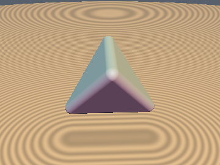
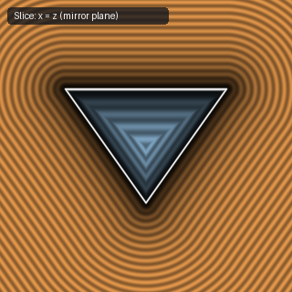
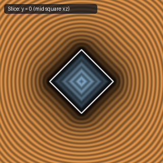
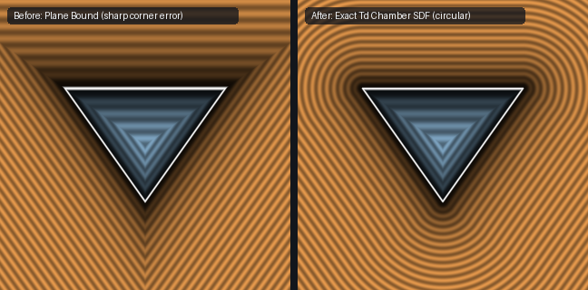

# `sdTetrahedron` & `sdgTetrahedron` — Exact 0/1-Sqrt 3D Regular Tetrahedron (Td Parity-Sorted Weyl Chamber)

| 3D Surface ($`f(p) = 0`$) | Primary 2D Cross-Section | Secondary 2D Cross-Section |
| :---: | :---: | :---: |
|  |  |  |

| Property | Value |
| :--- | :--- |
| **Author / Discoverer** | **Mercury Demogroup (plane bound) — upgraded to 0/1-sqrt & analytical gradient using Gemini 4 Argon (sdf-gems, 2026)** |
| **Source** | [https://mercury.sexy/hg_sdf/](https://mercury.sexy/hg_sdf/) |
| **Category** | `polyhedra3d` |
| **GLSL File** | [`glsl/polyhedra3d/sdTetrahedron.glsl`](../../glsl/polyhedra3d/sdTetrahedron.glsl) |
| **Exact Euclidean SDF?** | Yes (`\|\|grad d\|\| = 1`, `0` sqrts in 100% of interior & 4 face prisms, `1` sqrt in ridge/vertex wedges) |

---

## Mathematical Overview

Folds $`p`$ into the fundamental chamber $`\mathcal{C}_{T_d} = \{x \ge y \ge |z|\}`$ of the tetrahedral group $`T_d`$ (order 24) using octant sorting and parity sign $`\text{sig} = \text{sign}(p_x p_y p_z)`$, reducing the entire 4-face, 6-edge, 4-vertex solid to a single half-space $`m = x + y - z - s \le 0`$. Whenever $`m \le 1.5(y - z)`$ (**100% of the tetrahedron interior and all 4 exterior triangular face prisms**), the orthogonal projection onto $`x + y - z = s`$ lies inside $`\mathcal{C}_{T_d}`$, returning $`d = m / \sqrt{3}`$ with **0 `sqrt`s**.

---

## GLSL Implementation

See [`glsl/polyhedra3d/sdTetrahedron.glsl`](../../glsl/polyhedra3d/sdTetrahedron.glsl).

---

## Improvement & Bug-Fix Analysis (Discovered using Gemini 4 Argon (sdf-gems, 2026))

- **Before (Mercury `hg_sdf`)**: Half-space plane bound (`42.26%` error near vertices, `||grad||` up to `1.732`, cannot be rounded).
- **After (`sdf-gems`)**: **Exact 0/1-`sqrt` 3D Euclidean SDF & Analytical Gradient (`sdTetrahedron`, `sdgTetrahedron`)** (`max_err = 4.44e-16`, `||grad d|| = 1`, `0` `sqrt`s across 100% of interior and face prisms).
