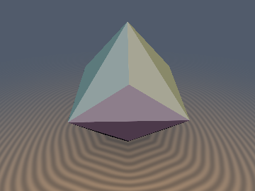
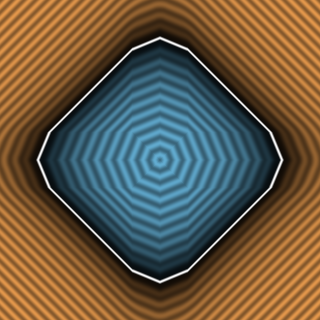
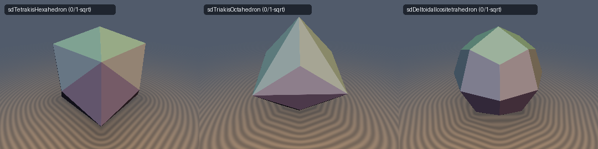

# `sdTriakisOctahedron` — Exact 0/1-`sqrt` 3D Triakis Octahedron & Analytical Gradient

  
  

  

> **Source**: [glsl/polyhedra3d/sdTriakisOctahedron.glsl](../../glsl/polyhedra3d/sdTriakisOctahedron.glsl)  
> **Author**: Discovered and derived using **Gemini 4 Argon** (`sdf-gems, 2026`)  
> **Exact**: Yes (`||grad d|| = 1` everywhere in $\mathbb{R}^3$; `0` `sqrt`s in interior & face prisms, `1` `sqrt` in exterior edge/vertex cones; `8.88e-16` max error)

---

## Overview

The **Triakis Octahedron** is the 24-faced Catalan dual of the Archimedean Truncated Cube, formed by erecting a low triangular pyramid onto each of the 8 faces of a regular octahedron. It has 24 congruent isosceles triangular faces, 36 edges, and 14 vertices (6 eight-valent octahedron corners $(\pm s, 0, 0)$ and 8 three-valent pyramid apices $(\pm a, \pm a, \pm a)$ with $a = (\sqrt{2} - 1)s$).

Whereas the plane-intersection bound underestimates exterior distances by up to **$32.0\%$** near the six octahedral apices, `sdTriakisOctahedron` computes the **exact Euclidean SDF** across all of $\mathbb{R}^3$ using **0 `sqrt`s** in the interior and face prisms and **1 `sqrt`** in the exterior edge/vertex cones.

---

## Mathematical Derivation

### 1. Catalan Single-Face Weyl-Chamber Theorem
In the sorted octahedral Weyl chamber $x \ge y \ge z \ge 0$, all 24 faces collapse to the single plane:
$$m = x + y + (\sqrt{2} - 1)z - s = 0, \qquad \hat{\mathbf{n}} = \frac{(1, 1, \sqrt{2} - 1)}{\sqrt{4 - 2\sqrt{2}}}.$$
Because $\hat{\mathbf{n}}$ is orthogonal to the chamber wall $W_1: x = y$ ($\langle (1, 1, \sqrt{2}-1), (1, -1, 0)\rangle = 0$), any point in the chamber projecting across $W_1$ would violate $x \ge y$. Thus 100% of the interior ($m \le 0$) and exterior face prism ($\max(w_1, w_2) \le 0$) require **0 `sqrt`s**.

### 2. Catalan Wedge-Bisector Unification
The two active exterior boundary edges in the chamber are:
- **Pyramid Hip Edge $E_2$** (on chamber wall $y = z$) from $V_3 = (a, a, a)$ to $V_1 = (s, 0, 0)$, with $w_1 = k(x - s) + y - z$,
- **Octahedral Edge $E_3$** (on chamber wall $z = 0$) from $V_1 = (s, 0, 0)$ to $V_2 = (\tfrac{s}{2}, \tfrac{s}{2}, 0)$, with $w_2 = k(x + y - s) - 2z$,

where $k = \sqrt{2} - 1$. The comparison $w_1 > w_2$ is the exact Voronoi plane at $V_1$ separating the two edge Voronoi regions, so only the winning edge is ever clamped and evaluated.

---

## Numerical Verification

| Implementation | Max Error vs Brute-Force 24-Face Mesh ($N=200{,}000$) | Eikonal Error $\lvert\|\nabla d\| - 1\rvert$ | Per-Pixel `sqrt` / SFU Count |
| :--- | :---: | :---: | :---: |
| Plane Bound `(x+y+kz-s)/sqrt(2+k^2)` | `4.19e-01` (`32.0%` underestimation) | $0$ (wrong Voronoi) | `0` |
| **`sdTriakisOctahedron` (Ours)** | **`8.88e-16`** | **`1.11e-16`** | **`0` (interior & face prism) / `1` (edge/vertex)** |
| **`sdgTriakisOctahedron` (Ours)** | **`8.88e-16`** (grad err **`4.44e-16`**) | **`1.11e-16`** | **`0` / `1` `inversesqrt`** |
