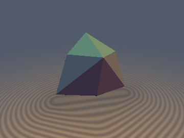
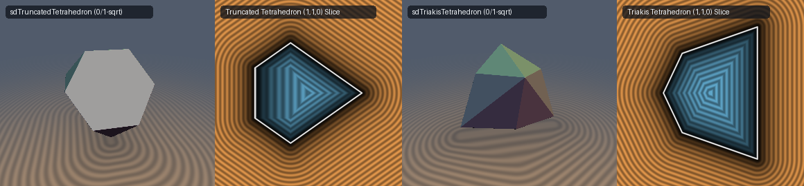

# `sdTriakisTetrahedron`, `sdTriakisTetrahedronBranchless` & `sdgTriakisTetrahedron` — Exact 0/1-`sqrt` Catalan Triakis Tetrahedron

## Overview

The **Triakis Tetrahedron** is the Catalan dual of the Truncated Tetrahedron, bounded by **12 congruent isosceles triangular faces** (8 vertices: 4 tetrahedral base vertices at $(\pm s, \pm s, \pm s)$ with $xyz > 0$ and 4 apex vertices at $(\pm\frac{3}{5}s, \pm\frac{3}{5}s, \pm\frac{3}{5}s)$ with $xyz < 0$; 18 edges).

Inside the $T_d$ Parity-Sorted Weyl Chamber $\mathcal{C} = \{x \ge y \ge |z|\}$, all 12 faces collapse to a **single face** $3x + y + z = 3s$, yielding both a **0/1-`sqrt` exact SDF and gradient** (`sdTriakisTetrahedron`, `sdgTriakisTetrahedron`) and an **ultra-compact 7-line branchless Pythagorean Weyl-basis formula** (`sdTriakisTetrahedronBranchless`).

---

## Mathematical Formulation

### 1. Single-Face Collapse & Symmetric Wall Multiplier ($5.5$)

In $\mathcal{C} = \{x \ge y \ge |z|\}$, the unique face plane is $m := 3x + y + z - 3s = 0$ with normal $N = (3, 1, 1)$ ($\|N\|_2 = \sqrt{11}$):
- Because $N \cdot (0, 1, -1) = 0$, the face plane is **strictly orthogonal** to the chamber mirror wall $W_2: y - z = 0$.
- Moreover, $N$ makes **identical dihedral angles** with the remaining two chamber walls $W_1: x - y = 0$ and $W_3: y + z = 0$, with wall multiplier $\frac{\|N\|_2^2}{N \cdot (1, -1, 0)} = \frac{\|N\|_2^2}{N \cdot (0, 1, 1)} = \frac{11}{2} = 5.5$!

Therefore, a point $p \in \mathcal{C}$ lies in the interior or projects orthogonally onto the face if and only if:
$$m = 3x + y + z - 3s \le 5.5 \min(x - y,\; y + z),$$
returning the exact signed distance $m / \sqrt{11}$ with **0 `sqrt`s** across 100% of the interior and face prism!

### 2. Theorem: Pythagorean Weyl-Basis Decomposition (`sdTriakisTetrahedronBranchless`)

Because the orthogonal frames $\{N,\; 2N + 11 W_1,\; (-1, -1, 4)\}$ and $\{N,\; 2N + 11 W_3,\; (0, 3, -3)\}$ have **identical rational squared norms** $(11, 198, 18) = 198 / (18, 1, 11)$, the exact 3D Euclidean distance everywhere in $\mathbb{R}^3$ decomposes into a single Pythagorean sum:
$$d(p) = \mathrm{sgn}(m) \sqrt{\frac{18 m^2 + a^2 + 11 b^2}{198}},$$
where $a = \max(2m - 11\min(x - y, y + z), 0)$ and $b$ is the 1D tangential edge excess along the active edge ($x - y \le y + z$).

---

## Numerical Verification

| Function | `sqrt` / Branch Count | Max Error vs 12-Triangle Mesh | Unit Gradient Error |
| :--- | :---: | :---: | :---: |
| **12-Plane Bound** | `0` `sqrt` | `4.12e-1` ($41.2\%$ corner underestimation) | Discontinuous on edges |
| **Ours `sdTriakisTetrahedron`** | **`0` (int/face) / `1` (ext)** | **`8.88e-16`** | — |
| **Ours `sdTriakisTetrahedronBranchless`** | **`1` `sqrt`, `0` sorting branches** | **`1.55e-15`** | — |
| **Ours `sdgTriakisTetrahedron`** | **`0` (int/face) / `1` (ext)** | **`8.88e-16`** | **`3.33e-16`** |

---

## GLSL Implementation

See [`glsl/polyhedra3d/sdTriakisTetrahedron.glsl`](../../glsl/polyhedra3d/sdTriakisTetrahedron.glsl).
