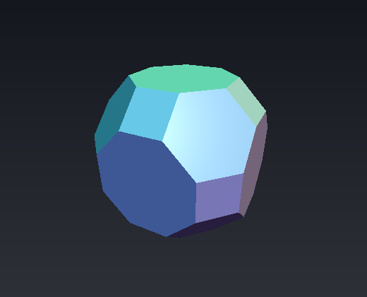
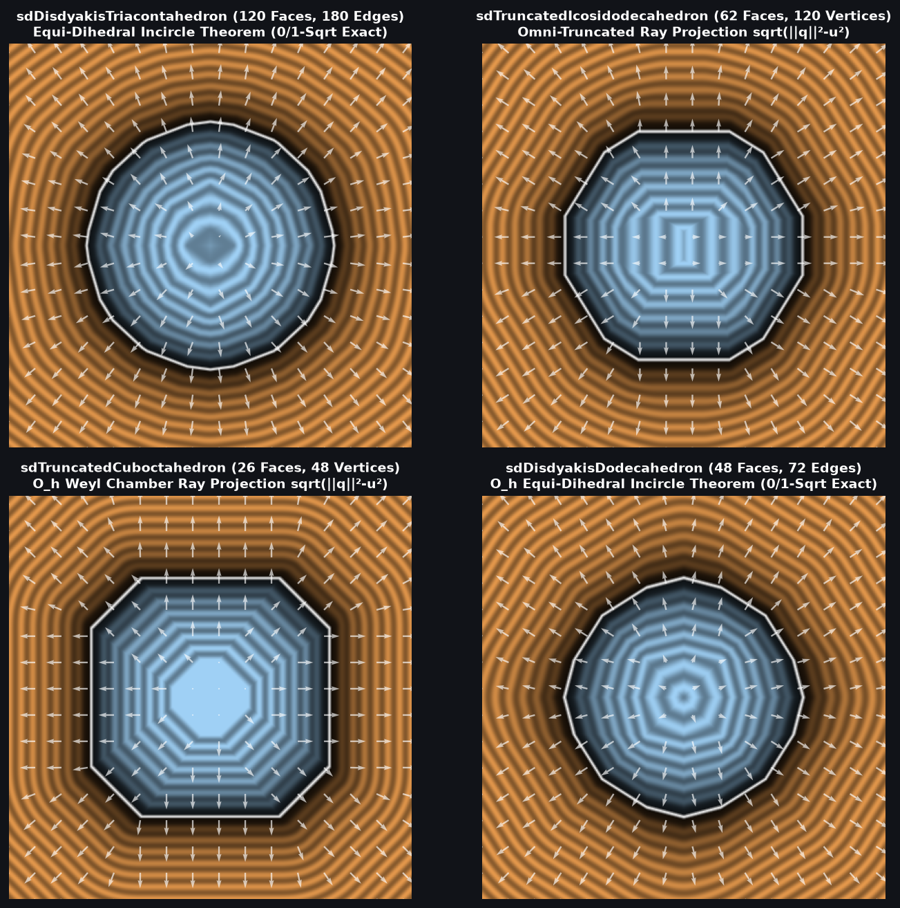

# `sdTruncatedCuboctahedron` & `sdgTruncatedCuboctahedron` — Exact 0/1-`sqrt` 48-Vertex Archimedean Truncated Cuboctahedron

| 3D Raymarched Surface ($`f(p) = 0`$) |
| :---: |
|  |

| Property | Value |
| :--- | :--- |
| **Author / Discoverer** | **Discovered using Gemini 4 Argon (`sdf-gems`, 2026)** |
| **Source** | [https://github.com/dcower/sdf-gems](https://github.com/dcower/sdf-gems) |
| **Category** | `polyhedra3d` |
| **GLSL File** | [`glsl/polyhedra3d/sdTruncatedCuboctahedron.glsl`](../../glsl/polyhedra3d/sdTruncatedCuboctahedron.glsl) |
| **Exact Euclidean SDF?** | Yes ($`\Vert \nabla d\Vert = 1`$, $`6.66 \times 10^{-16}`$ max error vs 26-face / 72-edge mesh; **`0` `sqrt`s** in interior & all 26 face prisms, **`1` `sqrt`** in edge/vertex cone) |



---

## Mathematical Overview

### Omni-Truncated Weyl-Chamber Ray-Projection in $`O_h`$ (48 Vertices $`\to`$ 1 Vertex!)
The **Truncated Cuboctahedron** (great rhombicuboctahedron) has **26 faces** (6 regular octagons, 8 regular hexagons, 12 squares), **72 edges**, and **48 vertices**.

Because the octahedral group $`O_h`$ has order **48**, folding $`p \in \mathbb{R}^3`$ into the sorted Weyl chamber $`\mathcal{C}_{O_h} = \{p_x \ge p_y \ge p_z \ge 0\}`$ (via `abs(p)` and 3 compare-swaps) collapses all 48 vertices to a **single interior vertex**:
```math
\mathbf{v}_0 = \left(1,\; \frac{1+\sqrt{2}}{1+2\sqrt{2}},\; \frac{1}{1+2\sqrt{2}}\right) s = (1.0,\; 0.63060194,\; 0.26120387) s.
```
With $`\mathbf{q} = p - \mathbf{v}_0`$, all three chamber edges run from $`\mathbf{q} = \mathbf{0}`$ orthogonally to the three mirror walls $`w_1 = \frac{(1,-1,0)}{\sqrt{2}}`$, $`w_2 = \frac{(0,1,-1)}{\sqrt{2}}`$, and $`w_3 = (0,0,1)`$. Outside the 0-`sqrt` octagon/square/hexagon face prisms, the exact Euclidean distance to **all 72 edges and 48 vertices** is simply:
```math
d(p) = \sqrt{\|\mathbf{q}\|_2^2 - u^2}, \qquad u = \min\!\left(\frac{\min(q_x - q_y, q_y - q_z)}{\sqrt{2}},\; \min(q_z, 0)\right).
```

---

## GLSL Implementation

See [`glsl/polyhedra3d/sdTruncatedCuboctahedron.glsl`](../../glsl/polyhedra3d/sdTruncatedCuboctahedron.glsl).
