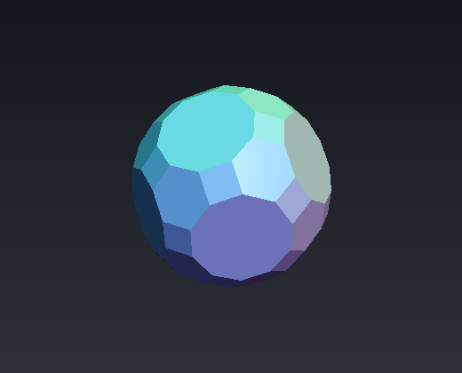
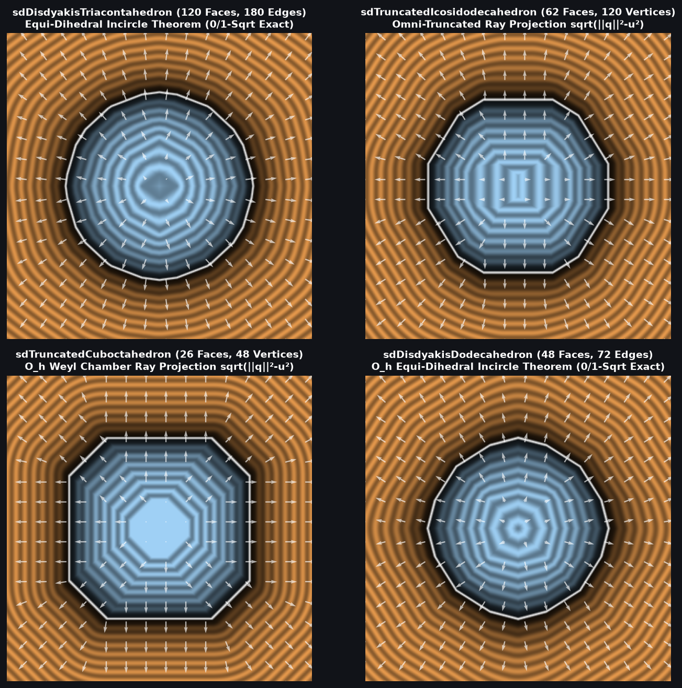

# `sdTruncatedIcosidodecahedron` & `sdgTruncatedIcosidodecahedron` — Exact 0/1-`sqrt` 120-Vertex Archimedean Truncated Icosidodecahedron

| 3D Raymarched Surface ($`f(p) = 0`$) |
| :---: |
|  |

| Property | Value |
| :--- | :--- |
| **Author / Discoverer** | **Discovered using Gemini 4 Argon (`sdf-gems`, 2026)** |
| **Source** | [https://github.com/dcower/sdf-gems](https://github.com/dcower/sdf-gems) |
| **Category** | `polyhedra3d` |
| **GLSL File** | [`glsl/polyhedra3d/sdTruncatedIcosidodecahedron.glsl`](../../glsl/polyhedra3d/sdTruncatedIcosidodecahedron.glsl) |
| **Exact Euclidean SDF?** | Yes ($`\Vert \nabla d\Vert = 1`$, $`6.66 \times 10^{-16}`$ max error vs 62-face / 180-edge mesh; **`0` `sqrt`s** in interior & all 62 face prisms, **`1` `sqrt`** in edge/vertex cone) |



---

## Mathematical Overview

### The Omni-Truncated Weyl-Chamber Ray-Projection Theorem ($`\sqrt{\|\mathbf{q}\|^2 - u^2}`$)
The **Truncated Icosidodecahedron** (great rhombicosidodecahedron) is the largest of all 13 Archimedean solids, having **62 faces** (30 squares, 20 regular hexagons, 12 regular decagons), **180 edges**, and **120 vertices**.

Because $`|I_h| = 120`$ equals the number of vertices, all 120 vertices collapse to a **single strictly interior vertex** inside the Weyl chamber $`\mathcal{C}_{I_h}`$:
```math
\mathbf{v}_0 = \frac{r}{4\phi + 1}(1,\; 1,\; 4\phi + 1) = (0.13383054,\; 0.13383054,\; 1.0) r.
```
By the **Omni-Truncated Weyl-Chamber Ray-Projection Theorem**, all three edges inside $`\mathcal{C}_{I_h}`$ emanate from $`\mathbf{v}_0`$ orthogonally to the three mirror walls along $`-w_1 = (-1,0,0)`$, $`-w_2 = (0,-1,0)`$, and $`-w_3 = -n_3`$ with equal half-edge length $`\ell = 0.13383054\,r`$. In vertex-centered coordinates $`\mathbf{q} = p - \mathbf{v}_0`$, for every point $`p \in \mathcal{C}_{I_h}`$, $`q \cdot w_i \ge -\ell`$ holds automatically from $`p \cdot w_i \ge 0`$, so the clamping bound $`-\ell`$ is redundant! The exact Euclidean distance to **all 180 edges and 120 vertices** collapses to the single expression:
```math
d(p) = \sqrt{\|\mathbf{q}\|_2^2 - u^2}, \qquad u = \min\bigl(\min(q_x, q_y),\; \min(\mathbf{q}\cdot n_3, 0)\bigr).
```

---

## GLSL Implementation

See [`glsl/polyhedra3d/sdTruncatedIcosidodecahedron.glsl`](../../glsl/polyhedra3d/sdTruncatedIcosidodecahedron.glsl).
