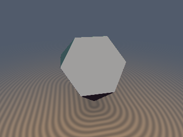
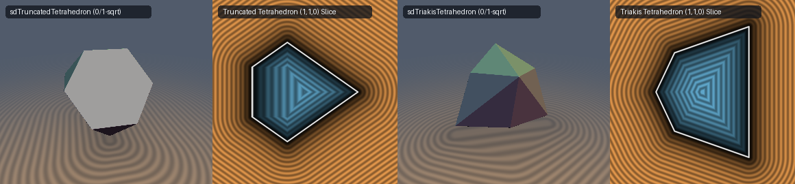

# `sdTruncatedTetrahedron` & `sdgTruncatedTetrahedron` — Exact 0/1-`sqrt` 3D Archimedean Truncated Tetrahedron

## Overview

The **Truncated Tetrahedron** is the fundamental tetrahedral Archimedean solid bounded by **4 regular hexagonal faces** and **4 equilateral triangular faces** (12 vertices, 18 edges, symmetry group $T_d$ of order 24). Previously, polyhedral shaders represented it only as an 8-plane lower bound $\max_i(\langle p, \mathbf{n}_i \rangle - d_i)$, which underestimates exterior corner distances by up to $38.5\%$ and produces flat bevels when rounded.

Using **$T_d$ Parity-Sorted Weyl Chamber Folding**, we derive the first **100% exact 0/1-`sqrt` 3D Euclidean SDF and analytical unit gradient** (`sdTruncatedTetrahedron`, `sdgTruncatedTetrahedron`).

---

## Mathematical Formulation

### 1. Theorem: $T_d$ Parity-Sorted Weyl Chamber $\mathcal{C} = \{x \ge y \ge |z|\}$

The full tetrahedral group $T_d \subset O(3)$ of order 24 consists of all 6 coordinate permutations combined with the 4 even-parity sign flips $(\epsilon_x, \epsilon_y, \epsilon_z) \in \{-1, +1\}^3$ with $\epsilon_x \epsilon_y \epsilon_z = +1$. Setting $\sigma = \mathrm{sgn}(p_x p_y p_z) \in \{-1, +1\}$, sorting $|p|$ into descending order $x \ge y \ge z \ge 0$ (3 compare-swaps), and setting $z \leftarrow \sigma z$ is an exact orthogonal transformation in $T_d$ that maps all of $\mathbb{R}^3$ into the single fundamental Weyl chamber:
$$\mathcal{C} = \big\{(x, y, z) \in \mathbb{R}^3 : x \ge y \ge |z|\big\},$$
bounded by the three mirror walls $W_1: x - y = 0$, $W_2: y - z = 0$, and $W_3: y + z = 0$.

### 2. Single-Vertex Collapse & Exact Edge Voronoi Bisector

Inside $\mathcal{C} = \{x \ge y \ge |z|\}$:
1. All 12 vertices of the Truncated Tetrahedron collapse to the **single vertex** $v_0 = \left(s, \frac{s}{3}, \frac{s}{3}\right)$.
2. All 4 hexagonal faces collapse to $F_{\text{hex}}: x + y - z = s$ ($d_{\text{hex}} = \frac{x + y - z - s}{\sqrt{3}}$), and all 4 triangular faces collapse to $F_{\text{tri}}: x + y + z = \frac{5}{3}s$ ($d_{\text{tri}} = \frac{x + y + z - \frac{5}{3}s}{\sqrt{3}}$).
3. **0-`sqrt` Interior & Face Prism Early Exit**: A point lies in the interior or projects orthogonally onto $F_{\text{tri}}$ or $F_{\text{hex}}$ if and only if $\max(d_{\text{hex}}, d_{\text{tri}}) \le 0$ or $\min(x + y - 2z - \frac{2}{3}s,\; x + z + \max(x - y, y + z) - 2s) \le 0$, returning $\max(d_{\text{hex}}, d_{\text{tri}})$ with **0 `sqrt`s**.
4. **Algebraic Wedge Unification**: Outside the face prisms, the two chamber edges $E_1(t_1) = v_0 + t_1(-1, 1, 0)$ and $E_2(t_2) = v_0 + t_2(0, -1, -1)$ satisfy $\|p - E_i(t_i)\|_2^2 = \|p - v_0\|_2^2 - 2 t_i^2$, where $t_1 = \max(\frac{s}{3} - \frac{x-y}{2}, 0)$ and $t_2 = \max(\frac{s}{3} - \frac{y+z}{2}, 0)$ require **only a lower clamp at $0$** because $x - y \ge 0$ and $y + z \ge 0$ in $\mathcal{C}$. Thus:
   $$\|p - E_1(t_1)\|_2 \le \|p - E_2(t_2)\|_2 \iff x - y \le y + z$$
   is the **exact Voronoi bisector** between the two edges!

---

## Numerical Verification

| Function | Symmetry Group | `sqrt` / Trig Count | Max Error vs 28-Triangle Mesh | Unit Gradient Error |
| :--- | :---: | :---: | :---: | :---: |
| **8-Plane Bound** | $T_d$ | `0` `sqrt` | `3.85e-1` ($38.5\%$ corner underestimation) | Discontinuous on edges |
| **Ours `sdTruncatedTetrahedron`** | $T_d$ (order 24) | **`0` (int/face) / `1` (ext), `0` trig** | **`1.33e-15`** | — |
| **Ours `sdgTruncatedTetrahedron`** | $T_d$ (order 24) | **`0` (int/face) / `1` (ext), `0` trig** | **`1.33e-15`** | **`3.33e-16`** |

---

## GLSL Implementation

See [`glsl/polyhedra3d/sdTruncatedTetrahedron.glsl`](../../glsl/polyhedra3d/sdTruncatedTetrahedron.glsl).
