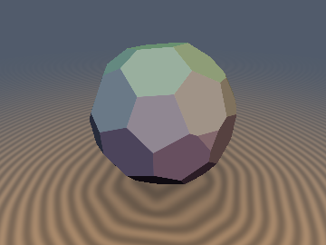
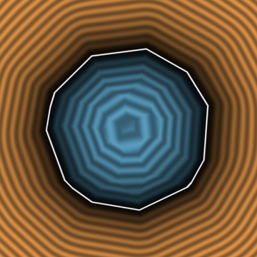
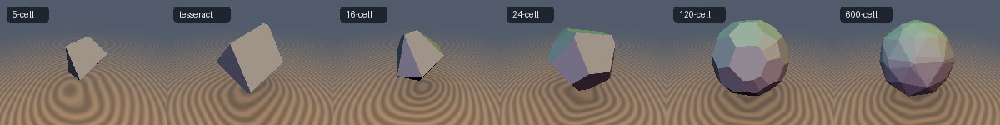

# sd4Polytopes — 4D SDFs of the Six Regular 4-Polytopes and Their 3D Slices






*Top: `sdRegularSlice(SD4_CELL120, ...)`, circumradius 0.62, offset `w = 0.2`, generic 4D rotation, and its `z = 0` section.
Bottom: the same 3-flat (offset 0.12) through the 5-cell, tesseract, 16-cell, 24-cell, 120-cell and 600-cell.*

- **Category**: polytopes4d (experimental)
- **GLSL File**: [`glsl/polytopes4d/sd4Polytopes.glsl`](../../glsl/polytopes4d/sd4Polytopes.glsl)
- **Attribution**: Claude Fable 5.2 (construction after Coxeter's orthoscheme and the well-known reflection-fold technique)

| Function | Domain | Label |
| :--- | :--- | :--- |
| `sd4Cell5`, `sd4Tesseract`, `sd4Cell16`, `sd4Cell24`, `sd4Cell120`, `sd4Cell600`, `sd4Regular(id, ...)` | $`\mathbb{R}^4`$ | **Exact** (verified against two independent references) |
| `sd4RegularEdges` | $`\mathbb{R}^4`$ | **Exact**, unsigned (verified against brute force over all edges) |
| `sdRegularSlice`, `sdRegularEdgesSlice` | $`\mathbb{R}^3`$ | **Conservative bound**, 1-Lipschitz, exact zero set |
| `sdRegularSliceBound` | $`\mathbb{R}^3`$ | **Conservative bound**, tighter outside, **not continuous** |
| `op4Rotation`, `op4Slice`, `sd4CoxeterFold`, `sd4RegularConstants`, `sd4Orthoscheme*` | helpers | n/a |

Size convention: `r` is the **circumradius** in every function.

## Construction

Each regular 4-polytope has a reflection group generated by four mirrors. In the "orthoscheme frame" used by the file
the mirrors are $`x = 0`$ and three planes acting on the coordinate pairs $`xy`$, $`yz`$, $`zw`$, and the fundamental chamber is

```math
0 \le \frac{x}{h_x} \le \frac{y}{h_y} \le \frac{z}{h_z} \le \frac{w}{h_w},
```

where the unit vector $`h`$ points at a vertex. `sd4CoxeterFold` repeats the four reflections (`abs` plus three conditional 2D
reflections) for a fixed number of sweeps. Inside the chamber the solid is the box corner $`\{q \le r h\}`$, so with $`q \leftarrow q - r h`$

```math
d = \begin{cases} \lVert \max(q, 0) \rVert & q_w > 0 \\ q_w & q_w \le 0 \end{cases}
```

and the edge skeleton is the single segment $`x \in [0, r h_x]`$ at $`(y, z, w) = r\,h_{yzw}`$. Cost: 4 reflections per sweep;
4 sweeps (5-cell, tesseract, 16-cell), 6 (24-cell), 15 (120-cell, 600-cell).

## A 3D slice of an exact 4D SDF is a bound, not an SDF

For an orthogonal $`R`$ and offset $`w_0`$, `sdRegularSlice` returns $`f(x) = d_4(R\,(x, w_0))`$. Restriction to a flat keeps the
Lipschitz constant and the zero set, and the nearest 4D point is in general not in the flat, so

```math
\lvert f(x) \rvert \le \lvert d_3(x) \rvert, \qquad f(x) = 0 \iff d_3(x) = 0 .
```

It is safe to sphere-trace but it is **not** the 3D SDF of the slice polyhedron. Measured tightness is in the table below.
`sdRegularSliceBound` also folds the flat's normal, which gives the true in-flat distance to the plane cut from the nearest cell
(and from the cell across the ridge); it takes the max with the 4D distance. That is still a lower bound, but the tracked cell
changes across mirrors, so the function jumps.

## Verification

All numbers are from the literal GLSL on the GPU (FP32), reproduced for this document. Ground truth for the 4D solids is an
FP64 half-space/active-set distance built from the convex hull of the textbook vertex coordinates, cross-checked against a
vertex-hull QP (agreement of the two references: $`\le 10^{-14}`$).

**4D functions** (`r = 1`, 24 000 points per polytope: uniform, near-surface, near vertices; inside and outside pooled):

| Polytope | max err vs truth | sign errors | Lipschitz (24k pairs) | NaN/Inf | sweeps shipped / max needed (10⁶ pts) | edges: max err (edge count) |
| :--- | :--- | :--- | :--- | :--- | :--- | :--- |
| 5-cell | 7.7e-7 | 0 | 0.9991 | 0 | 4 / 4 | 6.6e-7 (10) |
| tesseract | 1.8e-7 | 0 | 0.9997 | 0 | 4 / 4 | 1.1e-6 (32) |
| 16-cell | 6.9e-7 | 0 | 0.9993 | 0 | 4 / 4 | 6.9e-7 (24) |
| 24-cell | 8.8e-7 | 0 | 0.9979 | 0 | 6 / 6 | 8.2e-7 (96) |
| 120-cell | 1.8e-6 | 0 | 0.9979 | 0 | 15 / 15 | 1.7e-6 (1200) |
| 600-cell | 2.0e-6 | 0 | 0.9994 | 0 | 15 / 15 | 2.0e-6 (720) |

- NaN/Inf: 0 of 36 121 probes at each of `r = 1, 0, 1e-6, 1e6`, per polytope.
- 64 000 points placed on the fold mirrors ($`\lvert p \rvert`$ up to 19): max error 3.4e-6 (600-cell); no seam jumps.
- Independent surface samples: $`\lvert d \rvert \le 8.9 \times 10^{-7}`$. `sd4Tesseract` vs `sd4Regular(SD4_TESSERACT)`: 1.1e-6.
- With too few sweeps the result was wrong on 0.7% (14 sweeps, 600-cell) to 64% (1 sweep) of points, but only ever **too small**
  (max over-estimate 2e-7, max under-estimate up to 1.0): a truncated fold degrades to a bound instead of over-stepping.

**3D slices** (generic rotation, 20 000 points per row, exterior points, vs the brute-force 3D SDF of the slice polyhedron;
`w0` in units of `r = 1`):

| Polytope | `sdRegularSlice` $`f/d_3`$ mean at `w0` = 0 / 0.3 / 0.6 | min (worst `w0`) | `sdRegularSliceBound` mean at 0 / 0.3 / 0.6 | min |
| :--- | :--- | :--- | :--- | :--- |
| 5-cell | 0.944 / 0.904 / 0.768 | 0.217 | 0.975 / 0.940 / 0.812 | 0.217 |
| tesseract | 0.960 / 0.908 / 0.824 | 0.240 | 0.984 / 0.963 / 0.917 | 0.251 |
| 16-cell | 0.973 / 0.920 / 0.794 | 0.315 | 0.990 / 0.973 / 0.920 | 0.387 |
| 24-cell | 0.985 / 0.953 / 0.809 | 0.433 | 0.995 / 0.989 / 0.939 | 0.590 |
| 120-cell | 0.994 / 0.960 / 0.865 | 0.576 | 0.999 / 0.992 / 0.970 | 0.691 |
| 600-cell | 0.995 / 0.963 / 0.854 | 0.596 | 0.999 / 0.994 / 0.957 | 0.700 |

- Never an over-estimate: $`\max(\lvert f \rvert - \lvert d_3 \rvert) \le 1.1 \times 10^{-6}`$ (`sdRegularSlice`), $`\le 1.6 \times 10^{-6}`$
  (`sdRegularSliceBound`); 0 sign errors in all 18 rows.
- Lipschitz ratio: `sdRegularSlice` $`\le 1.000`$; `sdRegularSliceBound` up to 22.4 (it is discontinuous).
- Mirror slices (3-flat = one of the four mirrors, 20 000 points each): exterior max error 7.8e-7 to 2.0e-6, i.e. exact outside;
  **interior** error 0.106 / 0.126 / 0.063 / 0.067 / 0.029 / 0.007 (5-cell ... 600-cell).
- Sphere tracing the preview slice (120-cell): mean 6.98 steps (`sdRegularSlice`) vs 6.84 (`sdRegularSliceBound`), 0 overstep pixels for both.
- Rotating the flat: $`\lvert f_{R_1}(x) - f_{R_2}(x) \rvert / \lVert (R_1 - R_2)(x, w_0) \rVert \le 0.35`$ over 10 rotation pairs (bound: 1).
- Single-translation-unit compile with every shipped function: passes in forward, reverse and new-first order.

## Findings

**Held**
- One fold loop plus a box-corner distance gives the exact 4D SDF of all six regular 4-polytopes and of their edge skeletons
  (FP32 error $`\le 2 \times 10^{-6}`$ at `r = 1`).
- The slice restriction is a valid 1-Lipschitz bound with the exact zero set, and it is tight for the two large polytopes near
  the centre (mean ratio 0.99 at `w0 = 0`).

**Failed or weaker than first claimed**
- "The restriction is the exact 3D SDF on mirror slices" is false inside the solid (errors up to 0.126). It holds outside only.
  The GLSL header was corrected.
- The `w = 0` regression against existing 3D primitives matched only for the tesseract (`sdBox`, 9.5e-7). The 16-cell, 24-cell
  and 600-cell slices differ from `sdOctahedron`, `sdCuboctahedron`, `sdIcosidodecahedron` by 0.070, 0.064, 0.100. The first two
  values are consistent with the interior under-estimate above. The 600-cell value is larger than its measured mirror-slice
  interior error (0.007), so that test probably has an orientation or size mismatch; this was **not** resolved.
- The slice bound gets loose far from the centre: worst ratio 0.22 (5-cell) to 0.60 (600-cell) at `w0 = 0.6`.
- `sdRegularSliceBound` raises the mean ratio but saved only 2% of sphere-tracing steps on the preview, and it is discontinuous.
  It is not worth its cost for rendering.

**Open**
- The shipped sweep counts equal the largest count observed on 10⁶ FP32 points, so there is no margin. The header says the
  counts are the worst case over every chamber; that exhaustive check was not re-run for this document.
- An exact 3D SDF of a generic slice (it is a convex polyhedron with up to 120 or 600 facets) without enumerating facets.
- Interior and exterior errors of the 4D functions were not reported separately.

## Prior art (from memory, not checked)

- Coxeter, *Regular Polytopes*: characteristic orthoscheme and the reflection groups A4, B4, F4, H4.
- Reflection folding for 3D polyhedra and for 4D polytope renders is widely used in Shadertoy and Fragmentarium shaders
  (knighty's polychora shaders, the `hg_sdf` fold helpers). Those usually render stereographic projections or wireframes.
- Not known to me, and not searched for: a packaged, numerically verified exact 4D solid distance for all six polytopes with
  measured slice tightness. Treat novelty as unestablished.

## Not done

No web search; no analytic gradients; no star polychora or uniform (Wythoffian) polytopes; no exterior/interior error split
for the 4D table; the 600-cell `w = 0` regression mismatch was not debugged.

Reproduce (from the repo root; scripts live in the experiment's scratch directory `polytopes4d/`):
`uv run python 04_gpu_4d.py`, `05_gpu_slices.py`, `07_mirror_split.py`, `06_render.py`.
