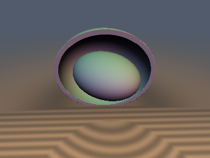
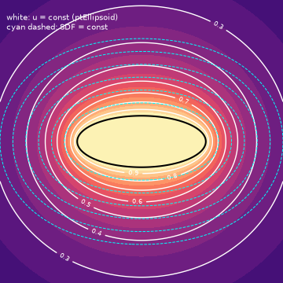
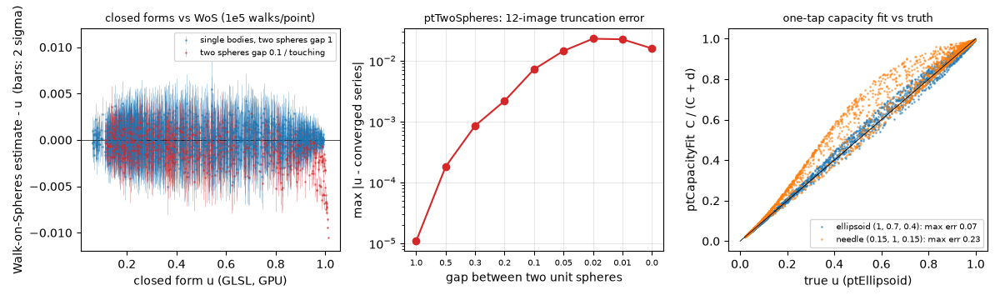

# ptHarmonic: Closed-Form Capacitary Potentials of Primitives

 

*Left: an ellipsoid (semi-axes 0.42, 0.24, 0.32) and its equipotential* $`u = 0.6`$ *(thin shell, front half cut away).
Right: equipotentials of `ptEllipsoid` (white) against the level sets of the exact SDF (cyan dashed), slice* $`z = 0`$*, semi-axes (1, 0.4, 0.6).*

| Property | Value |
| :--- | :--- |
| **Category** | Potentials (experimental, research) |
| **GLSL file** | [`glsl/potentials/ptHarmonic.glsl`](../../glsl/potentials/ptHarmonic.glsl) |
| **Attribution** | Implementation and measurements: **Claude Fable 5.2**. The formulas are classical potential theory. |
| `ptSphere`, `ptSpheroid`, `ptDisk`, `ptSegment` | **Exact** potential and gradient (FP32 error up to 2.8e-6) |
| `ptEllipsoid`, `ptEllipsoidCap` | **Exact** formula, verified for axis ratios up to 10:1. **Approximate** beyond (1.5e-2 at 100:1) |
| `ptTwoSpheres` | **Approximate** (12-term image series): 1.1e-5 at a gap of one radius, 2.5e-2 when touching |
| `ptConvexBound` | **Bounds**, tested (0 violations in 24,000 samples), only partly proved |
| `ptCapacityFit`, `ptUnionCoupled` | **Approximate** (max errors 0.07 to 0.22, and 0.08) |

## Idea

For a body $`K`$ the capacitary potential $`u`$ is the harmonic function outside $`K`$ with $`u = 1`$ on $`K`$ and $`u \to 0`$ at
infinity. Equivalently, $`u(x)`$ is the probability that Brownian motion started at $`x`$ ever hits $`K`$, so $`1 - u`$ is a
"diffusion occlusion": the fraction of random walkers that escape. Far away $`u \approx C / |x|`$ with $`C`$ the capacity.
For a handful of primitives $`u`$ has a closed form, so a shader can evaluate it in one call instead of running Walk-on-Spheres.

This is **not** ray ambient occlusion. Cosine-weighted AO integrates straight-line visibility over a hemisphere at a surface
point; $`1 - u`$ is defined at free-space points, has no normal, and Brownian paths go around obstacles. The two are different
quantities and no numerical relation between them was measured here.

None of these functions is a distance. The preview sphere-traces $`f = (0.6 - u) / G`$ with $`G = 1.02\, C / (r_{mid}\, r_{min})`$,
the gradient maximum at the tip of the longest axis (measured max $`|\nabla u|`$ 4.2311 against 4.2315 from the formula on 200,000 samples).

## Formulas

Sphere of radius $`R`$: $`u = R / r`$. Ellipsoid with semi-axes $`r_i`$, where $`\lambda \ge 0`$ is the largest root of
$`\sum_i p_i^2 / (r_i^2 + \lambda) = 1`$ and $`R_F`$ is Carlson's symmetric elliptic integral:

```math
u(p) = C\, R_F\!\left(r_x^2 + \lambda,\; r_y^2 + \lambda,\; r_z^2 + \lambda\right), \qquad C = \frac{1}{R_F(r_x^2, r_y^2, r_z^2)}
```

```math
\nabla u = -\frac{C}{\sqrt{\prod_i (r_i^2 + \lambda)}}\; \frac{g}{T}, \qquad g_i = \frac{p_i}{r_i^2 + \lambda}, \quad T = \sum_i \frac{p_i^2}{(r_i^2+\lambda)^2}
```

`ptEllipsoid` finds $`\lambda`$ with 6 Newton steps on $`1 / S(\lambda) - 1`$ and $`R_F`$ with 5 duplication steps.
Spheroids (equatorial $`a`$, polar $`c`$, $`f^2 = |a^2 - c^2|`$) reduce to elementary functions with $`\lambda`$ from a quadratic:

```math
u_{\mathrm{oblate}} = \frac{\arctan\!\left(f / \sqrt{c^2 + \lambda}\right)}{\arctan(f / c)}, \qquad
u_{\mathrm{prolate}} = \frac{\mathrm{artanh}\!\left(f / \sqrt{c^2 + \lambda}\right)}{\mathrm{artanh}(f / c)}
```

The disk is the oblate case $`c = 0`$ with $`C = 2R / \pi`$. `ptSegment(p, a, b, r)` is the prolate spheroid with foci $`a, b`$
and equatorial radius $`r`$ (it is **not** a capsule), using $`\sqrt{c^2 + \lambda} = (|p - a| + |p - b|) / 2`$.
`ptTwoSpheres` sums two chains of Kelvin image charges ($`q' = -q R / t`$ placed at $`R^2 / t`$ from the other centre),
12 charges per chain with the last at half weight.

Helpers: `ptCapacityFit(d, C)` $`= C / (C + d)`$ (exact for a sphere, correct far field for any body);
`ptConvexBound(d, l, r_{in}, r_c)` returns $`r_{in} / l \le u \le \min\!\left(r_c / l,\ 2 r_c / \sqrt{4 r_c^2 + d^2}\right)`$;
`ptUnionCoupled` is a two-body monopole-coupled superposition clamped to $`[\max(u_A, u_B), 1]`$.

## Verification

Literal GLSL on the GPU (FP32) against FP64 references (`scipy.special.elliprf` + bracketed root; the arcsine form for the disk;
a 20,000-term image series for two spheres). About 5,700 to 6,000 exterior points per row, from 1e-4 to 1e2 body sizes away,
10% on symmetry planes. Gradients are compared with central differences of the FP64 reference on 300 to 500 points with $`u < 0.97`$.
Non-finite outputs: 0 in every row.

| Function / case | max abs error of u | gradient, max relative error | far field $`u\,r / C - 1`$ |
| :--- | :--- | :--- | :--- |
| `ptSphere` R = 0.8 | 1.2e-7 | 3.1e-7 | 1.2e-7 |
| `ptSpheroid` (a, c) = (1, 0.5), (0.4, 1), (1, 0.1), (1, 1) | 4.6e-7 or less | 9.8e-7 or less | 1.9e-7 or less |
| `ptSpheroid` (0.1, 1) | 2.8e-6 | 7.8e-7 | 4.1e-7 |
| `ptDisk` R = 1 | 1.1e-7 | 3.0e-7 | 1.2e-7 ($`C = 2/\pi`$) |
| `ptSegment` r = 0.15, focal length 1.4, off-centre | 2.1e-6 | 3.7e-6 | 3.7e-7 |
| `ptEllipsoid` (1, .7, .4), (3, 2, 1), (.3, 1.2, .6), (1, .5, .25) | 3.2e-7 or less | 5.7e-7 or less | 1.5e-7 or less |
| `ptEllipsoid` (1, 0.3, 0.1) | 7.2e-7 | 3.5e-6 | 1.0e-7 |
| `ptEllipsoid` (10, 0.3, 2) | 6.8e-5 (99th percentile 2.6e-7) | 3.2e-5 | 3.4e-7 |
| `ptEllipsoid` (1, 1, 0.02) | 5.7e-4 | 4.9e-3 | 1.5e-7 |
| `ptEllipsoid` (1, 0.1, 0.01) | **1.5e-2** (99th percentile 2.0e-5) | 1.7e-2 | 7.4e-8 |
| `ptTwoSpheres` radii 1, 1, gap 1 | 1.1e-5 | 2.7e-5 | capacity 1.51442 vs 1.51441 |
| `ptTwoSpheres` radii 1, 0.5, gap 0.3 | 3.6e-4 | 1.0e-3 | 1.13322 vs 1.13312 |
| `ptTwoSpheres` radii 1, 1, gap 0.1 | **7.3e-3** | 1.3e-2 | 1.40316 vs 1.40087 |
| `ptTwoSpheres` radii 1, 1, gap 0.01 / touching | **2.3e-2 / 1.6e-2** | 2.3e-2 / 2.9e-2 | touching: 1.38975 vs $`2 \ln 2 = 1.38629`$ |
| `ptTwoSpheres` radii 1, 0.3, touching | **2.5e-2** | 4.7e-2 | 1.03211 vs 1.03097 |

Other checks:

- **Surface value**: `ptEllipsoid` on FP32-rounded surface points, $`\max |u - 1|`$ = 1.8e-7 for (1, 0.7, 0.4) and 9.5e-7 for (1, 0.1, 0.01).
  `ptTwoSpheres` on the sphere surfaces: 1.1e-5 (gap 1), 2.4e-3 (gap 0.1), 2.5e-2 (radii 1 and 0.3, touching).
- **Range**: $`0 \le u \le 1`$ holds for all single-body functions. `ptTwoSpheres` **exceeds 1** near a narrow gap (max 1.0245).
- **Harmonicity** (7-point Laplacian of the FP64 reference, $`h = 10^{-3}`$): 6e-6 for the sphere, 9e-6 for ellipsoid (3, 2, 1), 2e-6 to 8e-6
  for two spheres, up to 8e-4 for (1, 0.7, 0.4). For thin bodies the stencil does not resolve the field near the edge, so this
  check carries no information there.
- **Walk-on-Spheres** (GPU, repo SDFs, 240 points per case, 1e5 walks per point): for sphere, two ellipsoids, two spheroids, disk,
  needle and two spheres at gap 1, the z-scores have mean within 0.10 of zero, rms 0.95 to 1.06, max 3.45, and
  $`\max |u - \hat u|`$ is 3.3e-3 to 5.4e-3 (statistical noise of 1.1e-3 to 1.4e-3 per point). For two spheres at gap 0.1
  and touching the deviation is 3.6e-3 and 1.1e-2 and the z statistic is unusable (points with a zero variance estimate).
- **`ptConvexBound`**: on ellipsoids (1, .7, .4), (1, .3, .1), (1, .35, 1), (.15, 1, .15), 6,000 points each: 0 violations of
  either bound. Mean bracket width 0.33 to 0.57, so the bounds are loose.
- **`ptCapacityFit`**: max error 0.069 (1, .7, .4), 0.080 (oblate 1 : 0.35), 0.195 (1, .3, .1), 0.222 (needle); mean 0.009 to 0.018.
- **`ptUnionCoupled`** (two spheres, 5 configurations): max error 0.074 to 0.083, mean 0.007 to 0.008; plain $`\max(u_A, u_B)`$ has
  max error 0.175 to 0.254. The bracket $`\max(u_A, u_B) \le u \le \min(u_A + u_B, 1)`$ had 0 violations.
- Single-translation-unit compile with all 299 files: forward, reverse and new-first orders pass.



*Left: Walk-on-Spheres minus closed form, bars are 2 sigma. Middle: `ptTwoSpheres` truncation error against the gap.
Right: `ptCapacityFit` against the true potential.*

## Findings

**Held**
- The sphere, spheroid, disk and needle potentials and gradients agree with FP64 references to FP32 rounding (2.8e-6 or better) and with Walk-on-Spheres within noise.
- The ellipsoid potential agrees to 7.2e-7 for axis ratios up to 10:1; the far field reproduces $`C = 1 / R_F`$ to 3.4e-7 at every ratio tested.
- The convex bounds and the union bracket had no violations.

**Failed or only partly true**
- `ptEllipsoid` is not accurate for very thin bodies: 6 fixed Newton steps leave errors of 6.8e-5 (33:1), 5.7e-4 (50:1) and 1.5e-2 (100:1) in a small set of points next to the thin edge. Several other root solvers were tried by the previous agent (scratch `t2*.py`); those results were not re-run and are not claimed here.
- `ptTwoSpheres` was first labelled exact. With 12 images it is only accurate for well separated spheres; near contact the error reaches 2.5e-2 and the value exceeds 1. The "sphere resting on a reflecting floor" use is the touching case and carries the same error.
- `ptCapacityFit` is a poor substitute for elongated bodies (error 0.2). $`u`$ is not a function of the distance alone.
- The reference cross-check by direct quadrature only confirmed `elliprf` for (1, 0.7, 0.4) (2.5e-14); for the other two shapes the quadrature itself reported non-convergence, so it is not an independent confirmation there.

**Open**
- A proof (or counterexample) for the $`2 r_c / \sqrt{4 r_c^2 + d^2}`$ upper bound.
- A robust $`\lambda`$ solver for extreme aspect ratios, and a closed-form (bispherical) evaluation or convergence acceleration for nearly touching spheres.
- Whether $`1 - u`$ is visually useful as an occlusion term. No rendering comparison against ray AO was made.

## Prior art (from memory, not checked)

No web search was done for this document. From memory: the conducting ellipsoid potential and its capacity are textbook
electrostatics (ellipsoidal coordinates, 19th century); Carlson's duplication algorithm for $`R_F`$ is standard; the disk
potential in arcsine form and the two-sphere image series (including the capacity $`2 R \ln 2`$ for equal touching spheres) are
classical; Walk-on-Spheres dates to the 1950s and has recent use in graphics for Monte Carlo geometry processing. Nothing
mathematical here is new. What may be new is only the packaging as GLSL primitives with gradients next to SDFs, and the measured
error tables. That novelty claim is unverified.

## Not done

- No prior-art search, no `--github` render check of the math, no performance timing.
- No interior values other than the constant 1, no boxes, capsules, tori or other non-ellipsoidal bodies.
- No fix for the thin-ellipsoid and near-contact failures; they are documented and relabelled instead.
