# 4. 2D Primitives & Algebraic Curves

[**← Back to Main `sdf-gems` README**](../../README.md) · **GLSL Headers**: [`glsl/primitives2d/`](../../glsl/primitives2d/) (61 headers)

Exact 2D Euclidean Signed Distance Functions (many accompanied by `sdg*` 2D gradients and 3D prism/revolution helpers), covering polygons, circular sectors, constant-width rotors, gears, spirals, and classical algebraic curves.

## Contents

- **Polygons, Boxes, Segments & Crosses** (20)
- **Arcs, Sectors, Constant-Width & Composite Shapes** (11)
- **Conics, Splines, Spirals, Trochoids & Gears** (15)
- **Classical Cubic, Quartic & Sextic Algebraic Curves** (15)

## Polygons, Boxes, Segments & Crosses

| Preview | Function | Summary |
| :---: | :--- | :--- |
|  | [**`sdCircle`**](sdCircle.md) [`glsl`](../../glsl/primitives2d/sdCircle.glsl) · **Exact** | Exact 2D disk $`\Vert p\Vert - r`$ |
|  | [**`sdBox2D`**](sdBox2D.md) [`glsl`](../../glsl/primitives2d/sdBox2D.glsl) · **Exact** | **Also**: `sdRoundBox2D`, `sdgBox2D`, `sdgRoundBox2D`. 0/1-SFU 2D rectangle & rounded box + gradients (`0` SFUs in interior + 4 exterior face slabs) |
| 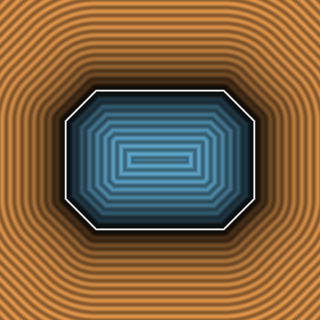 | [**`sdChamferBox2D`**](sdChamferBox2D.md) [`glsl`](../../glsl/primitives2d/sdChamferBox2D.glsl) · **Exact** | **Also**: `sdChamferBoxPrism`, `sdCoolS2D`. 0/1-`sqrt` 2D & 3D chamfer box (`0` `sqrt`s in interior & 10 face/chamfer prisms), 0-div `sdOrientedBox2D`, & round/clamp-free `sdCoolS2D` |
| 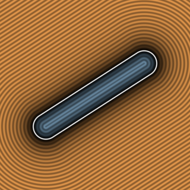 | [**`sdSegment2D`**](sdSegment2D.md) [`glsl`](../../glsl/primitives2d/sdSegment2D.glsl) · **Exact** | **Also**: `sdCapsule2D`, `sdgSegment2D`, `sdgCapsule2D`. 1-`inversesqrt` 2D line segment & capsule + analytical gradients (`0` spine `NaN`s) |
| 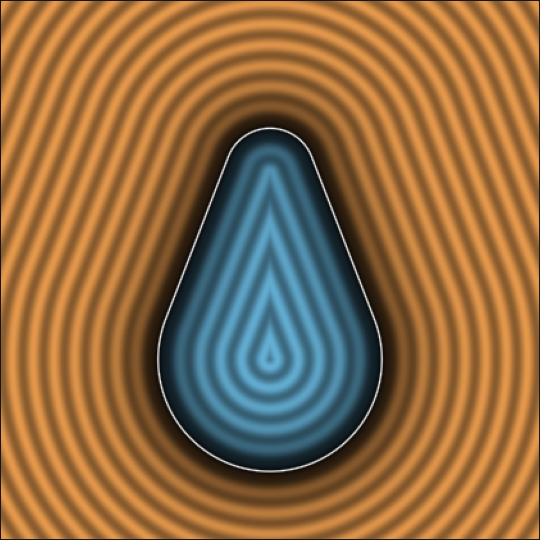 | [**`sdUnevenCapsule2D`**](sdUnevenCapsule2D.md) [`glsl`](../../glsl/primitives2d/sdUnevenCapsule2D.glsl) · **Exact** | 1-`sqrt` 2D uneven capsule everywhere via signed-square tangent-cone reduction (down from 2 `sqrt`s) |
| 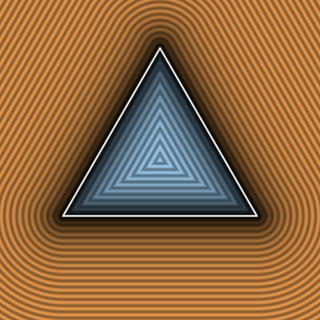 | [**`sdEquilateralTriangle2D`**](sdEquilateralTriangle2D.md) [`glsl`](../../glsl/primitives2d/sdEquilateralTriangle2D.glsl) · **Exact** | 0/1-`sqrt` $`D_3`$ fold via chamber double inequality (`0` `sqrt`s, `0` `clamp`s, `0` `sign`s in interior & face strips) |
| 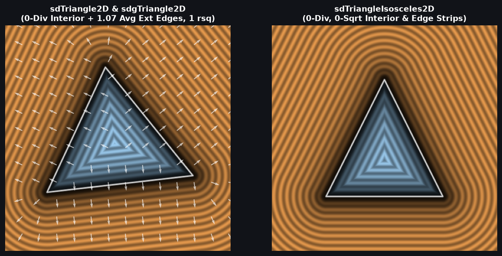 | [**`sdTriangle2D`**](sdTriangle2D.md) [`glsl`](../../glsl/primitives2d/sdTriangle2D.glsl) · **Exact** | **Also**: `sdgTriangle2D`, `sdTriangleIsosceles2D`, `sdgTriangleIsosceles2D`. 100% 0-division, 0-clamp disjoint-Voronoi 2D triangle & 1-`inversesqrt` gradient (down from 3 divs & 4–6 SFUs in IQ) |
| 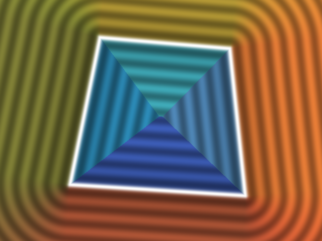 | [**`sdQuad2D`**](sdQuad2D.md) [`glsl`](../../glsl/primitives2d/sdQuad2D.glsl) · **Exact** | **Also**: `sdgQuad2D`. 0-division-interior, half-space edge-pruned 2D convex quad & 1-SFU gradient via Barycentric Partition-of-Unity (down from 4 `sqrt`s) |
| 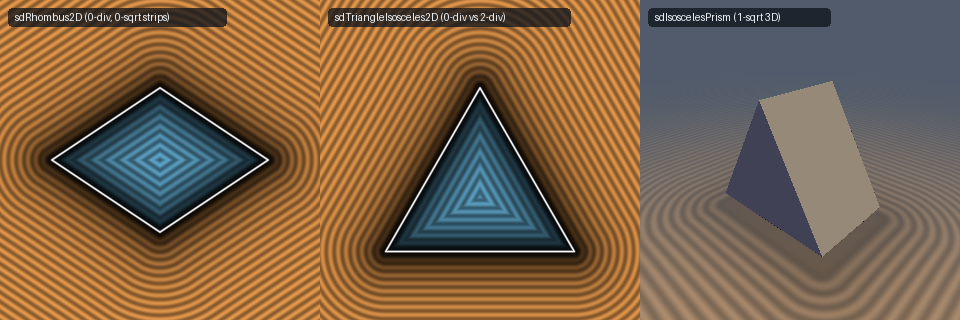 | [**`sdRhombus2D`**](sdRhombus2D.md) [`glsl`](../../glsl/primitives2d/sdRhombus2D.glsl) · **Exact** | **Also**: `sdTriangleIsosceles2D`. 0-division, 0/1-`sqrt` 2D rhombus & isosceles triangle (`0` `sqrt`s in interior & face strips), 1-SFU `sdgRhombus2D` / `sdgTriangleIsosceles2D`, & 3D `sdIsoscelesPrism` |
| 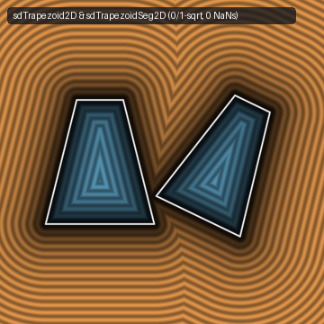 | [**`sdTrapezoid2D`**](sdTrapezoid2D.md) [`glsl`](../../glsl/primitives2d/sdTrapezoid2D.glsl) · **Exact** | 0/1-`sqrt` 2D trapezoid (`sdTrapezoid2D`) & Lagrange cross-product `sdTrapezoidSeg2D` (fixes $`30.9\%`$ axis `NaN`s) |
| 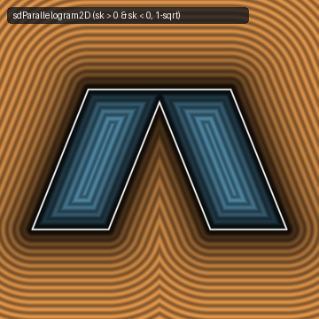 | [**`sdParallelogram2D`**](sdParallelogram2D.md) [`glsl`](../../glsl/primitives2d/sdParallelogram2D.glsl) · **Exact** | 1-`sqrt` 2D parallelogram (`sdParallelogram2D`) & 1-`sqrt` 3D skewed prism (`sdParallelogramPrism`) |
| 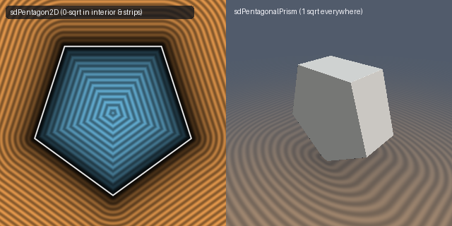 | [**`sdPentagon2D`**](sdPentagon2D.md) [`glsl`](../../glsl/primitives2d/sdPentagon2D.glsl) · **Exact** | **Also**: `sdPentagonalPrism`. 0/1-`sqrt` $`D_5`$ regular pentagon (`0` `sqrt`s in interior & 5 edge strips) & 1-`sqrt` 3D `sdPentagonalPrism` |
|  | [**`sdHexagon2D`**](sdHexagon2D.md) [`glsl`](../../glsl/primitives2d/sdHexagon2D.glsl) · **Exact** | 0/1-`sqrt` $`D_6`$ fold via fundamental-chamber vertex dominance (0 sqrts in interior and face strips) |
| 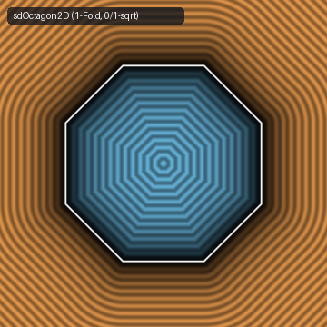 | [**`sdOctagon2D`**](sdOctagon2D.md) [`glsl`](../../glsl/primitives2d/sdOctagon2D.glsl) · **Exact** | 1-fold 0/1-`sqrt` $`D_8`$ regular octagon (`sdOctagon2D`, cutting reflections from 2 to 1) & 3D `sdOctagonalPrism` |
| 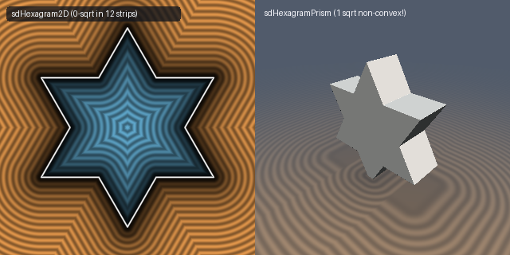 | [**`sdHexagram2D`**](sdHexagram2D.md) [`glsl`](../../glsl/primitives2d/sdHexagram2D.glsl) · **Exact** | **Also**: `sdPentagram2D`. 0/1-`sqrt` $`D_6`$/$`D_5`$ star polygons (`0` `sqrt`s in 12/10 edge strips) & 1-`sqrt` 3D non-convex `sdHexagramPrism` / `sdPentagramPrism` |
| 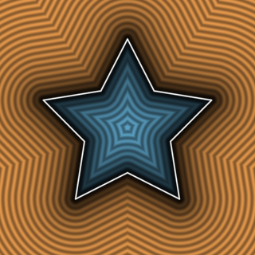 | [**`sdStar2D`**](sdStar2D.md) [`glsl`](../../glsl/primitives2d/sdStar2D.glsl) · **Exact** | **Also**: `sdRegularPolygon2D`, `sdRegularPrism`. 1-`sqrt` orthonormal-Weyl 2D star (`0` post-fold `sqrt`s in $`2n`$ edge strips) & regular $`n`$-gon (`0` post-fold `sqrt`s in interior & $`n`$ strips) |
| 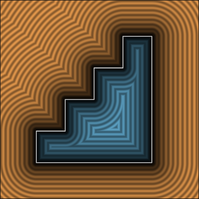 | [**`sdStairs2D`**](sdStairs2D.md) [`glsl`](../../glsl/primitives2d/sdStairs2D.glsl) · **Exact** | 1-`sqrt` rotation-free 2D staircase; fixes IQ `7tKSWt` tall-step (`wh.x < wh.y`) sign-flip & Voronoi tear |
| 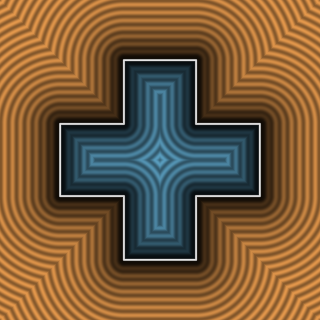 | [**`sdCross2D`**](sdCross2D.md) [`glsl`](../../glsl/primitives2d/sdCross2D.glsl) · **Exact** | 1-`sqrt` symmetric & rectangular 2D cross (`sdRectCross2D`); fixes IQ `sdCross` $`b_x < b_y`$ shape corruption |
| 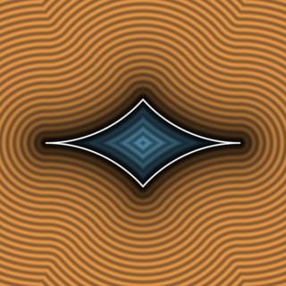 | [**`sdRoundedCross2D`**](sdRoundedCross2D.md) [`glsl`](../../glsl/primitives2d/sdRoundedCross2D.glsl) · **Exact** | **Also**: `sdRoundedCrossPrism`. Division-free region test, 1-`dot2` corner selector, & 0/1-`sqrt` 3D `sdRoundedCrossPrism` |
| 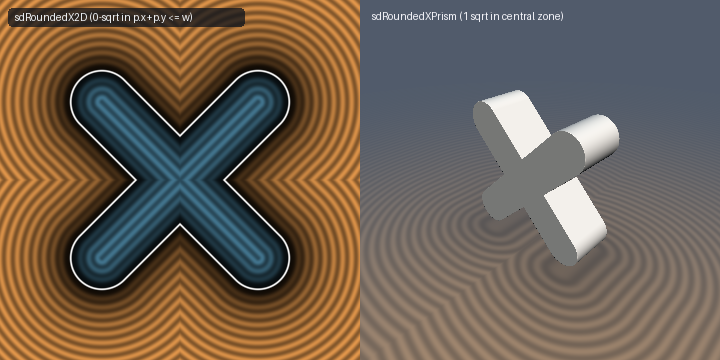 | [**`sdRoundedX2D`**](sdRoundedX2D.md) [`glsl`](../../glsl/primitives2d/sdRoundedX2D.glsl) · **Exact** | 0/1-`sqrt` 2D rounded X (`0` `sqrt`s in central diamond & arm strips $`p_x + p_y \le w`$) & 1-`sqrt` 3D `sdRoundedXPrism` |

## Arcs, Sectors, Constant-Width & Composite Shapes

| Preview | Function | Summary |
| :---: | :--- | :--- |
| 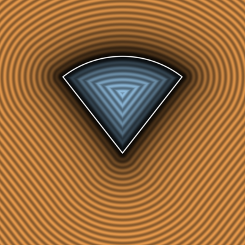 | [**`sdPie2D`**](sdPie2D.md) [`glsl`](../../glsl/primitives2d/sdPie2D.glsl) · **Exact** | 1-`sqrt` circular pie & annular ring sector via orthonormal ray-basis dominance (down from 2 `sqrt`s) |
| 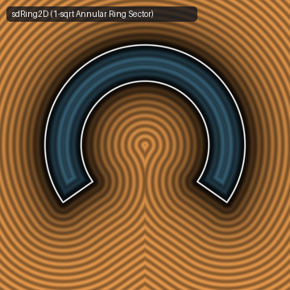 | [**`sdRing2D`**](sdRing2D.md) [`glsl`](../../glsl/primitives2d/sdRing2D.glsl) · **Exact** | **Also**: `sdArc2D`. 1-`sqrt` flat-capped annular ring sector (`sdRing2D`, down from 2 `sqrt`s in IQ's `sdRing`) & round-capped `sdArc2D` |
| 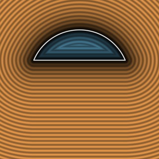 | [**`sdCutDisk2D`**](sdCutDisk2D.md) [`glsl`](../../glsl/primitives2d/sdCutDisk2D.glsl) · **Exact** | **Also**: `sdCutHollowDisk2D`, `sdgCutDisk2D`. 0/1-`sqrt` 2D cut disk (`0` `sqrt`s in chord strip, `1` `sqrt` in disk region; down from 1–2 `sqrt`s via signed-square reduction) |
| 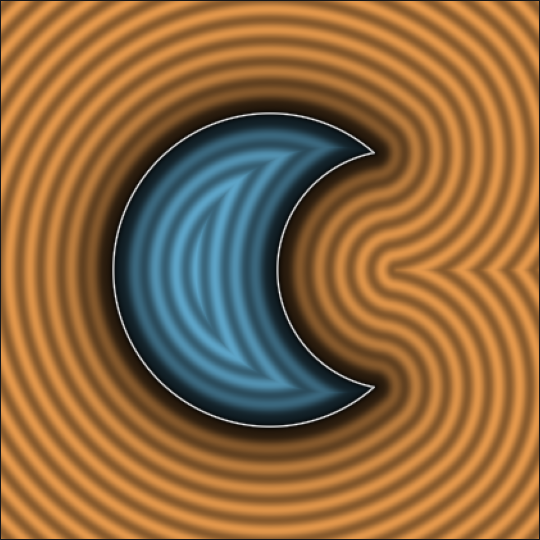 | [**`sdMoon2D`**](sdMoon2D.md) [`glsl`](../../glsl/primitives2d/sdMoon2D.glsl) · **Exact** | 1-`length()` crescent moon (`sdMoon2D`) & asymmetric lens (`sdLens2D`) via confocal-conic bisector |
| 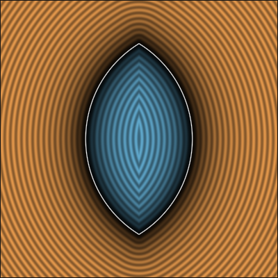 | [**`sdVesica2D`**](sdVesica2D.md) [`glsl`](../../glsl/primitives2d/sdVesica2D.glsl) · **Exact** | 1-`sqrt`-body 2D vesica piscis (`sdVesica2D`) & 1-`sqrt`-everywhere width-parameterized `sdVesicaWidth2D` |
| 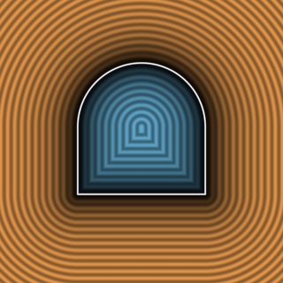 | [**`sdTunnel2D`**](sdTunnel2D.md) [`glsl`](../../glsl/primitives2d/sdTunnel2D.glsl) · **Exact** | 1-`sqrt` exact 2D arched tunnel via closed-form radial-vs-base square comparison (`max(q.x, q.y) < 0` sign) |
|  | [**`sdHorseshoe2D`**](sdHorseshoe2D.md) [`glsl`](../../glsl/primitives2d/sdHorseshoe2D.glsl) · **Exact** | **Also**: `sdgHorseshoe2D`, `sdHorseshoe3D`. 1-`sqrt` obtuse-safe 2D & 3D horseshoe (fixes IQ's `sdHorseshoe` $`\theta > \pi/2`$ sign bug and non-Euclidean interior wedge) |
| 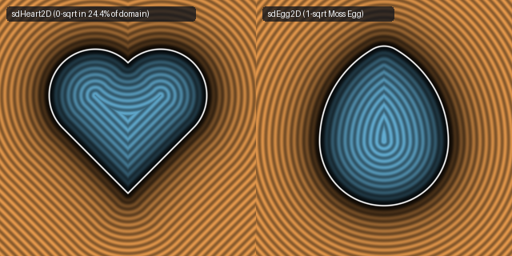 | [**`sdHeart2D`**](sdHeart2D.md) [`glsl`](../../glsl/primitives2d/sdHeart2D.glsl) · **Exact** | **Also**: `sdEgg2D`, `sdHorseshoe2D`. 0/1-`sqrt` heart (`0` `sqrt`s in $`24.4\%`$ of domain, `NaN`-free `sdgHeart2D`) & 1-`sqrt` `sdEgg2D` / `sdHorseshoe2D` (down from 2 `sqrt`s) |
| 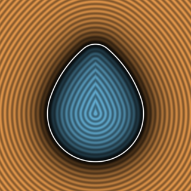 | [**`sdEgg2D`**](sdEgg2D.md) [`glsl`](../../glsl/primitives2d/sdEgg2D.glsl) · **Exact** | **Also**: `sdgEgg2D`, `sdEgg3D`, `sdgEgg3D`. 1-`sqrt` 2D Moss's egg & 3D egg solid of revolution via confocal-hyperbola cap bisector and signed-square cone test (down from 3 `sqrt`s) |
| 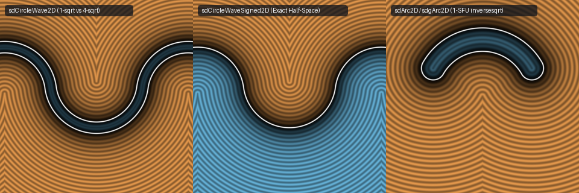 | [**`sdCircleWave2D`**](sdCircleWave2D.md) [`glsl`](../../glsl/primitives2d/sdCircleWave2D.glsl) · **Exact** | **Also**: `sdCircleWaveSigned2D`, `sdgArc2D`. 1-`sqrt` unsigned & signed circular wave (down from 4 `sqrt`s via inflection-normal dead-code collapse) & 1-SFU `inversesqrt` `sdgCircleWave2D` / `sdgArc2D` |
| 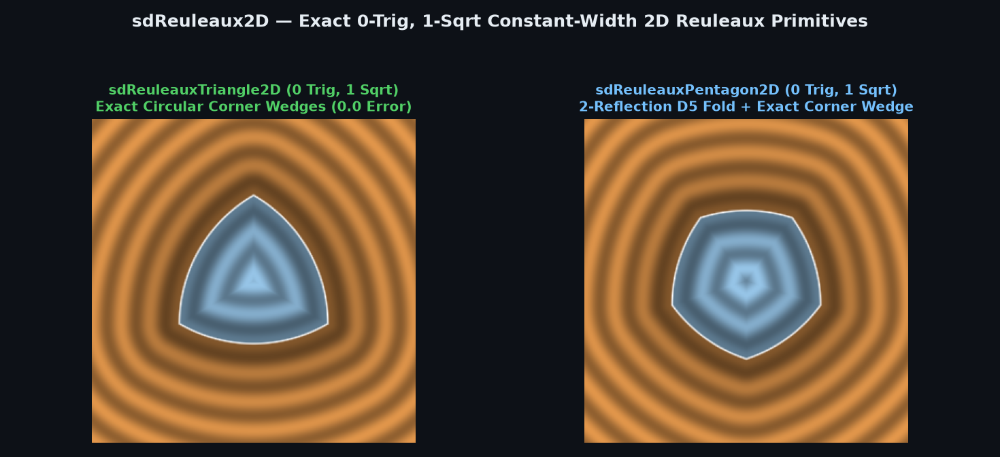 | [**`sdReuleaux2D`**](sdReuleaux2D.md) [`glsl`](../../glsl/primitives2d/sdReuleaux2D.glsl) · **Exact** | **Also**: `sdReuleauxTriangle2D`, `sdReuleauxPentagon2D`, `sdReuleauxPolygon2D`, `sdg*`. 0-trig, 0-div, 1-`sqrt` constant-width 2D Reuleaux triangle & pentagon (eliminates $`13.4\%`$ corner error & 3–5 `sqrt`s of naive CSG) |

## Conics, Splines, Spirals, Trochoids & Gears

| Preview | Function | Summary |
| :---: | :--- | :--- |
|  | [**`sdEllipse2D`**](sdEllipse2D.md) [`glsl`](../../glsl/primitives2d/sdEllipse2D.glsl) · **Exact** | Singularity-free pole-midpoint quartic & trig-free algebraic Householder (fixes circle & evolute `NaN`s) |
| 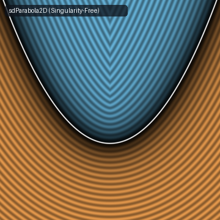 | [**`sdParabola2D`**](sdParabola2D.md) [`glsl`](../../glsl/primitives2d/sdParabola2D.glsl) · **Exact** | Singularity-free 2D parabola & segment (`sdParabolaSeg2D`); fixes focal `0/0` `NaN` and $`x=0`$ sign inversion |
| 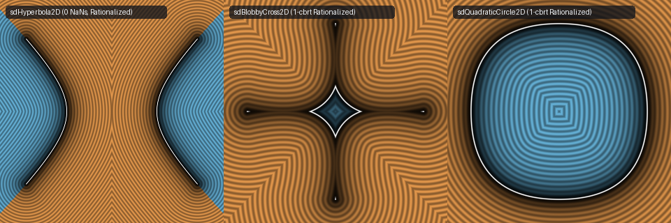 | [**`sdHyperbola2D`**](sdHyperbola2D.md) [`glsl`](../../glsl/primitives2d/sdHyperbola2D.glsl) · **Exact** | **Also**: `sdBlobbyCross2D`, `sdQuadraticCircle2D`. 1-`cbrt` conjugate-rationalized curves; fixes origin/vertex `NaN`s in `sdHyperbola2D` ($`2.6\times 10^6\times`$ lower FP32 error) & cuts `pow` in half |
| 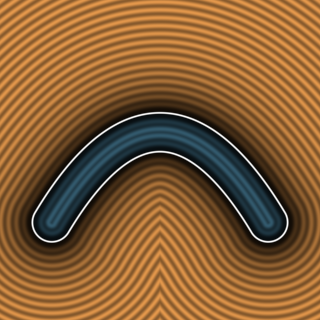 | [**`sdBezier2D`**](sdBezier2D.md) [`glsl`](../../glsl/primitives2d/sdBezier2D.glsl) · **Exact** | **Also**: `udBezier2D`, `sdgBezier2D`. Collinear-safe, 1-`cbrt` conjugate-rationalized 2D signed/unsigned quadratic Bézier curve & gradient (fixes collinear `0/0` `NaN`) |
| 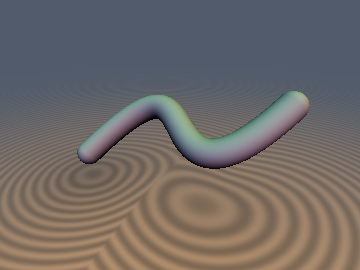 | [**`sdCubicBezier2D`**](sdCubicBezier2D.md) [`glsl`](../../glsl/primitives2d/sdCubicBezier2D.glsl) · **Exact** | **Also**: `udCubicBezier2D`, `sdgCubicBezier2D`, `sdCubicBezierClosedLoop2D`, `sdCubicBezierBezout2D`, `sdCubicBezier3D`, `sdgCubicBezier3D`. 0-trig exact 2D/3D cubic Bézier curves & capsules via Osculating Fourier–Darboux Rolle quintic cascade (`< 8e-7` err, `0` cusp/collinear `NaN`s) & 1-`determinant(mat3)` Sederberg Bézout closed loops |
|  | [**`sdSquircle2D`**](sdSquircle2D.md) [`glsl`](../../glsl/primitives2d/sdSquircle2D.glsl) · **Exact** | **Also**: `sdgSquircle2D`, `sdSquircleBox2D`, `sdgSquircleBox2D`. Machine-precision (`< 1e-7`) 2D quartic Lamé squircle & unequal-axes squircle-box via 2-step co-normal secular solver |
| 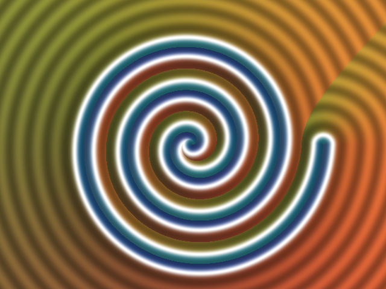 | [**`sdArchimedeanSpiral2D`**](sdArchimedeanSpiral2D.md) [`glsl`](../../glsl/primitives2d/sdArchimedeanSpiral2D.glsl) · **Exact** | **Also**: `sdgArchimedeanSpiral2D`, `sdSpiral3D`. 0-loop, 1-`atan`, 1-`sqrt` exact $`N`$-turn 2D & 3D Archimedean spiral ($`r = a\theta`$) via 2-turn rational Newton-Halley projection |
| 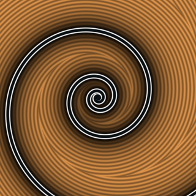 | [**`sdLogSpiral2D`**](sdLogSpiral2D.md) [`glsl`](../../glsl/primitives2d/sdLogSpiral2D.glsl) · **Exact** | **Also**: `sdgLogSpiral2D`, `sdNautilusShell3D`, `sdgNautilusShell3D`. Exact 2D logarithmic spiral ($`r = a e^{b\theta}`$) and 3D self-similar Nautilus shell via $`O(1)`$ turn-index bracketing and 2-step Halley root-finding |
| 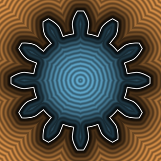 | [**`sdInvoluteGear2D`**](sdInvoluteGear2D.md) [`glsl`](../../glsl/primitives2d/sdInvoluteGear2D.glsl) · **Exact** | **Also**: `sdSpurGear2D`, `sdgInvoluteGear2D`, `sdInvoluteSpiral2D`. 0-iteration exact involute spur gear via the Involute Parallel-Offset Theorem $`d = r_b(\varphi - \psi(\rho))`$ (fixes $`+19.1\%`$ overstep of CSG involute implicits) & exact constant-pitch involute spiral |
| 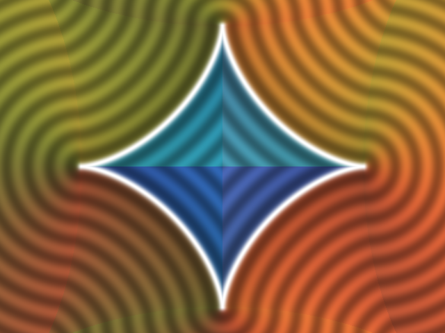 | [**`sdAstroid2D`**](sdAstroid2D.md) [`glsl`](../../glsl/primitives2d/sdAstroid2D.glsl) · **Exact** | **Also**: `sdgAstroid2D`, `sdAstroidRevolved3D`. Machine-precision (`< 1e-7`) 4-cusped astroid ($`\Vert x\Vert ^{2/3} + \Vert y\Vert ^{2/3} = r^{2/3}`$) via tangent-angle secular quadratic + 1 Halley step |
| 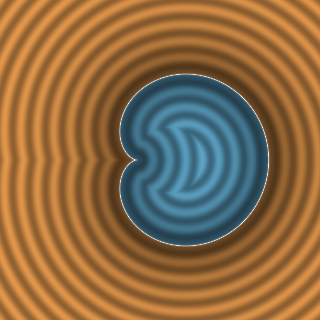 | [**`sdCardioid2D`**](sdCardioid2D.md) [`glsl`](../../glsl/primitives2d/sdCardioid2D.glsl) · **Exact** | **Also**: `sdgCardioid2D`, `sdCardioid3D`, `sdDeltoid2D`, `sdgDeltoid2D`, `sdLemniscate2D`. 0-trig, 0-`cbrt` 2D & 3D cardioid (`2.78e-9` error via Cotangent Convex-Branch cubic), Steiner deltoid, & Bernoulli lemniscate |
| 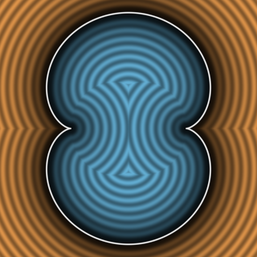 | [**`sdEpicycloid2D`**](sdEpicycloid2D.md) [`glsl`](../../glsl/primitives2d/sdEpicycloid2D.glsl) · **Exact** | **Also**: `sdgEpicycloid2D`, `sdHypocycloid2D`, `sdgHypocycloid2D`, `sdNephroid2D`, `sdSteinerDeltoid2D`. Exact cusp-desingularized 2D epicycloids, hypocycloids, Nephroid caustics, and Steiner deltoids via Euler's half-angle theorem |
| 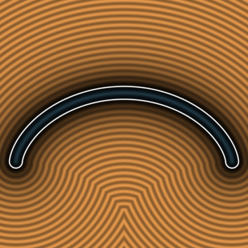 | [**`sdCycloid2D`**](sdCycloid2D.md) [`glsl`](../../glsl/primitives2d/sdCycloid2D.glsl) · **Exact** | **Also**: `sdgCycloid2D`, `sdCycloidSpindle3D`, `sdgCycloidSpindle3D`. Exact 2D Huygens-Bernoulli cycloid arch and 3D Torricelli-Wren revolved cycloidal spindle via half-angle cusp desingularization |
| 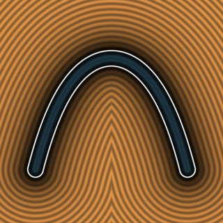 | [**`sdCatenary2D`**](sdCatenary2D.md) [`glsl`](../../glsl/primitives2d/sdCatenary2D.glsl) · **Exact** | **Also**: `sdgCatenary2D`, `sdCatenaryDome3D`, `sdgCatenaryDome3D`. Exact 2D catenary arch and Hooke-Gaudí revolved 3D catenary dome via hyperbolic arc-length unit-tangent desingularization |
| 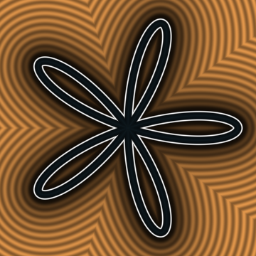 | [**`sdRhodonea2D`**](sdRhodonea2D.md) [`glsl`](../../glsl/primitives2d/sdRhodonea2D.glsl) · **Exact** | **Also**: `sdgRhodonea2D`, `sdOrbitalDz2`, `sdgOrbitalDz2`. $`O(1)`$ exact 2D Grandi Rhodonea rose curves and 3D quantum $`3d_{z^2}`$ atomic orbital via fundamental petal sector folding & 0-trig interior sign test |

## Classical Cubic, Quartic & Sextic Algebraic Curves

| Preview | Function | Summary |
| :---: | :--- | :--- |
| 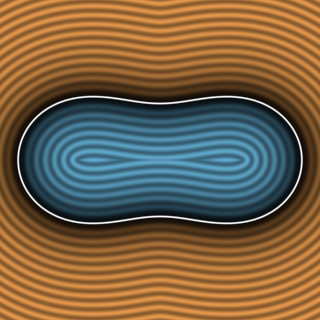 | [**`sdCassiniOvalExact2D`**](sdCassiniOvalExact2D.md) [`glsl`](../../glsl/primitives2d/sdCassiniOvalExact2D.glsl) · **Exact** | **Also**: `sdgCassiniOvalExact2D`, `sdLemniscateExact2D`, `sdgLemniscateExact2D`, `sdBiconcaveCell3D`, `sdgBiconcaveCell3D`. Exact 2D Cassini ovals across all 4 topological regimes, Bernoulli lemniscate, and 3D biconcave red blood cell via quartic secular reduction |
| 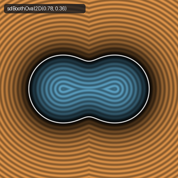 | [**`sdBoothOval2D`**](sdBoothOval2D.md) [`glsl`](../../glsl/primitives2d/sdBoothOval2D.glsl) · **Exact** | **Also**: `sdgBoothOval2D`, `sdBoothLemniscate2D`, `sdgBoothLemniscate2D`, `sdBoothSpindle3D`, `sdgBoothSpindle3D`. Exact 2D James Booth's (1852) elliptic hippopede oval, hyperbolic Booth lemniscate, and 3D dipolar peanut spindle via inverse-conic 0-`sqrt` parameterization and 4-multiply polynomial sign test |
| 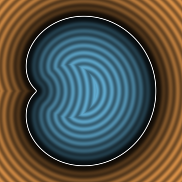 | [**`sdLimacon2D`**](sdLimacon2D.md) [`glsl`](../../glsl/primitives2d/sdLimacon2D.glsl) · **Exact** | **Also**: `sdgLimacon2D`, `sdTrisectrix2D`, `sdgTrisectrix2D`, `sdLimacon3D`, `sdgLimacon3D`. Exact 2D Étienne Pascal's (1650) limaçon across all 4 regimes, Maclaurin's (1742) self-intersecting trisectrix, and 3D revolved limaçon via 0-trig, 0-`sqrt` factored quartic algebraic sign test |
| 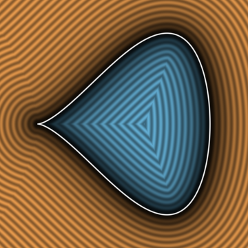 | [**`sdPiriform2D`**](sdPiriform2D.md) [`glsl`](../../glsl/primitives2d/sdPiriform2D.glsl) · **Exact** | **Also**: `sdgPiriform2D`, `sdTeardrop2D`, `sdgTeardrop2D`, `sdTeardrop3D`, `sdgTeardrop3D`, `sdPiriform3D`, `sdgPiriform3D`. Exact 0-trig nodal cubic teardrop, Wallis quartic piriform, and 3D raindrop of revolution via co-normal cubic/quartic reduction |
| 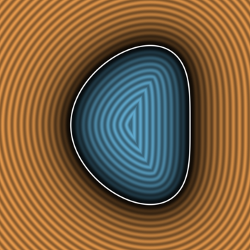 | [**`sdBeanCurve2D`**](sdBeanCurve2D.md) [`glsl`](../../glsl/primitives2d/sdBeanCurve2D.glsl) · **Exact** | **Also**: `sdgBeanCurve2D`, `sdBifolium2D`, `sdgBifolium2D`, `sdBean3D`, `sdgBean3D`. Exact 2D Cundy-Rollett (1961) quartic bean curve, Longchamps-Viviani quartic bifolium double leaf, and 3D revolved kidney-bean solid with 0-trig, 0-`sqrt` polynomial sign tests |
| 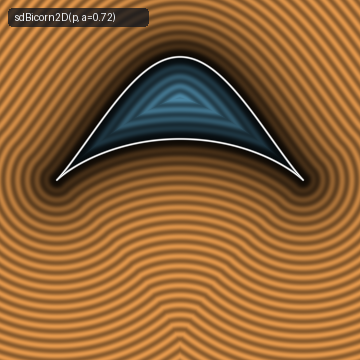 | [**`sdBicorn2D`**](sdBicorn2D.md) [`glsl`](../../glsl/primitives2d/sdBicorn2D.glsl) · **Exact** | **Also**: `sdgBicorn2D`, `sdBicornDome3D`, `sdgBicornDome3D`. Exact 2D Sylvester-Cayley (1864) quartic bicorn (cocked-hat curve) and 3D revolved bicorn dome via rational-sine branch decomposition and 0-trig, 0-`sqrt` quartic polynomial sign test |
| 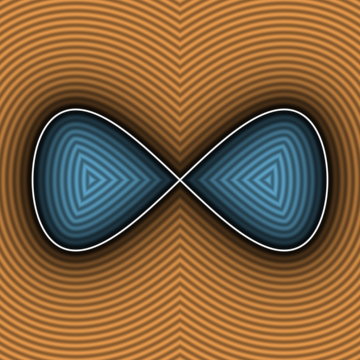 | [**`sdLemniscateGerono2D`**](sdLemniscateGerono2D.md) [`glsl`](../../glsl/primitives2d/sdLemniscateGerono2D.glsl) · **Exact** | **Also**: `sdgLemniscateGerono2D`, `sdLemniscateGerono3D`, `sdgLemniscateGerono3D`. Exact 0-trig 2D Huygens-Gerono figure-eight lemniscate ($`x^4 = a^2(x^2 - y^2)`$), Cramer's (1750) general besace, and 3D hourglass via rational Chebyshev parameterization and 0-`sqrt` quartic sign test |
| 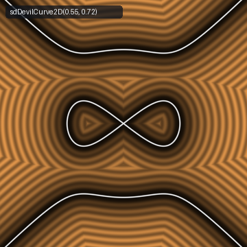 | [**`sdDevilCurve2D`**](sdDevilCurve2D.md) [`glsl`](../../glsl/primitives2d/sdDevilCurve2D.glsl) · **Exact** | **Also**: `sdDevilLoop2D`, `sdDevilSpindle3D`. Exact 0-trig 2D Gabriel Cramer's (1750) Devil's curve (*Courbe du Diable* / electric motor curve), central rotor loop, and 3D hourglass spindle via dual-root stator-rotor factorization and 0-`sqrt` quartic sign test |
| 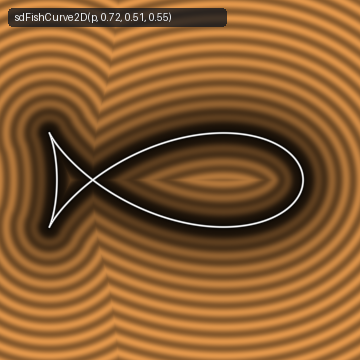 | [**`sdFishCurve2D`**](sdFishCurve2D.md) [`glsl`](../../glsl/primitives2d/sdFishCurve2D.glsl) · **Exact** | **Also**: `sdgFishCurve2D`, `sdFishLoop2D`, `sdgFishLoop2D`, `sdFish3D`, `sdgFish3D`. Exact 0-trig 2D Steiner-Plateau fish curve (astroid pedal / ellipse negative pedal), closed teardrop body loop, and 3D streamlined fish fuselage via Weierstrass branch unification |
| 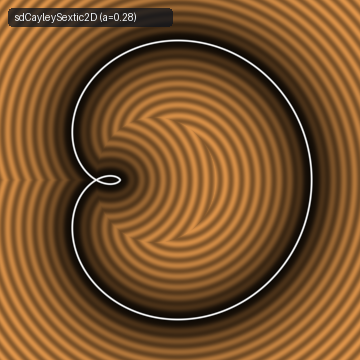 | [**`sdCayleySextic2D`**](sdCayleySextic2D.md) [`glsl`](../../glsl/primitives2d/sdCayleySextic2D.glsl) · **Exact** | **Also**: `sdgCayleySextic2D`, `sdCayleyOuter2D`, `sdgCayleyOuter2D`, `sdCayleyShell3D`, `sdgCayleyShell3D`. Exact 0-trig 2D Arthur Cayley's (1859) sextic cardioid pedal curve, closed outer kidney loop, and 3D revolved shell via rational cubic-tangent substitution and circle-separator identity |
|  | [**`sdAgnesiWitch2D`**](sdAgnesiWitch2D.md) [`glsl`](../../glsl/primitives2d/sdAgnesiWitch2D.glsl) · **Exact** | **Also**: `sdgAgnesiWitch2D`, `sdAgnesiBell3D`, `sdgAgnesiBell3D`, `sdCissoid2D`, `sdgCissoid2D`. Exact 0-trig 2D Witch of Agnesi, 3D Cauchy-Lorentz bell spire, & Diocles cissoid via cubic/quartic co-normal reduction |
|  | [**`sdStrophoid2D`**](sdStrophoid2D.md) [`glsl`](../../glsl/primitives2d/sdStrophoid2D.glsl) · **Exact** | **Also**: `sdgStrophoid2D`, `sdFolium2D`, `sdgFolium2D`, `sdFoliumLeaf3D`, `sdgFoliumLeaf3D`. Exact 0-trig 2D Barrow-Torricelli right strophoid nodal loop, René Descartes's (1638) folium loop, and 3D revolved folium leaf via diagonal strophoid isomorphism and 0-`sqrt` polynomial sign test |
|  | [**`sdConchoidNicomedes2D`**](sdConchoidNicomedes2D.md) [`glsl`](../../glsl/primitives2d/sdConchoidNicomedes2D.glsl) · **Exact** | **Also**: `sdgConchoidNicomedes2D`, `sdConchoidSpindle3D`, `sdgConchoidSpindle3D`. Exact 0-trig 2D Nicomedes (c. 200 BC) conchoid nodal loop and 3D revolved teardrop spindle via scaled half-angle rational parameterization and 0-trig, 0-`sqrt` factored quartic interior test |
|  | [**`sdKeplerFolium2D`**](sdKeplerFolium2D.md) [`glsl`](../../glsl/primitives2d/sdKeplerFolium2D.glsl) · **Exact** | **Also**: `sdDoubleFolium2D`, `sdTrifolium2D`, `sdKeplerEgg3D`. Exact 0-trig 2D Johannes Kepler's (1609) oviform folium, Albrecht Dürer's (1525) double folium, $`D_3`$-folded regular trifolium, and 3D revolved Kepler egg |
|  | [**`sdTschirnhausenCubic2D`**](sdTschirnhausenCubic2D.md) [`glsl`](../../glsl/primitives2d/sdTschirnhausenCubic2D.glsl) · **Exact** | **Also**: `sdTschirnhausenLoop2D`, `sdTschirnhausenDrop3D`. Exact 0-trig, 0-division pure degree-3 polynomial 2D Tschirnhaus's (1690) cubic teardrop loop, full crunodal cubic, and 3D revolved drop spindle |
