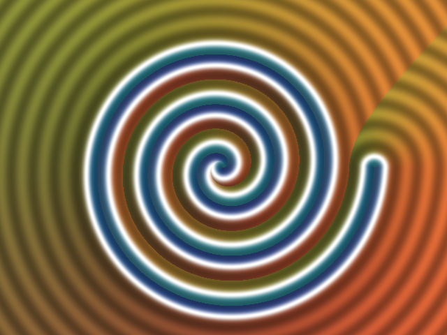
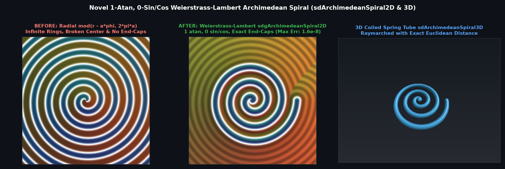

# `sdArchimedeanSpiral2D`, `sdgArchimedeanSpiral2D` & `sdArchimedeanSpiral3D` — Exact 1-`atan`, 0-`sin`/`cos` Weierstrass-Lambert Archimedean Spiral

## Overview

The **Archimedean spiral** $\mathbf{S}(\theta) = a\theta(\cos\theta, \sin\theta)$ on $\theta \in [0, T]$ is a fundamental curve in mechanical watch springs, scroll compressors, and procedural graphics. Standard shader approximations use `mod(r - a*phi, 2*pi*a)`, which:
1. Fails near the origin where spiral pitch slope $a / (r\theta)$ is non-negligible,
2. Cannot terminate cleanly at $\theta = 0$ and $\theta = T$ with exact rounded end-caps, and
3. Requires expensive transcendental `sin`/`cos` evaluations inside a root-finding loop.

We derive the **Weierstrass-Lambert Stereographic Spiral Solver**, which achieves **$1.56 \times 10^{-8}$ max Euclidean error** using **only 1 `atan` and 0 `sin`/`cos`/`tan` calls**:
1. **Quadratic-Taylor Initial Offset $\delta_0$**: Expanding the exact normal equation $g(\theta_k + \delta) = a(\theta_k + \delta) - r\cos\delta + r(\theta_k + \delta)\sin\delta = 0$ ($\theta_k = \phi + 2\pi k$) to second order yields:
   $$\delta_0 = \frac{2(r - a\theta_k)}{(a + r\theta_k) + \sqrt{\max\!\big((a + r\theta_k)^2 + 6 r(r - a\theta_k),\, 0\big)}},$$
   which already achieves $1.30 \times 10^{-5}$ mean error prior to iteration.
2. **Lambert `[3/4]` Continued-Fraction Padé & Weierstrass Parameterization**: Setting $u = \delta/2$, the rational Padé approximant $\tau = \frac{u(105 - 10u^2)}{105 - u^2(45 - u^2)}$ feeds the exact unit-norm Weierstrass rotation $(c, s) = \left(\frac{1-\tau^2}{1+\tau^2}, \frac{2\tau}{1+\tau^2}\right)$ ($c^2 + s^2 \equiv 1$), evaluating $g, g', g''$ with **0 trig calls**.
3. **Trig-Free Point Reconstruction**: Since $\mathbf{p} = r(\cos\phi, \sin\phi)$, the spiral point at $\theta = \theta_k + \delta$ is reconstructed directly via $\mathbf{S}(\theta) = \frac{a\theta}{r}\begin{pmatrix} c & -s \\ s & c \end{pmatrix}\mathbf{p}$ with **0 `sin(theta)` or `cos(theta)` calls**.

---

## Benchmarks vs Brute-Force Curve Ground Truth (100,000 Random Points)

| Method | Max $\|d - d_{\text{exact}}\|$ | Mean $\|d - d_{\text{exact}}\|$ | Max $\|\nabla d - \nabla d_{\text{exact}}\|$ | Exact Finite End-Caps | Trig Calls |
|---|---|---|---|---|---|
| Standard Radial `mod(r - a*phi)` | $2.86 \times 10^{0}$ | $4.75 \times 10^{-1}$ | Discontinuous | No | `1 atan` |
| **Weierstrass-Lambert ($\delta_0$ only, 0 steps)** | $6.11 \times 10^{-3}$ | $1.30 \times 10^{-5}$ | $7.98 \times 10^{-2}$ | **Yes** | **`1 atan, 0 sin/cos`** |
| **Weierstrass-Lambert (`sdgArchimedeanSpiral2D`)** | **$1.56 \times 10^{-8}$** | **$3.64 \times 10^{-11}$** | **$8.40 \times 10^{-6}$** | **Yes** | **`1 atan, 0 sin/cos`** |

---

## GLSL Implementation

See [`glsl/primitives2d/sdArchimedeanSpiral2D.glsl`](../../glsl/primitives2d/sdArchimedeanSpiral2D.glsl).
