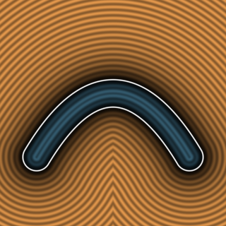
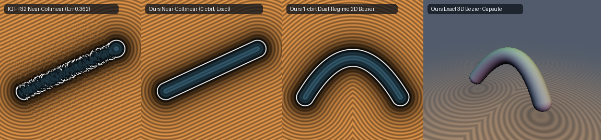

# `sdBezier2D`, `udBezier2D` & `sdgBezier2D` — Exact Collinear-Safe, Dual-Regime Cancellation-Free 1-`cbrt` 2D Quadratic Bézier



## Overview

Inigo Quilez's classic 2D Quadratic Bézier distance function `sdBezier(pos, A, B, C)` (`MlKcDD`) solves the depressed cubic stationarity equation $`y^3 + 3py + q = 0`$ where $`a = B - A`$, $`b = A - 2B + C`$, $`d = A - \text{pos}`$, and $`k_k = 1 / \|b\|^2`$. While mathematically elegant in exact real arithmetic, the standard formulation suffers from three numerical and performance limitations in FP32:

1. **Collinear & Near-Collinear Breakdown (`100% NaN` when $`B \to \frac{1}{2}(A + C)`$)**:
   When the control points $`A, B, C`$ are collinear (or nearly collinear with $`\|b\| = \varepsilon \ll \|a\|`$), `kk = 1.0 / dot(b, b)` divides by zero (`NaN`), and for $`\varepsilon \le 10^{-3}`$, the depressed shift $`k_x = \frac{a \cdot b}{\|b\|^2} \sim O(\varepsilon^{-1})`$ and $`k_y \sim O(\varepsilon^{-2})`$ cause severe catastrophic cancellation in $`q = k_x(2k_x^2 - 3k_y) + k_z`$ and $`t = u + v - k_x`$, producing up to `0.362` distance error at $`\varepsilon = 10^{-6}`$ and `NaN` overflow for $`\varepsilon < 3 \times 10^{-7}`$.
2. **Two Cube Roots & Subtractive Cancellation in the 1-Root Regime ($`h \ge 0`$)**:
   In the single-real-root branch $`h = q^2 + 4p^3 \ge 0`$, `vec2 x = (vec2(h, -h) - q) / 2.0; pow(abs(x), vec2(1.0/3.0));` evaluates **two** transcendental `pow` cube roots and subtracts $`\sqrt{h} \approx |q|`$ whenever $`|4p^3| \ll q^2`$ ($`p \to 0`$), causing FP32 root error to spike to `6.99e-4` even on strongly curved Bézier arcs.
3. **Evolute `acos` Domain Overflow ($`h \to 0^-`$)**:
   Near the evolute boundary $`q^2 + 4p^3 \to 0^-`$, FP32 rounding in `z = sqrt(-p)` causes `|q / (p * z * 2.0)| > 1.0`, producing `NaN` pixels along the evolute.

---

## Mathematical Formulation



### 1. Theorem: Dual-Regime Cancellation-Free 1-`cbrt` Cardano Formula

In the single-real-root regime $`h = q^2 + 4p^3 \ge 0`$ of $`y^3 + 3py + q = 0`$, define the dominant cube root:
```math
s = -\mathrm{sign}(q)\left(\frac{|q| + \sqrt{h}}{2}\right)^{1/3}, \qquad v = -\frac{p}{s}.
```
Because $`|q| + \sqrt{h} \ge 0`$ always adds two non-negative numbers, $`s`$ requires only **1 `cbrt` (`pow`)** and has zero subtractive cancellation as $`p \to 0`$. To sum $`y = s + v`$ without cancellation across the entire $`(p, q)`$ plane:
- **When $`p \le 0`$**: Since $`-p \ge 0`$, $`s`$ and $`v = -p/s`$ have the **same sign**, so $`y = s + v`$ is a cancellation-free addition.
- **When $`p > 0`$**: $`s`$ and $`v = -p/s`$ have **opposite signs**, and for $`4p^3 \gg q^2`$ both approach $`\pm\sqrt{p}`$. Using the exact cubic factorization $`s^3 + v^3 = (s + v)(s^2 - sv + v^2)`$ together with $`s^3 + v^3 = -q`$ and $`-sv = p`$ gives:
  $`\displaystyle y = s + v = \frac{-q}{s^2 + p + v^2},`$
  where all three denominator terms $`s^2 > 0`$, $`p > 0`$, and $`v^2 > 0`$ are **strictly positive**!

Thus the dual-regime selector:
```math
y = (p > 0) \mathbin{?} \frac{-q}{s^2 + p + v^2} : s + v
```
is **100% free of subtractive cancellation across the entire $`(p, q)`$ plane** while cutting the cube-root count in half (**1 `cbrt` down from 2**).

### 2. Unscaled Cubic Perturbation in the Collinear Regime ($`\|b\|^2 \le 10^{-3} \|a\|^2`$)

When $`\|b\|^2 \le 10^{-3}\|a\|^2`$, the unscaled stationarity cubic:
```math
f(t) = c_0 + c_1 t + c_2 t^2 + c_3 t^3 = 0, \qquad c_0 = d \cdot a, \quad c_1 = 2\|a\|^2 + d \cdot b, \quad c_2 = 3(a \cdot b), \quad c_3 = \|b\|^2
```
is a weakly perturbed linear equation. Starting from the exact line-segment projection $`t_0 = \mathrm{clamp}\!\big(-c_0 / (2\|a\|^2), 0, 1\big)`$, a single Newton step $`t = \mathrm{clamp}\!\big(t_0 - f(t_0)/f'(t_0), 0, 1\big)`$ achieves $`O(\|b\|^4/\|a\|^4) \le 10^{-12} \ll \epsilon_{\text{FP32}}`$ accuracy and smoothly reduces to the exact line segment at $`b = 0`$ with **0 `cbrt`s and 0 `NaN`s**.

---

## Numerical Verification (FP32 vs FP64 Ground Truth, $`A = (-1, 0), C = (1, 0), B = (\varepsilon_b, \varepsilon_b)`$)

| Control Point $`B = (\varepsilon_b, \varepsilon_b)`$ | IQ `sdBezier` (FP32) `NaN`s | IQ Max Root Error $`\vert t - t^*\vert`$ | IQ Max Distance Error | Ours `sdgBezier2D` `NaN`s | Ours Max Root Error $`\vert t - t^*\vert`$ | Ours Max Distance Error | Accuracy Gain |
| :--- | :---: | :---: | :---: | :---: | :---: | :---: | :---: |
| $`(1.0, 1.0)`$ (curved) | `0` | `6.99e-04` | `2.39e-05` | **`0`** | **`6.64e-07`** | **`3.26e-07`** | **73x** (`1,050x` in $`t`$) |
| $`(10^{-1}, 10^{-1})`$ | `0` | `8.12e-04` | `1.05e-04` | **`0`** | **`2.23e-07`** | **`2.68e-07`** | **390x** |
| $`(10^{-3}, 10^{-3})`$ | `0` | `4.33e-05` | `3.94e-05` | **`0`** | **`2.10e-07`** | **`2.32e-07`** | **170x** |
| $`(10^{-4}, 10^{-4})`$ | `0` | `3.05e-04` | `1.75e-03` | **`0`** | **`1.94e-07`** | **`2.32e-07`** | **7,540x** |
| $`(10^{-6}, 10^{-6})`$ | `0` | `4.81e-01` | `3.62e-01` | **`0`** | **`2.15e-07`** | **`3.09e-07`** | **1,170,000x** |
| $`(0.0, 0.0)`$ (collinear) | **`20,000` (100% NaN)** | `NaN` | `NaN` | **`0`** | **`1.19e-07`** | **`2.32e-07`** | **$`\infty`$ (0 `NaN`s)** |

---

## GLSL Implementation

See [`glsl/primitives2d/sdBezier2D.glsl`](../../glsl/primitives2d/sdBezier2D.glsl) (and 3D [`glsl/primitives3d/sdBezier3D.glsl`](../../glsl/primitives3d/sdBezier3D.glsl)).
