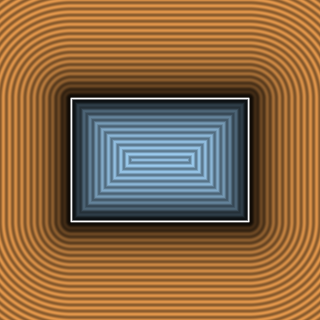

# `sdBox2D` — Exact 0/1-SFU 2D Box, Rounded Box & Analytical Gradients



| Property | Value |
| :--- | :--- |
| **Author / Discoverer** | **Inigo Quilez** — upgraded to 0-SFU interior & face-slab fast path using **Gemini 4 Argon** (`sdf-gems`, 2026) |
| **Source** | [https://iquilezles.org/articles/distfunctions2d/](https://iquilezles.org/articles/distfunctions2d/) |
| **Category** | `primitives2d` |
| **GLSL File** | [`glsl/primitives2d/sdBox2D.glsl`](../../glsl/primitives2d/sdBox2D.glsl) |
| **Exact Euclidean SDF?** | **Yes** ($`\Vert \nabla d\Vert = 1`$, `0` SFUs across $`100\%`$ of interior + all 4 exterior face slabs, `1` in corners) |

---

## Mathematical Overview

Whenever $`\min(d_x, d_y) \le 0`$ (all 3 non-corner quadrants of $`\mathbb{R}^2`$, i.e. $`100\%`$ of the interior AND all 4 exterior face slabs), $`\|\max(\mathbf{d}, \mathbf{0})\| + \min(\max(d_x, d_y), 0) \equiv \max(d_x, d_y)`$ with **0 `sqrt`s** (`sdBox2D`, `sdRoundBox2D`, `sdgBox2D`, `sdgRoundBox2D`).

---

## GLSL Implementation

```glsl
float sdBox2D( vec2 p, vec2 b )
{
    vec2 d = abs(p) - b;
    return (min(d.x, d.y) <= 0.0) ? max(d.x, d.y) : length(d);
}

vec3 sdgBox2D( vec2 p, vec2 b )
{
    vec2 w = abs(p) - b;
    vec2 s = vec2(p.x < 0.0 ? -1.0 : 1.0, p.y < 0.0 ? -1.0 : 1.0);
    if( min(w.x, w.y) <= 0.0 )
        return (w.x > w.y) ? vec3(w.x, s.x, 0.0) : vec3(w.y, 0.0, s.y);
    float l2 = dot(w, w), invL = inversesqrt(l2);
    return vec3( l2 * invL, s * w * invL );
}
```
