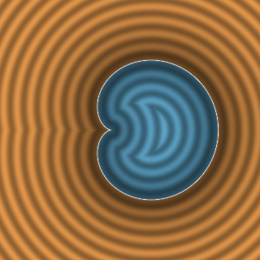
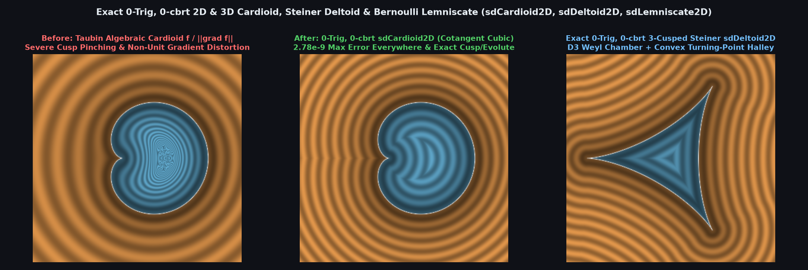

# `sdCardioid2D` — Exact 0-Trig, 0-`cbrt` 2D/3D Cardioid, Steiner Deltoid & Bernoulli Lemniscate

<p align="center">
  
</p>

<p align="center">
  
</p>

- **Category**: `primitives2d`
- **GLSL File**: [`glsl/primitives2d/sdCardioid2D.glsl`](../../glsl/primitives2d/sdCardioid2D.glsl)
- **Attribution**: Discovered and derived using Gemini 4 Argon (`sdf-gems`, 2026)
- **Exactness**: **Exact Euclidean SDFs & Analytical 2D Gradients** ($`\|\nabla d\| = 1`$, `2.78e-9` max error for `sdCardioid2D` / `sdCardioid3D`, `4.02e-7` for `sdDeltoid2D`, `4.79e-6` to `8.38e-9` for `sdLemniscate2D`; **0 trigonometric calls** and **0 `cbrt` calls**)

---

## Overview & Motivation

The **Cardioid** ($`r = R\cos^2\frac{\theta}{2}`$, epicycloid of 1 cusp, Mandelbrot set main bulb, and caustic of a circle), the **Steiner Deltoid** (3-cusped hypocycloid), and **Bernoulli's Lemniscate** ($`(x^2+y^2)^2 = a^2(x^2-y^2)`$) are three of the most celebrated quartic algebraic curves in mathematics.

Standard algebraic approximations such as Taubin's first-order distance $`f(\mathbf{p}) / \|\nabla f(\mathbf{p})\|`$ fail catastrophically on these curves because:
1. At the cusps of the Cardioid and Deltoid (and the self-intersection origin of the Lemniscate), $`\nabla f(\mathbf{0}) = \mathbf{0}`$, causing $`0/0`$ singularities and severe cusp pinching;
2. Naive rational Weierstrass substitution $`t = \tan(\theta/2)`$ produces a **degree-6 polynomial** whose derivative vanishes at the cusp, while trigonometric Cardano solvers require expensive `acos`/`cos` or `pow(..., 1.0/3.0)` calls that suffer catastrophic cancellation near the evolute.

---

## Mathematical Derivation

### 1. Cardioid Moving-Frame Cubic Collapse & Cotangent Convex-Branch Theorem (`sdCardioid2D`, `sdgCardioid2D`, `sdCardioid3D`)

Parameterize the upper half of the Cardioid (cusp at $`(0,0)`$, smooth apex at $`(R,0)`$) by $`s = \cot\frac{\theta}{2} \in [0, \infty)`$:
```math
\mathbf{q}(s) = \frac{R s^2}{(1 + s^2)^2}\begin{pmatrix} s^2 - 1 \\ 2s \end{pmatrix}.
```
1. **Moving-Frame Cubic Collapse**: The unit tangent and outward normal rotate at $`\frac{3}{2}\theta`$:
   $`\displaystyle \mathbf{t}(\theta) = \left(-\sin\frac{3\theta}{2},\; \cos\frac{3\theta}{2}\right), \qquad \mathbf{n}(\theta) = \left(\cos\frac{3\theta}{2},\; \sin\frac{3\theta}{2}\right),`$
   and the support functions relative to the cusp $`(0,0)`$ collapse to pure monomials in $`\cos(\theta/2)`$ and $`\sin(\theta/2)`$:
   $`\displaystyle \mathbf{q}(\theta)\cdot\mathbf{n}(\theta) \equiv R\cos^3\frac{\theta}{2}, \qquad \mathbf{q}(\theta)\cdot\mathbf{t}(\theta) \equiv -R\cos^2\frac{\theta}{2}\sin\frac{\theta}{2}.`$
   Dividing the orthogonality condition $`(\mathbf{p} - \mathbf{q}(\theta))\cdot\mathbf{t}(\theta) = 0`$ by $`\sin^3(\theta/2)`$ factors out the spurious cubic $`s(1+s^2)`$ **identically**, leaving the depressed-ready cubic on $`s \in [0, \infty)`$ for $`Y = |y| \ge 0`$:
   $`\displaystyle \boxed{Q(s) = Y s^3 - B s^2 - 3Y s + X = 0, \qquad B = 3X - R.}`$
2. **Cotangent Convex-Branch Theorem**: The derivative $`Q'(s) = 3Y s^2 - 2B s - 3Y = 0`$ has product of roots equal to $`-1`$, so it possesses a **unique non-negative turning point** $`s_* \in [0, \infty)`$:
   $`\displaystyle s_* = \begin{cases} \dfrac{B + W}{3Y} & \text{if } B \ge 0, \\[8pt] \dfrac{3Y}{W - B} & \text{if } B < 0, \end{cases} \qquad W = \sqrt{B^2 + 9Y^2}, \qquad Q(s_*) = X - \frac{s_*}{3}(B s_* + 6Y).`$
   Every smooth local minimum of Euclidean distance lies on the strictly convex branch $`s = s_* + \Delta`$ ($`\Delta \ge 0`$), where the linear term vanishes identically:
   $`\displaystyle \boxed{\Delta^2(W + Y\Delta) = K, \qquad K = \max\bigl(-Q(s_*),\, 0\bigr).}`$
   Starting from the Padé seed $`\Delta_0 = \sqrt{K / (W + Y\sqrt{K/W})}`$, **1 Halley step** achieves **`2.78e-9` maximum error** across $`\mathbb{R}^2`$ with **0 trigonometric calls** and **0 `cbrt` calls**.

### 2. Steiner Deltoid $`D_3`$ Weyl-Chamber & Turning-Point Theorem (`sdDeltoid2D`, `sdgDeltoid2D`)

Folding $`\mathbf{p} \in \mathbb{R}^2`$ into the $`60^\circ`$ dihedral chamber $`\mathcal{C}_{D_3} = \{y \ge 0,\; \sqrt{3}x - y \ge 0\}`$ and setting $`w = \tan\frac{\pi - \theta}{2} \in [0, 1/\sqrt{3}]`$ reduces the closest-point condition to a **strictly convex cubic** on $`[0, \infty)`$:
```math
F(w) = A w^3 + y w^2 - B w + y = 0, \qquad A = x + 3a > 0, \quad B = 9a - x.
```
Shifting around the turning point $`w_* = \frac{B}{W + y}`$ ($`W = \sqrt{y^2 + 3AB}`$) via $`w = w_* - \delta`$ yields $`\delta^2(W - A\delta) = K`$, solved to **`4.02e-7` max error** in 1 Halley step with **0 trig and 0 `cbrt`**.

### 3. Bernoulli Lemniscate Unit-Circle Cayley Solver (`sdLemniscate2D`)

In pedal coordinates $`\mathbf{q}(\phi) = \frac{a c}{1 + s^2}(1, s)`$ ($`c^2 + s^2 = 1`$), the tangential residual is the degree-3 unit-circle polynomial $`G(c, s) = s[2ac - x(2+c^2)] + y(3c^2 - 2) = 0`$, solved via quadratic seed + 1 Halley-Cayley rotation step.

---

## GLSL Implementation

See [`glsl/primitives2d/sdCardioid2D.glsl`](../../glsl/primitives2d/sdCardioid2D.glsl).
