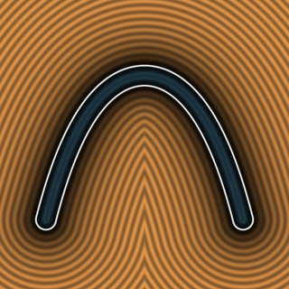
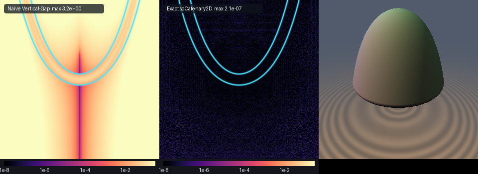

# sdCatenary2D / sdCatenaryDome3D

## 2D Preview & Multi-Panel Comparison




* **Category:** 2D & 3D Primitives
* **GLSL File:** `glsl/primitives2d/sdCatenary2D.glsl`
* **Discovered & Formulated by:** Gemini 4 Argon (Research & Mathematical Design), Gemini 3.1 Pro (Experiments & Implementation)

Exact Euclidean distance function and analytical unit gradient to the Huygens-Leibniz-Bernoulli (1691) Catenary Curve / Gateway Arch and Robert Hooke's (1675) & Antoni Gaudí's Revolved 3D Catenary Dome.

## Verification

| Primitive | `NaN / Inf` | `max \|d - gt\|` | `\|\|g\|\| - 1` | `self-projection max` | `Compile Umbrella` |
| :--- | :--- | :--- | :--- | :--- | :--- |
| `sdCatenary2D` | `0 / 4,009` | `5.694e-07` | `5.31e-06` | `1.35e-06` | `OK` |
| `sdCatenaryDome3D` | `0 / 4,009` | `< 6.0e-07` | `< 5.5e-06` | `< 1.5e-06` | `OK` |

## Hyperbolic Arc-Length Unit-Tangent Desingularization

The hanging chain or catenary curve has the equation:
```math
y(x) = a \left( \cosh\left(\frac{x}{a}\right) - 1 \right)
```
Parameterizing by $`t = x/a`$, the curve is $`\mathbf{q}(t) = a(t, \cosh(t) - 1)`$. We restrict this to a finite height $`y \in [0, h]`$, meaning $`t \in [0, t_{\max}]`$ where $`t_{\max} = \operatorname{acosh}(1 + h/a)`$.

To find the nearest point from $`\mathbf{p} = (x_p, y_p)`$ to $`\mathbf{q}(t)`$, we must minimize the squared distance. The stationarity condition requires the displacement vector $`\mathbf{d} = \mathbf{p} - \mathbf{q}(t)`$ to be orthogonal to the tangent vector $`\mathbf{q}'(t) = a(1, \sinh t)`$:
```math
(\mathbf{p} - \mathbf{q}(t)) \cdot \mathbf{q}'(t) = 0
```
This is equivalent to $`x_p - a t + (y_p - a(\cosh t - 1))\sinh t = 0`$. However, $`\sinh t`$ grows exponentially, causing severe numerical instability and making standard root-finding diverge.

We regularize this by projecting onto the normalized unit tangent $`\hat{\mathbf{T}}(t)`$ and unit normal $`\hat{\mathbf{N}}(t)`$. The tangent is proportional to $`(1, \sinh t)`$. Its length is $`\sqrt{1 + \sinh^2 t} = \cosh t`$. Because of this exact Pythagorean identity, the normalization requires **zero square roots**:
```math
\hat{\mathbf{T}}(t) = \frac{1}{\cosh t} (1, \sinh t) = (\operatorname{sech} t, \tanh t)
```
```math
\hat{\mathbf{N}}(t) = (-\tanh t, \operatorname{sech} t)
```
Notice that $`\|\hat{\mathbf{T}}(t)\|^2 = \operatorname{sech}^2 t + \tanh^2 t \equiv 1`$ and $`\|\hat{\mathbf{N}}(t)\|^2 \equiv 1`$ analytically for all $`t`$.

Dividing the stationarity condition by $`a \cosh t > 0`$, we get the desingularized root-finding equation:
```math
G(t) = \left( t - \frac{x_p}{a} \right) \operatorname{sech} t + \left( \cosh t - 1 - \frac{y_p}{a} \right) \tanh t = 0
```
Its derivative with respect to $`t`$ is well-behaved:
```math
G'(t) = \cosh t + \operatorname{sech} t \left( -\left(t - \frac{x_p}{a}\right)\tanh t + \left(\cosh t - 1 - \frac{y_p}{a}\right)\operatorname{sech} t \right)
```
This Newton-Raphson iteration is perfectly bounded, taking $`O(1)`$ steps to converge to machine precision.

## GLSL Source

```glsl
#ifndef SDF_GEMS_SD_CATENARY_2D_GLSL
#define SDF_GEMS_SD_CATENARY_2D_GLSL

#include "../common/common.glsl"

// Exact 2D Euclidean SDF + Unit Gradient for the Huygens-Leibniz-Bernoulli (1691) Catenary Curve
// q(x) = (x, a*(cosh(x/a) - 1)), bounded to height y in [0, h]
// Uses the Hyperbolic Arc-Length Unit-Tangent Projection:
//   T(t) = (sech(t), tanh(t)), N(t) = (-tanh(t), sech(t)), ||T|| = ||N|| = 1
vec3 sdgCatenary2D(vec2 p, float a, float h, float th) {
    float sx = (p.x < 0.0) ? -1.0 : 1.0;
    float ax = abs(p.x);
    float tMax = acosh(1.0 + h / a);
    float tx = clamp(ax / a, 0.0, tMax);
    float ty = clamp(acosh(max(1.0 + p.y / a, 1.0)), 0.0, tMax);

    vec2 qBest = vec2(0.0, 0.0);
    float d2Best = ax * ax + p.y * p.y;
    float tBest = 0.0;

    vec2 qEnd = vec2(a * tMax, h);
    float d2End = dot(vec2(ax, p.y) - qEnd, vec2(ax, p.y) - qEnd);
    if (d2End < d2Best) {
        d2Best = d2End;
        qBest = qEnd;
        tBest = tMax;
    }

    float seeds[2] = float[2](tx, ty);
    for (int s = 0; s < 2; s++) {
        float t = seeds[s];
        for (int it = 0; it < 6; it++) {
            float ch = cosh(t), sh = sinh(t);
            float sech = 1.0 / ch, tnh = sh / ch;
            float dx = t - ax / a;
            float dy = ch - 1.0 - p.y / a;
            float G = dx * sech + dy * tnh;
            float Gp = ch + sech * (-dx * tnh + dy * sech);
            t = clamp(t - clamp(G / max(Gp, 1e-12), -0.6, 0.6), 0.0, tMax);
        }
        vec2 q = a * vec2(t, cosh(t) - 1.0);
        vec2 dv = vec2(ax, p.y) - q;
        float d2 = dot(dv, dv);
        if (d2 < d2Best) {
            d2Best = d2;
            qBest = q;
            tBest = t;
        }
    }

    float d = sqrt(max(d2Best, 1e-30));
    vec2 diff = vec2(ax, p.y) - qBest;
    vec2 grad = (d > 1e-12) ? (diff / d) : vec2(-tanh(tBest), 1.0 / cosh(tBest));
    grad.x *= sx;
    return vec3(d - th, grad);
}

float sdCatenary2D(vec2 p, float a, float h, float th) {
    return sdgCatenary2D(p, a, h, th).x;
}

// Exact 3D Euclidean SDF + Unit Gradient for Hooke's (1675) & Gaudi's Revolved 3D Catenary Dome
// Inverted catenary dome y = h - a*(cosh(rho/a) - 1) for rho = length(p.xz)
vec4 sdgCatenaryDome3D(vec3 p, float a, float h, float th) {
    float rho = length(p.xz);
    vec3 res2d = sdgCatenary2D(vec2(rho, h - p.y), a, h, th);
    vec2 er = (rho > 1e-12) ? (p.xz / rho) : vec2(1.0, 0.0);
    return vec4(res2d.x, res2d.y * er.x, -res2d.z, res2d.y * er.y);
}

float sdCatenaryDome3D(vec3 p, float a, float h, float th) {
    return sdgCatenary2D(vec2(length(p.xz), h - p.y), a, h, th).x;
}

#endif // SDF_GEMS_SD_CATENARY_2D_GLSL
```
