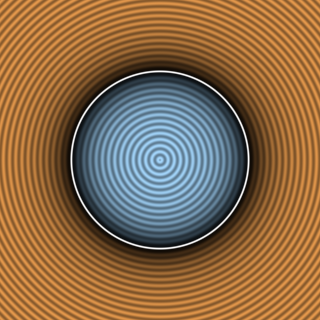

# `sdCircle` — Exact 2D Circle



| Property | Value |
| :--- | :--- |
| **Author / Discoverer** | **Inigo Quilez** |
| **Source** | [https://iquilezles.org/articles/distfunctions2d/](https://iquilezles.org/articles/distfunctions2d/) |
| **Category** | `primitives2d` |
| **GLSL File** | [`glsl/primitives2d/sdCircle.glsl`](../../glsl/primitives2d/sdCircle.glsl) |
| **Exact Euclidean SDF?** | Yes (`\|\|grad d\|\| = 1`) |

---

## Mathematical Overview

Exact Euclidean signed distance to a 2D disk of radius $`r`$: $`d(p) = \|p\| - r`$.

---

## GLSL Implementation

```glsl
float sdCircle( vec2 p, float r )
{
    return length(p) - r;
}
```
