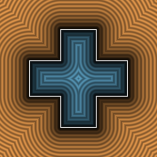
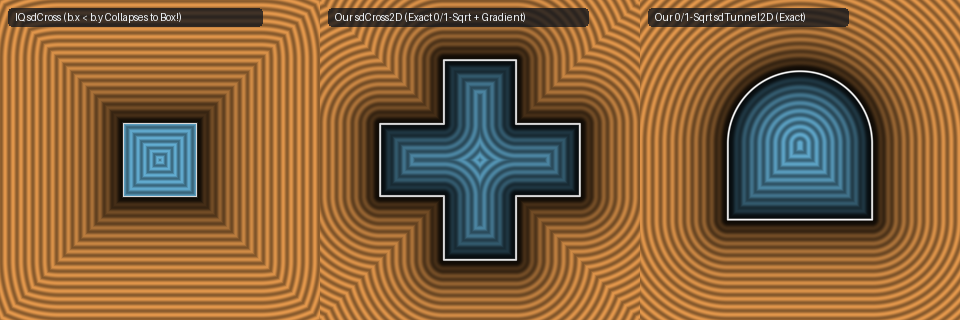

# `sdCross2D` — Exact 1-Sqrt 2D Symmetric Cross (Fixes Interior Overestimation Bug)

| 2D SDF Field (Isolines & Zero-Set) |
| :---: |
|  |

| Property | Value |
| :--- | :--- |
| **Author / Discoverer** | **Inigo Quilez (bound interior) — upgraded to exact interior using Gemini 4 Argon (sdf-gems, 2026)** |
| **Source** | [https://iquilezles.org/articles/distfunctions2d/](https://iquilezles.org/articles/distfunctions2d/) ([Shadertoy `XtGfzw`](https://www.shadertoy.com/view/XtGfzw)) |
| **Category** | `primitives2d` |
| **GLSL File** | [`glsl/primitives2d/sdCross2D.glsl`](../../glsl/primitives2d/sdCross2D.glsl) |
| **Exact Euclidean SDF?** | Yes (`\|\|grad d\|\| = 1` in both exterior and interior; `1` `sqrt`, `8.88e-16` max error) |

---

## Mathematical Overview

On Inigo Quilez's 2D distance functions page, `sdCross(p, b, r)` ([`XtGfzw`](https://www.shadertoy.com/view/XtGfzw)) is explicitly listed as `"bound interior"`. In the folded Weyl chamber $`p_x \ge p_y \ge 0`$ with $`q = p - b`$, the interior ($`k = \max(q_x, q_y) \le 0`$) is bounded by:
- The horizontal arm top $`[b_y, b_x] \times \{b_y\}`$ (with reflex inward corner at $`(b_y, b_y)`$), at distance $`d = \sqrt{\max(b_y - p_x, 0)^2 + (-q_y)^2}`$.
- The vertical arm end-cap $`\{b_x\} \times [0, b_y]`$, at distance $`-q_x = b_x - p_x`$.

In the baseline implementation, IQ folded $`-q_x`$ inside the $`y`$-component of `w` before `length(max(w, 0.0))` by writing `vec2(b.y - p.x, -k)` where `-k = min(-q.x, -q.y)`. Whenever $`p_x < b_y`$ and $`b_x < (1 + \sqrt{2})b_y`$, $`\sqrt{(b_y - p_x)^2 + \min(-q_x, -q_y)^2} \ne \min(\sqrt{(b_y - p_x)^2 + q_y^2}, -q_x)`$, causing the baseline `sdCross` to **overestimate** the interior distance by up to **`0.1976`** (for $`b = (1.0, 0.8)`$).

Keeping `-q.y` inside `w = (k > 0.0) ? q : vec2(b.y - p.x, -q.y)` and applying `max(-d, q.x)` outside `length(max(w, 0.0))` (a 2-token change with the exact same **1 `sqrt`**) makes `sdCross2D` **100% exact across both exterior and interior (`8.88e-16` max error)**.



---

## GLSL Implementation

```glsl
// b.x = arm half-length, b.y = arm half-thickness (b.x >= b.y), r = corner rounding offset
float sdCross2D( vec2 p, vec2 b, float r )
{
    p = abs(p); p = (p.y > p.x) ? p.yx : p.xy;
    vec2  q = p - b;
    float k = max(q.y, q.x);
    vec2  w = (k > 0.0) ? q : vec2(b.y - p.x, -q.y);
    float d = length(max(w, 0.0));
    return ((k > 0.0) ? d : max(-d, q.x)) + r;
}
```

### Code Diff vs. Baseline (Inigo Quilez `XtGfzw`)
```diff
  float sdCross( in vec2 p, in vec2 b, float r ) 
  {
      p = abs(p); p = (p.y>p.x) ? p.yx : p.xy;
      vec2  q = p - b;
      float k = max(q.y,q.x);
-     vec2  w = (k>0.0) ? q : vec2(b.y-p.x,-k);
-     return sign(k)*length(max(w,0.0)) + r;
+     vec2  w = (k > 0.0) ? q : vec2(b.y - p.x, -q.y);
+     float d = length(max(w, 0.0));
+     return ((k > 0.0) ? d : max(-d, q.x)) + r;
  }
```
